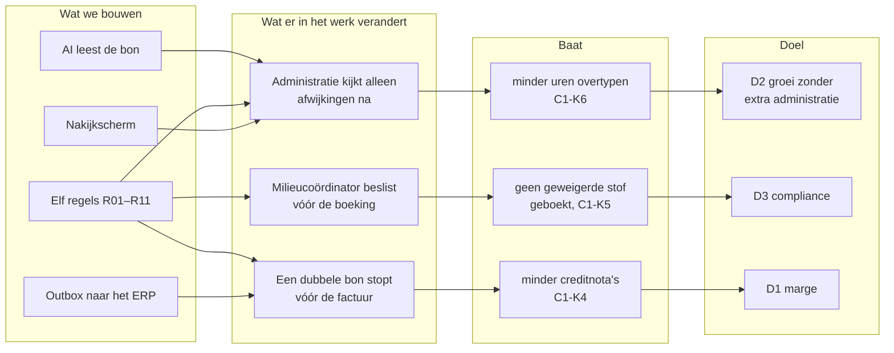

# 1 · Discover — wie heeft welk probleem?

> **Gesimuleerd.** Halverdijk is fictief. Sponsorgesprek, workshop en interviews zijn uitgeschreven als scenario: zo zou ik ze voeren, met deze verwachte uitkomst. Er is niet met echte medewerkers gesproken.

## Mandaat (stap 0 · initiate)

Vóór de analyse begint, staat op één blad wat de sponsor vraagt en wat hij toestaat. Zonder dat blad is er geen analyse, alleen een gesprek.

| | |
|---|---|
| Vraag van de sponsor | "Een extra halftijdse kracht voor de administratie, want het overtypen lukt niet meer." |
| Herformuleerd probleem | het overtypen kost tijd **en** laat fouten (dubbels, gewichten, geweigerde stoffen) pas bij facturatie of inspectie zien |
| Scope van de analyse | weegbon van ontvangst tot boeking in het ERP; breekwerf en stortplaats. **Niet:** de weegbrugsoftware, de facturatie zelf |
| Ruwe businesscase | ±<!--n:c1.hoursAsIs-->1.838<!--/n--> uur overtypen per jaar (aanname) tegenover een halftijdse kracht van ±€24.000 per jaar; de vraag is of een oplossing goedkoper is **en** de fouten wegneemt |
| Wat de analyse mag kosten | 4 weken analist, 6 uur van de administratie, 2 uur van de milieucoördinator |
| Sponsor | divisieverantwoordelijke recyclage |
| Poort | **sponsor geeft mandaat** voor discover en analyse; na stap 4 beslist hij opnieuw (optie en budget) |

## Aanleiding

De administratie van de breekwerf vraagt "een extra halftijdse kracht" omdat het overtypen van weegbonnen niet meer bij te houden is. De facturatie meldt elke maand creditnota's door verkeerde gewichten of klanten. De vraag aan de analist is niet "bouw OCR", maar: **wat is er echt aan de hand, en wat lost het op?**

## Strategie en doelen

De case is een middel, geen doel. Ze draagt bij aan drie doelen van de groep ([strategie en portfolio](../shared-methodology/strategie-en-portfolio.md)):

| Doel van de groep | Wat deze case belooft (SMART, business requirement) | Eigenaar | KPI |
|---|---|---|---|
| D2 groeien zonder extra administratie | BR-01: binnen 6 maanden na go-live ≥ 65% van de bonnen zonder mens, bij ≥ 98% veldnauwkeurigheid | divisieverantwoordelijke recyclage | [C1-K1, C1-K3](07-measure-improve.md#kpi-kaarten) |
| D3 compliance en veiligheid | BR-02: vanaf go-live 0 bonnen met geweigerd materiaal geboekt | milieucoördinator | C1-K5 |
| D1 marge per werf | BR-03: binnen 12 maanden −80% creditnota's door weegbonfouten | facturatie | C1-K4 |

### Benefits map

Van wat we bouwen, via wat er in het werk verandert, naar de baat en het doel. De middelste kolom is de belangrijkste: zonder die verandering levert de techniek niets op.

## Stakeholders

De houding is een **aanname** na de eerste gesprekken (fictief). Ze bepaalt hoe je iemand betrekt; ze wordt na elke workshop herbekeken ([methodiek](../shared-methodology/stakeholdermethodiek.md#houding-conflicten-en-communicatie)).

| Stakeholder | Rol in het proces | Belang | Invloed | Houding | Wil | Grootste zorg | Betrekken via |
|---|---|---|---|---|---|---|---|
| Administratie recyclage (3 pers.) | typt bonnen over, controleert | H | M | sceptisch | minder typwerk, minder nabellen | "AI maakt fouten en dan krijgen wij de schuld" | ontdekkingsworkshop, key users in UAT |
| Weegbrugoperator | weegt, print bon | M | L | neutraal | geen extra werk aan de weegbrug | "nog een scherm erbij" | meelopen aan de weegbrug |
| Facturatie | maakt maandfacturen | H | M | voorstander | correcte facturen, minder creditnota's | klachten van klanten | interview |
| Milieucoördinator | vergunning, acceptatielijst, traceerbaarheid | H | H | voorstander, onder voorwaarden | nooit geweigerde stoffen aanvaard of geboekt | aansprakelijkheid bij inspectie | regels R06–R08 samen opstellen |
| Divisieverantwoordelijke recyclage (sponsor) | budget, prioriteit | M | H | voorstander, ongeduldig | kosten onder controle zonder extra personeel | project dat blijft hangen | stuurgroep elke 4 weken |
| Vervoerders en klanten | brengen en halen | L | L | neutraal | snel door de weegbrug | geen | informeren bij nieuwe afspraken (e-mail van bonnen) |
| IT (3 developers) + ERP-partner | bouw en integratie | M | H | sceptisch | werkbare specificaties, geen schaduw-IT | "nog een systeem om te beheren" | architectuurworkshop, ADR's |

### Conflicten, en hoe ze beslecht werden

| Wie tegenover wie | Het conflict | Beslissing | Wie besliste |
|---|---|---|---|
| Sponsor ↔ milieucoördinator | de sponsor wil zoveel mogelijk automatisch boeken; milieu wil elke twijfelachtige lading zelf zien | geweigerd materiaal blokkeert altijd (R06), de rest mag automatisch; 5% steekproef op automatische boekingen | sponsor, na advies van milieu ([D-02](raid-en-beslissingen.md#beslissingslog)) |
| Sponsor ↔ administratie | de sponsor wil snel baten; de administratie vertrouwt de AI niet | eerst 4 weken schaduwdraaien, met de vergelijking zichtbaar voor de administratie | sponsor ([D-04](raid-en-beslissingen.md#beslissingslog)) |
| Administratie ↔ IT | de administratie wil een eigen scherm; IT wil geen extra systeem om te beheren | het nakijkscherm draait op het bestaande Power Platform, met dezelfde tabellen als de backoffice | IT-architect ([ADR-001](../shared-methodology/adr/ADR-001-dataverse.md)) |

### Communicatieplan

| Wie | Wat | Hoe vaak | Vorm | Door |
|---|---|---|---|---|
| Sponsor | voortgang, beslissingen die nodig zijn, KPI's na go-live | elke 4 weken | stuurgroep, één blad ([samenvatting](samenvatting.md)) | analist |
| Milieucoördinator | regels R06–R08, escalaties, steekproef | bij elke regelwijziging; daarna maandelijks | korte sessie met de regelcatalogus | analist |
| Administratie | wat verandert, schaduwresultaten, training | wekelijks tijdens schaduwdraaien | 15 minuten aan het bureau, met hun eigen bonnen | key user + analist |
| Facturatie | datum overstap, creditnota's | maandelijks | mail + dashboard | key user |
| Weegbrugoperators | wat er (niet) verandert | eenmalig, bij de start | toolboxmoment van 15 minuten | divisieverantwoordelijke |
| Vervoerders en klanten | bonnen voortaan naar het postvak; melding bij een weigering | eenmalig + bij nieuwe klanten | brief en mail | facturatie |
| IT en ERP-partner | ontwerpkeuzes, API-contract, runbook | tweewekelijks tijdens de bouw | refinement, ADR's | analist + developer |

## Ontdekkingsworkshop (verslag, samengevat — gesimuleerd)

**Deelnemers:** 3 medewerkers administratie, 1 weegbrugoperator, 1 facturatie. Leidinggevenden waren bewust niet aanwezig.

### Concrete voorbeelden ("de laatste keer dat …")
1. Een bon met een koffievlek: het netto-gewicht was niet leesbaar. Een kwartier gezocht in de weegbrugsoftware.
2. Een vervoerder mailde dezelfde bon twee keer (eens als foto, eens als pdf). Hij werd twee keer gefactureerd, wat pas aan het licht kwam na een klacht.
3. Een lading met "eterniet" stond op de bon als gemengd bouw- en sloopafval. De milieucoördinator zag het toevallig bij een steekproef.

### Pijnpunten

| ID | Pijnpunt | Hoe vaak | Gevolg | Citaat |
|---|---|---|---|---|
| P-01 | Overtypen van elke bon | elke bon | uren werk, typfouten | "Ik ben een dure typmachine." |
| P-02 | Onleesbare of onvolledige bonnen | wekelijks meermaals | nabellen, wachten | "Een vlek op het netto-gewicht kost me een kwartier." |
| P-03 | Dubbele bonnen (rescan, foto + pdf) | maandelijks | dubbele facturen, klachten | "We zien het pas als de klant belt." |
| P-04 | Geen controle op acceptatielijst bij het typen | zelden, maar ernstig | vergunningsrisico | "Wij weten niet welke codes niet mogen." |
| P-05 | Fouten pas zichtbaar bij facturatie | maandelijks | creditnota's, imago | "Een maand later weet niemand nog wat er gebeurde." |
| P-06 | Ontbrekend identificatieformulier of grondverzetdocument | wekelijks | nalopen bij vervoerder | — |

### Wensen zonder oplossing
- "Ik wil alleen de bonnen zien waar iets mis mee is."
- "Ik wil zeker weten dat een bon nooit twee keer gefactureerd wordt."
- "De milieucoördinator moet het zien vóór wij het boeken."

## Oorzaakanalyse: vijf keer waarom

Het zichtbare probleem is "fouten zien we pas bij de factuur" (P-05). Waarom?

1. **Waarom** zien we fouten pas bij de factuur? Omdat niemand de bon controleert bij het overtypen.
2. **Waarom** controleert niemand bij het overtypen? Omdat de administratie typt wat er staat, en niet weet wat er niet mag.
3. **Waarom** weet de administratie niet wat er niet mag? Omdat de acceptatielijst en de regels bij de milieucoördinator in Excel staan, niet in het proces.
4. **Waarom** staan ze niet in het proces? Omdat de bon op papier binnenkomt en pas later, door iemand anders, digitaal wordt.
5. **Waarom** komt de bon op papier binnen? Omdat de weegbrugsoftware en het ERP niet gekoppeld zijn.

**Twee grondoorzaken.** (1) De regels zitten in hoofden en in Excel, niet in het proces. (2) De bron is papier. AI-lezen alleen lost (1) niet op: een snelle typmachine maakt dezelfde fouten sneller. Daarom draagt de oplossing de **regels** (R01–R11) als kern, en staat de koppeling van de weegbrug (de echte oplossing voor 2) als optie A op de roadmap. Een eerlijke [optie 0](04-validate-prioritise.md#opties) zonder software (de regels als checklist bij het typen) lost (1) gedeeltelijk op: die is het startpunt van de schaduwperiode.

## Probleemstelling

> De recyclagedivisie verwerkt naar schatting <!--n:c1.docsYear-->31.500<!--/n--> weegbonnen per jaar volledig manueel. Dat kost ±<!--n:c1.hoursAsIs-->1.838<!--/n--> uur per jaar (aanname) en laat fouten (dubbels, verkeerde gewichten, geweigerde stoffen) pas bij facturatie of inspectie zien. Het doel is dat schone bonnen zonder menselijke tussenkomst correct geboekt worden en dat elke afwijking vóór de boeking bij de juiste persoon terechtkomt.

## Wat bewust buiten scope blijft
- De weegbrugsoftware vervangen. Dat is optie A in [ADR-003](../shared-methodology/adr/ADR-003-document-ai.md), voor een volgende fase.
- Facturatie zelf automatiseren. Die gebeurt in het ERP.

## BA-aanpak voor deze case

| | |
|---|---|
| Aanpak | hybride: discover en analyse vooraf (de regels moeten kloppen vóór er gebouwd wordt), daarna bouwen in sprints van 2 weken met de key users |
| Technieken | observatie aan de weegbrug, ontdekkingsworkshop, interviews, documentanalyse (bonnen, acceptatielijst), procesmodellering (BPMN), beslisregels, prototype, testset van 30 bonnen |
| Wie keurt wat goed | scope en budget: sponsor · regels R06–R08: milieucoördinator · nakijkscherm: administratie · architectuur: IT ([governance](../shared-methodology/governance.md)) |
| Requirements | [register en baseline](02-analyse.md#requirements), [traceerbaarheid](traceerbaarheid.md); een wijziging na de baseline volgt het [wijzigingsbeheer](../shared-methodology/governance.md#wijzigingsbeheer-voor-requirements-en-regels) |
| Beslissingen en risico's | [beslissingslog en RAID](raid-en-beslissingen.md) |
| Planning | week 1–2 discover · 3–4 analyse · 5–6 design en testset · 7 validate en stuurgroep |
| Communicatie | zie het communicatieplan hierboven |
