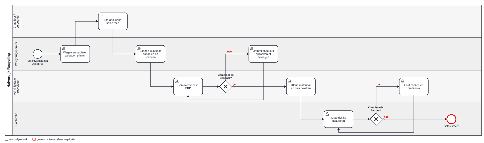

# 2 · Analyse — hoe loopt het vandaag?

## AS-IS-proces

Bron: [as-is.bpmn](bpmn/as-is.bpmn) (BPMN 2.0, opent in bpmn.io). Alle <!--n:bpmn.c1_asis.tasks-->8<!--/n--> taken zijn manueel; <!--n:bpmn.c1_asis.automated-->0<!--/n--> zijn geautomatiseerd.

**Wat opvalt:**
1. De bon wordt **drie keer aangeraakt** voor hij in het ERP staat: printen, scannen, overtypen.
2. Er is **geen controle bij de bron**. Fouten worden pas ontdekt bij een klantklacht na facturatie (lus onderaan).
3. De terugweg "ontbrekende info opzoeken" loopt via de weegbrug, die daar geen tijd voor heeft.

## Nulmeting (aanname, te bevestigen met 2 weken tijdsregistratie)

| Meting | Waarde | Bron |
|---|---|---|
| Bonnen per werkdag | 140 | aanname, [assumptions.json](../data/assumptions.json) |
| Bonnen per jaar | <!--n:c1.docsYear-->31.500<!--/n--> | 140 × 225 werkdagen |
| Minuten per bon (typen + controleren) | 3,5 | aanname, te meten |
| Uren per jaar | <!--n:c1.hoursAsIs-->1.838<!--/n--> | berekend |
| Typfouten | ±2,5% van de bonnen | aanname |

## Soorten documenten

| Document | Richting | Wat er op moet staan |
|---|---|---|
| Weegbon inkomend | afval in | bonnr, datum, plaat, klant, EURAL-code, bruto/tarra/netto, nummer identificatieformulier; bij bodem een traceerbaarheidsreferentie |
| Weegbon uitgaand | product uit | bonnr, datum, plaat, klant, productcode (granulaat), gewichten |
| Identificatieformulier | bij afvaltransport | wordt in deze fase alleen als referentie op de weegbon gelezen |

## Requirements

De requirements volgen de vier soorten van BABOK: **business** (wat de organisatie wil bereiken, SMART), **stakeholder** (wat een rol nodig heeft), **solution** (wat de oplossing moet doen: functioneel en niet-functioneel) en **transition** (wat nodig is om over te stappen, en daarna niet meer). Elke requirement heeft een bron, een eigenaar, een prioriteit, een stabiliteit en een status.

Dit register wordt gegenereerd uit [`data/requirements.json`](../data/requirements.json). De build faalt als een requirement verwijst naar een pijnpunt, story, BPMN-taak, flow, test of KPI die niet bestaat, of als een pijnpunt of story door geen enkele requirement gedekt is. Hoe elke requirement doorloopt tot test en KPI: [traceerbaarheid](traceerbaarheid.md). **Baseline 1.0** is gesimuleerd: in een echt project tekent de eigenaar per requirement; een wijziging daarna volgt het [wijzigingsbeheer](../shared-methodology/governance.md#wijzigingsbeheer-voor-requirements-en-regels).

<!--requirements:c1-->
#### Business

| ID | Requirement | Bron | Eigenaar | Prioriteit | Stabiliteit | Status |
|---|---|---|---|---|---|---|
| BR-01 | Binnen 6 maanden na go-live verwerkt de flow minstens 65% van de weegbonnen zonder menselijke tussenkomst, bij een veldnauwkeurigheid van minstens 98%. *(doel D2: Groeien zonder extra administratieve mensen)* | sponsor, nulmeting | Divisieverantwoordelijke recyclage | Must | hoog | in baseline |
| BR-02 | Vanaf go-live wordt geen enkele bon met geweigerd materiaal geboekt (harde grens: 0). *(doel D3: Compliance en veiligheid: vergunning, KLIP, verzekeringsdekking)* | milieuvergunning | Milieucoördinator | Must | hoog | in baseline |
| BR-03 | Binnen 12 maanden 80% minder creditnota's door weegbonfouten dan in de nulmeting. *(doel D1: Marge per werf: kosten sneller en juist op het project)* | facturatie | Facturatie | Should | middel | in baseline |

#### Stakeholder

| ID | Requirement | Bron | Eigenaar | Prioriteit | Stabiliteit | Status |
|---|---|---|---|---|---|---|
| SR-01 | De administratie ziet alleen de bonnen waar iets mis mee is, met de reden en het origineel ernaast. | ontdekkingsworkshop (wens) | Administratie recyclage | Must | hoog | in baseline |
| SR-02 | De milieucoördinator ziet elke afwijking van de acceptatielijst vóór de boeking, en beslist alleen. | interview milieucoördinator | Milieucoördinator | Must | hoog | in baseline |
| SR-03 | Facturatie kan erop rekenen dat een bon nooit twee keer gefactureerd wordt. | interview facturatie | Facturatie | Must | hoog | in baseline |
| SR-04 | De weegbrugoperator krijgt geen extra scherm of handeling aan de weegbrug. | meelopen aan de weegbrug | Weegbrugoperator | Must | hoog | in baseline |

#### Solution · functioneel

| ID | Requirement | Bron | Eigenaar | Prioriteit | Stabiliteit | Status |
|---|---|---|---|---|---|---|
| F-01 | Bonnen uit het gedeelde postvak en de scanmap worden automatisch opgehaald. *(postvak niet aangesloten in de ontwikkelomgeving)* | workshop | Administratie recyclage | Must | hoog | ontworpen |
| F-02 | Per bon worden elf velden gelezen, elk met een confidence. *(AI-extractie gesimuleerd met data/documents.json)* | workshop | Administratie recyclage | Must | middel | gesimuleerd |
| F-03 | Na extractie worden regels R01–R11 toegepast; de uitkomst is automatisch, nazicht, escalatie of dubbel. | workshop + milieucoördinator | Administratie recyclage | Must | middel | gebouwd |
| F-04 | Schone bonnen worden zonder tussenkomst in het ERP geboekt. | sponsor | Divisieverantwoordelijke recyclage | Must | hoog | gebouwd |
| F-05 | Een reviewer ziet alleen bonnen met bevindingen, met de foute velden gemarkeerd naast het origineel. | workshop | Administratie recyclage | Must | hoog | gebouwd |
| F-06 | Geweigerd materiaal gaat naar de milieucoördinator en wordt nooit automatisch geboekt. | milieuvergunning | Milieucoördinator | Must | hoog | gebouwd |
| F-07 | Een bon wordt nooit twee keer geboekt. | workshop (voorbeeld dubbele mail) | Facturatie | Must | hoog | gebouwd |
| F-08 | Correcties door reviewers worden bewaard (wie, wanneer, oud, nieuw), voor audit en modelverbetering. | functioneel beheer | Functioneel beheer | Should | hoog | gebouwd |
| F-09 | Klant en vervoerder krijgen een melding bij een geweigerde lading, met de reden. | milieucoördinator | Milieucoördinator | Could | middel | gebouwd |
| F-10 | Bonnen van de eigen weegbrug komen rechtstreeks digitaal binnen (zonder papier). *(optie A, volgende fase (ADR-003))* | IT | Divisieverantwoordelijke recyclage | Won't | laag | buiten scope |

#### Solution · niet-functioneel

| ID | Requirement | Bron | Eigenaar | Prioriteit | Stabiliteit | Status |
|---|---|---|---|---|---|---|
| NF-01 | Een schone bon is geboekt binnen 15 minuten na ontvangst. *(outbox elke 5 minuten)* | facturatie | Facturatie | Must | middel | gebouwd |
| NF-02 | Originele documenten worden 7 jaar bewaard, onveranderbaar. *(archief (documentbeheer) niet gebouwd; zie privacy-en-data.md)* | regelgeving (boekhouding) | Facturatie | Must | hoog | ontworpen |
| NF-03 | Elke boeking is herleidbaar tot document, extractie, regels en (indien van toepassing) reviewer. | audit | Functioneel beheer | Must | hoog | gebouwd |
| NF-04 | Drempels zijn aanpasbaar door de eigenaar of functioneel beheer, zonder nieuwe release. | functioneel beheer | Functioneel beheer | Should | hoog | gebouwd |
| NF-05 | Bij uitval van AI of ERP gaat geen document verloren; manuele verwerking blijft mogelijk. | risico | Functioneel beheer | Must | hoog | gebouwd |

#### Transition

| ID | Requirement | Bron | Eigenaar | Prioriteit | Stabiliteit | Status |
|---|---|---|---|---|---|---|
| TR-01 | Vier weken schaduwdraaien: de flow beslist, de administratie verwerkt nog manueel, en de verschillen worden elke week besproken. | risico (vertrouwen reviewers) | Administratie recyclage | Must | hoog | transitie |
| TR-02 | Stamgegevens opgeschoond vóór go-live: klanten, nummerplaten van klanten en vervoerders, acceptatielijst met prijzen. | datakwaliteit | Milieucoördinator | Must | hoog | transitie |
| TR-03 | Reviewers en milieucoördinator getraind (1 uur, op hun eigen bonnen); één key user per ploeg. | change-impact | Administratie recyclage | Must | hoog | transitie |
| TR-04 | Overstap op een maandgrens: de papieren bonnen van de lopende maand worden nog manueel afgewerkt. | facturatie (maandafsluiting) | Facturatie | Should | middel | transitie |
<!--/requirements-->

## Uitzonderingen (uit de workshop)

| Uitzondering | Hoe vaak | Behandeling in TO-BE |
|---|---|---|
| Handgeschreven correctie op de bon | wekelijks | lage confidence → nazicht (R02) |
| Bon van externe weegbrug (andere lay-out) | maandelijks | classificatie "onbekend" → nazicht |
| Nieuwe vrachtwagen van bestaande klant | wekelijks | R05 → nazicht, reviewer voegt plaat toe aan stamgegevens |
| Geblokkeerde klant (krediet) | zelden | R04 → nazicht, facturatie beslist |
| Overlading | zelden | R11 → nazicht, transportcompliance |

## Expliciete gap-analyse

De [gap-analysetabel](gap-analyse.md) verbindt de AS-IS met de gewenste uitkomsten, maatregelen, verantwoordelijke rollen en acceptatie. Een gebouwde functie sluit de gap pas na validatie van de werkelijke werkwijze en het resultaat.
