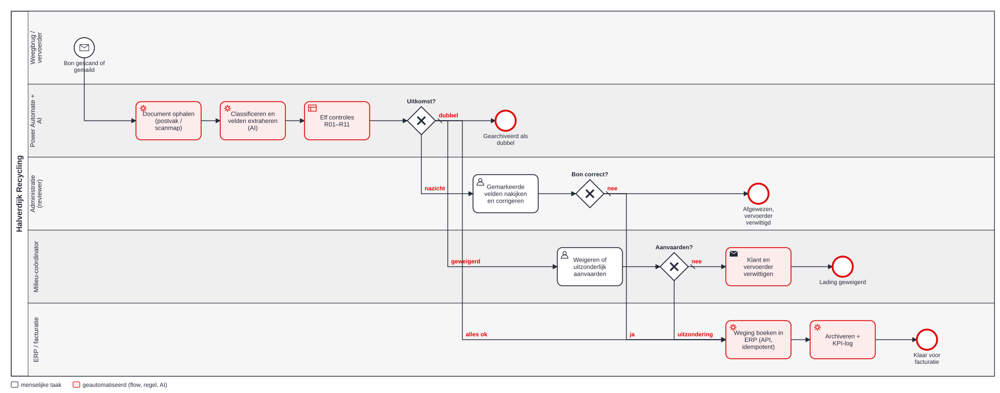
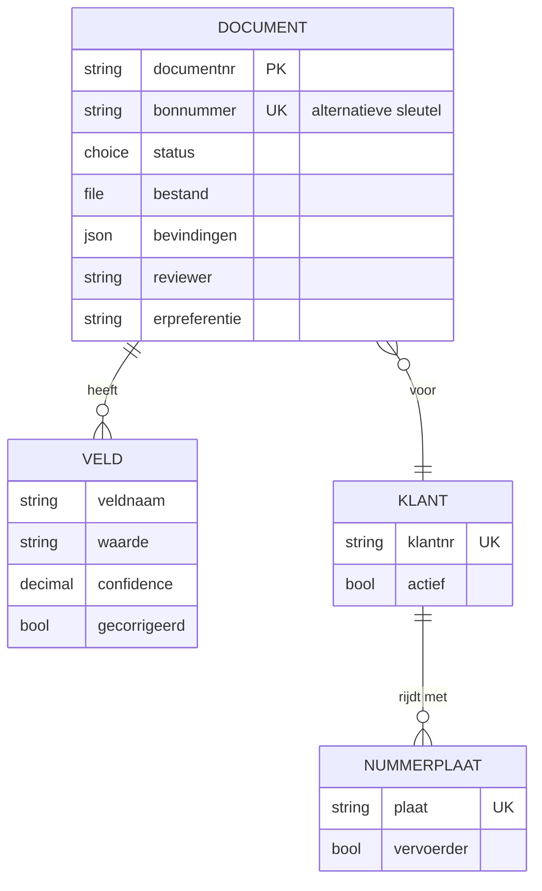

# 3 · Design — hoe moet het lopen?

## TO-BE-proces



Bron: [to-be.bpmn](bpmn/to-be.bpmn). Van de <!--n:bpmn.c1_tobe.tasks-->8<!--/n--> taken zijn er <!--n:bpmn.c1_tobe.automated-->6<!--/n--> geautomatiseerd (rood). De mens komt alleen nog in beeld bij nazicht en bij geweigerd materiaal.

## Vier uitkomsten per document

| Uitkomst | Wanneer | Wat er gebeurt | Wie |
|---|---|---|---|
| **automatisch** | geen enkele regel faalt | boeking in ERP, archief, KPI-log | niemand |
| **nazicht** | minstens één "review"-regel faalt | bon in wachtrij van de review-app met gemarkeerde velden | administratie |
| **escalatie** | materiaal geweigerd volgens vergunning (R06) | niets geboekt; melding aan milieucoördinator | milieucoördinator |
| **dubbel** | bonnummer al ontvangen (R09) | gearchiveerd als dubbel, niets geboekt | niemand (zichtbaar in rapport) |

## Regels na extractie

De regels zijn het hart van de case. Ze zijn geschreven in de taal van de administratie en de milieucoördinator, en geïmplementeerd in [`src/documents.mjs`](../src/documents.mjs). De tabel hieronder wordt uit de code gegenereerd.

<!--rules:c1-->
| Regel | Controle | Bij falen | Waarom |
|---|---|---|---|
| R01 | Verplichte velden aanwezig | nazicht door administratie | Zonder deze velden kan de boeking niet. |
| R02 | Zekerheid van de AI-lezing (0,85) | nazicht door administratie | Een onzekere lezing gaat naar een mens. De drempel wordt na de pilot herijkt. |
| R03 | Gewichten kloppen (20 kg) | nazicht door administratie | Vangt zelfverzekerde leesfouten die de confidence niet toont. |
| R04 | Klant bestaat en is actief | nazicht door administratie | Geen boeking op onbekende of geblokkeerde klanten. |
| R05 | Nummerplaat gekend | nazicht door administratie | Controle op fraude en verwisseling. Een nieuwe plaat wordt aan de stamgegevens toegevoegd. |
| R06 | Materiaal toegelaten | escalatie milieucoördinator | Geweigerde afvalstoffen (bv. asbest) worden nooit automatisch geboekt. De milieucoördinator beslist. |
| R07 | Identificatieformulier | nazicht door administratie | Afvaltransport moet traceerbaar zijn. Een ontbrekend nummer wordt bij de vervoerder opgevraagd. |
| R08 | Traceerbaarheid bodem | nazicht door administratie | Grondverzet vraagt een traceerbaarheidsdocument. Zonder referentie geen aanvaarding. |
| R09 | Geen dubbele bon | weigeren als dubbel | Een herscande of dubbel gemailde bon mag niet twee keer gefactureerd worden. |
| R10 | Datum aannemelijk (30 dagen) | nazicht door administratie | Een oude bon hoort mogelijk bij een afgesloten periode. |
| R11 | Bruto binnen de wettelijke grens (44.000 kg) | nazicht door administratie | Mogelijke overlading of leesfout. De administratie laat transportcompliance kijken. |
<!--/rules-->

**Twee ontwerpkeuzes die het verschil maken:**

1. **Confidence alleen is niet genoeg.** Een model kan zich met 0,96 zekerheid vergissen (een 8 gelezen als 3). Daarom controleert R03 de rekensom. Op de testset vangt die regel een fout die de confidence-drempel doorliet.
2. **Ernst bepaalt de route, niet het aantal fouten.** Eén asbestcode (R06) weegt zwaarder dan drie onzekere velden, dus het document gaat naar de milieucoördinator en niet naar de administratie.

## Datamodel



Volledig: [dataverse.json](artefacts/dataverse.json). Klanten en nummerplaten zijn een **read-only kopie** uit het ERP (principe P1).

## User stories

### US-01 Schone bon automatisch boeken
**Als** administratie **wil ik** dat bonnen zonder afwijkingen vanzelf geboekt worden **zodat** ik alleen nog uitzonderingen behandel.

```gherkin
Scenario: schone inkomende bon
  Gegeven een weegbon met alle velden boven confidence 0,85
  En netto = bruto − tarra
  En klant, nummerplaat en EURAL-code zijn gekend en toegelaten
  Als de bon in het postvak binnenkomt
  Dan staat hij binnen 15 minuten met status "Geboekt" en een ERP-referentie in Dataverse
  En is er geen taak voor de administratie aangemaakt
```

### US-02 Afwijkende bon nakijken
**Als** reviewer **wil ik** het origineel naast de gelezen velden zien, met de foute velden in het rood **zodat** ik een bon in minder dan 2 minuten kan nakijken.

```gherkin
Scenario: netto-gewicht verkeerd gelezen
  Gegeven een bon waarvan netto ≠ bruto − tarra (afwijking > 20 kg)
  Als ik de bon in de review-app open
  Dan is het veld "netto" rood gemarkeerd met de regel R03 en het verschil
  En kan ik de waarde corrigeren en "Goedkeuren en boeken" kiezen
  En wordt mijn correctie bewaard met mijn naam en tijdstip
```

### US-03 Geweigerd materiaal tegenhouden
**Als** milieucoördinator **wil ik** elke bon met een geweigerde afvalcode zien vóór er iets geboekt wordt **zodat** we nooit iets aanvaarden wat de vergunning niet toelaat.

```gherkin
Scenario: asbest op een inkomende bon
  Gegeven een bon met EURAL-code 17 06 05*
  Als de regels uitgevoerd worden
  Dan is de uitkomst "escalatie" en wordt er niets in het ERP geboekt
  En krijgt de milieucoördinator een melding in Teams
  En kan alleen de milieucoördinator de bon verder behandelen
```

### US-04 Dubbels voorkomen
**Als** facturatie **wil ik** dat een bon die twee keer binnenkomt maar één keer geboekt wordt **zodat** klanten geen dubbele factuur krijgen.

```gherkin
Scenario: dezelfde bon als foto en als pdf
  Gegeven bon WB-26-04201 is al ontvangen
  Als dezelfde bon opnieuw binnenkomt
  Dan krijgt het tweede document status "Dubbel"
  En stuurt de ERP-facade bij een herhaalde boeking met dezelfde Idempotency-Key de bestaande boeking terug (geen tweede)
```

## Review-app (gebouwd)

Twee schermen: **wachtrij** (alleen bonnen met bevindingen, oudste eerst, rood na 4 uur) en **detail** (origineel links, velden rechts, foute velden rood, knoppen "Goedkeuren en boeken" en "Afwijzen"). Bron: [review-app.pa.yaml](artefacts/power-apps/review-app.pa.yaml). De app beslist niets zelf: ze zet een status, en de flow boekt.

**Gebouwd als Power Apps code app** in plaats van canvas-app, omdat ze zo volledig van buiten Studio te bouwen en te testen is: [`power-platform/reviewapp/`](../power-platform/reviewapp/). Nieuw ten opzichte van het ontwerp: correcties worden in de app meteen opnieuw getoetst met dezelfde regelmotor ([`src/review.mjs`](../src/review.mjs)), escalaties zijn alleen voor de milieucoördinator (en die kan enkel weigeren), en flow HV-DI-02 controleert na goedkeuring nog eens op dubbels en geweigerd materiaal. Het canvas-ontwerp hierboven blijft als oefening om in Power Apps Studio na te bouwen.

## Formele use cases

De [uitgewerkte use cases](use-cases.md) verbinden de stories tot volledige gebruikersdoelen, inclusief voorwaarden, resultaat, alternatieve stromen en fouten. Ze verwijzen naar dezelfde requirements en het UAT-plan; open productievragen staan expliciet vermeld.
