# 5 · Integrate & automate — hoe werkt het samen?

## Architectuur

```mermaid
sequenceDiagram
  autonumber
  participant V as Vervoerder / scanner
  participant MB as Gedeeld postvak
  participant PA as Flow HV-DI-01
  participant DI as Azure AI Document Intelligence
  participant CF as Child flow HV-DI-02 (R01–R11)
  participant DV as Dataverse
  participant API as ERP-facade
  participant RA as Review-app
  V->>MB: bon als pdf/jpg
  MB->>PA: nieuwe mail met bijlage
  PA->>DV: document aanmaken (status Ontvangen)
  PA->>DI: analyze (model weegbon-v1)
  DI-->>PA: velden + confidence
  PA->>CF: extractie
  CF->>DV: klant, plaat, eerder bonnummer?
  CF-->>PA: beslissing + bevindingen
  alt automatisch
    PA->>API: POST /weighing-tickets (Idempotency-Key = bonnr)
    API-->>PA: 201 of 200 (al geboekt)
    PA->>DV: status Geboekt + ERP-referentie
  else nazicht / escalatie
    PA->>DV: status Nazicht / Escalatie
    RA->>DV: reviewer corrigeert en keurt goed
    DV->>PA: HV-DI-03 boekt (zelfde Idempotency-Key)
  else dubbel
    PA->>DV: status Dubbel
  end
```

## Artefacten

| Artefact | Wat het toont |
|---|---|
| [extraction-schema.json](artefacts/extraction-schema.json) | contract tussen extractie en regels: elf velden, elk met waarde en confidence |
| [sample-extraction.json](artefacts/sample-extraction.json) | echte uitvoer voor DOC-006 (de zelfverzekerde leesfout) |
| [weegbon-verwerken.flow.json](artefacts/power-automate/weegbon-verwerken.flow.json) | hoofdflow: trigger op postvak, DI-aanroep met polling, child flow, switch op beslissing, try/catch |
| [weegbon-controleren.childflow.json](artefacts/power-automate/weegbon-controleren.childflow.json) | de regels als child flow met drempels uit omgevingsvariabelen |
| [controles.fx](artefacts/power-fx/controles.fx) + [RESULTS.md](artefacts/power-fx/RESULTS.md) | R02/R03/R11 in Power Fx, uitgevoerd met de echte engine, 6/6 gelijk aan de JS-motor |
| [review-app.pa.yaml](artefacts/power-apps/review-app.pa.yaml) | review-app als Power Apps-broncode |
| [dataverse.json](artefacts/dataverse.json) | tabellen, sleutels, security roles |
| [erp-weighing.openapi.yaml](artefacts/erp-weighing.openapi.yaml) | ERP-contract met idempotency en problem details |

## Foutafhandeling

| Wat faalt | Wat er gebeurt | Wie merkt het |
|---|---|---|
| DI geeft geen resultaat binnen 2 minuten | catch-scope: status "Fout", Teams-melding aan functioneel beheer, bon blijft beschikbaar voor manuele verwerking | functioneel beheer |
| ERP 503 | 4 pogingen met exponentiële wachttijd; daarna status "Fout" | functioneel beheer |
| ERP 409 (bonnummer met andere inhoud) | geen retry; status "Fout" + bon naar nazicht | reviewer |
| Klantenlijst niet gesynchroniseerd | R04 faalt voor nieuwe klanten → nazicht; nachtelijke sync wordt gemonitord | reviewer |

## Waarom zo (kort)

- **Azure DI in plaats van AI Builder** voor productie: confidence per veld, modelversies en prijs per pagina ([ADR-003](../shared-methodology/adr/ADR-003-document-ai.md)).
- **Regels in een child flow** in plaats van in de hoofdflow: één plaats om aan te passen en apart te testen, en herbruikbaar voor de review-route.
- **Idempotency-Key = bonnummer**: zelfs als de flow twee keer zou lopen, boekt het ERP één keer ([ADR-004](../shared-methodology/adr/ADR-004-outbox-idempotency.md)).
- **Key Vault voor de DI-sleutel**, met secure inputs/outputs in de flow, zodat sleutels niet in de run-historie verschijnen.
