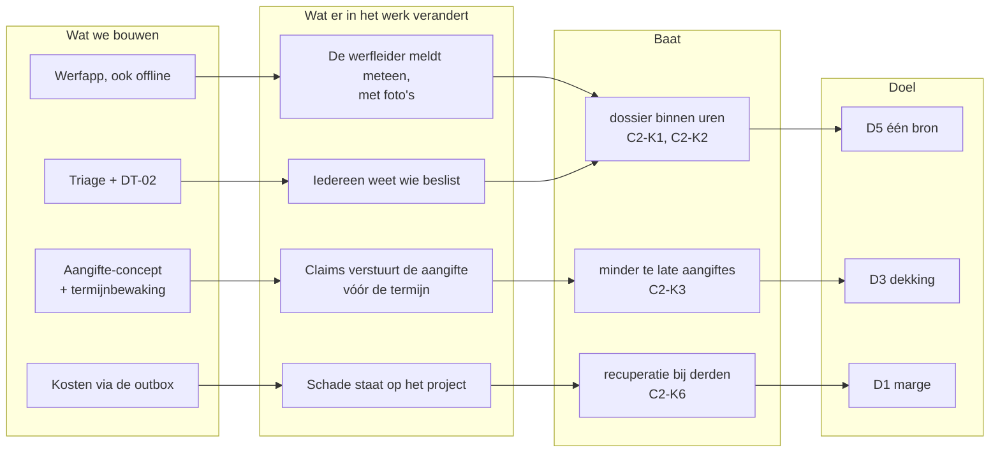

# 1 · Discover — wie heeft welk probleem?

> **Gesimuleerd.** Halverdijk is fictief. Sponsorgesprek, workshop en interviews zijn uitgeschreven als scenario: zo zou ik ze voeren, met deze verwachte uitkomst. Er is niet met echte medewerkers gesproken.

## Mandaat (stap 0 · initiate)

| | |
|---|---|
| Vraag van de sponsor | "Zorg dat we nooit meer een tussenkomst verliezen omdat we te laat zijn." |
| Herformuleerd probleem | niet alleen de aangifte is te laat: het hele dossier begint te laat en onvolledig |
| Scope van de analyse | materiële schade van melding tot afsluiting, alle werven. **Niet:** arbeidsongevallen (eigen wettelijke procedure), schade aan het eigen wagenpark op de openbare weg |
| Ruwe businesscase | <!--n:c2.lateInsurer-->13<!--/n--> van de <!--n:c2.insured-->24<!--/n--> verzekerde dossiers te laat (fictief register); als één verloren tussenkomst gemiddeld een paar duizend euro kost, betaalt een eenvoudige oplossing zich snel terug |
| Wat de analyse mag kosten | 5 weken analist, 2 workshops van 2 × 2 uur, interviews met claims, fleet en preventie |
| Sponsor | CFO |
| Poort | **sponsor geeft mandaat** voor discover en analyse; na stap 4 beslist hij opnieuw |

## Aanleiding

De verzekeraar weigerde twee keer in één jaar een tussenkomst, omdat de aangifte buiten de termijn kwam. Intern weet niemand hoeveel schadegevallen er lopen: ze zitten in mailboxen, op papier in de werfkeet en in een Excel-register dat één medewerker bijhoudt.

## Strategie en doelen

| Doel van de groep ([strategie](../shared-methodology/strategie-en-portfolio.md)) | Wat deze case belooft (SMART, business requirement) | Eigenaar | KPI |
|---|---|---|---|
| D5 één bron, data om op te sturen | BR-01: binnen 3 maanden na go-live staat een dossier mediaan binnen 4 uur na de schade in het systeem | claims & verzekeringen | [C2-K1](07-measure-improve.md#kpi-kaarten) |
| D3 compliance en verzekeringsdekking | BR-02: binnen 6 maanden ≤ 5% te late aangiftes (nu <!--n:c2.latePct-->54%<!--/n-->) | claims & verzekeringen | C2-K3 |
| D5 één bron | BR-03: binnen 6 maanden ≥ 80% van de meldingen via de app, per afdeling | afdelingsverantwoordelijken | C2-K4 |

### Benefits map

## Stakeholdermatrix

De houding is een **aanname** na de eerste gesprekken (fictief), en wordt na elke workshop herbekeken ([methodiek](../shared-methodology/stakeholdermethodiek.md#houding-conflicten-en-communicatie)).

| Stakeholder | Rol | Belang | Invloed | Houding | Wil | Grootste zorg | Betrekken via |
|---|---|---|---|---|---|---|---|
| Werfleider (±45) | stelt schade vast, meldt | H | L | sceptisch | snel melden, verder werken | "nog een app, nog meer typen" | werfbezoek, ontdekkingsworkshop, UAT op de werf |
| Projectleider | eerste beoordeling, herstel regelen | H | M | neutraal | geen verrassingen in de werfmarge | goedkeuringen die blijven liggen | procesworkshop |
| Afdelingsverantwoordelijke | keurt grotere bedragen goed | M | H | voorstander | overzicht en snelle beslissing | "ik word overstelpt met kleine dingen" | DT-02 samen opstellen |
| Fleetmanager | beoordeelt machineschade | H | M | voorstander | weten wat er met zijn machines gebeurt | hoort het pas als de machine stilstaat | interview |
| Claims & verzekeringen | aangifte, verhaal op derden | H | M | voorstander | volledige dossiers op tijd | termijnen, ontbrekende foto's | key user, beslistabel |
| Preventieadviseur | veiligheid, arbeidsongevallen | M | H | neutraal, waakzaam | personenletsel nooit als "schadeclaim" behandeld | verwarring tussen materiële schade en ongevallen | validatieregel letsel |
| Directie / CFO (sponsor) | budget, risico | M | H | voorstander | minder verzekeringsverlies, sneller zicht op kosten | IT-project zonder resultaat | stuurgroep |
| Verzekeraar (extern) | expertise, tussenkomst | M | M | neutraal | tijdige, volledige aangifte | – | informeren over nieuw aangifteformaat |
| Leidingbeheerders (extern) | eigenaar van kabels en leidingen | M | M | neutraal | onmiddellijk verwittigd bij schade | veiligheid | wettelijke meldplicht in de app opnemen |
| IT-team | bouw | M | H | sceptisch | duidelijke specificaties | offline is complex | architectuurworkshop |

### Conflicten, en hoe ze beslecht werden

| Wie tegenover wie | Het conflict | Beslissing | Wie besliste |
|---|---|---|---|
| Sponsor ↔ werfleiders | de sponsor wil alles via de app; werfleiders willen bij een gaslek eerst bellen | bellen blijft bij kritieke schade; de projectleider registreert die melding zelf; adoptie telt telefonische meldingen mee | sponsor ([D-05](raid-en-beslissingen.md#beslissingslog)) |
| Claims ↔ werfleiders | claims wil veel velden, werfleiders willen 2 minuten | 8 vaste velden + per categorie; wat kantoor kan opzoeken, vraagt de app niet | claims, na het papieren prototype |
| Preventie ↔ claims | claims wil letsel in hetzelfde dossier; preventie wil het gescheiden | letsel stopt het formulier | preventieadviseur ([D-04](raid-en-beslissingen.md#beslissingslog)) |
| Afdelingsverantwoordelijken ↔ projectleiders | de afdeling wil alles boven €1.000 zien; projectleiders willen meer vrijheid | grens €2.500, getoetst op 6 echte gevallen | directie ([D-02](raid-en-beslissingen.md#beslissingslog)) |

### Communicatieplan

| Wie | Wat | Hoe vaak | Vorm | Door |
|---|---|---|---|---|
| CFO (sponsor) | voortgang, beslissingen, KPI C2-K3 | elke 4 weken | stuurgroep, één blad ([samenvatting](samenvatting.md)) | analist |
| Werfleiders | waarom, hoe melden, wat er na de melding gebeurt | bij de start + na 1 maand | toolboxmoment van 15 minuten op de werf, QR-kaartje in de werfkeet | champion per afdeling |
| Projectleiders | beoordelen in de app, goedkeuren | eenmalig + bij vragen | sessie van 45 minuten | key user claims |
| Claims & verzekeringen | termijnbewaking, aangifte-concept | wekelijks tijdens de pilot | werksessie | analist |
| Preventieadviseur | letselregel, schadeoorzaken | maandelijks | dashboard preventie | claims |
| Verzekeraar en makelaar | nieuw aangifteformaat, termijn | eenmalig vóór go-live | brief + gesprek | claims & verzekeringen |
| IT | ontwerp, ADR's, runbook | tweewekelijks | refinement | analist + developer |

## Workshopscenario (procesworkshop, 2 × 2 u — gesimuleerd)

**Deelnemers:** 2 werfleiders (wegen, sloop), 1 projectleider, fleetmanager, claims & verzekeringen, 1 developer. Facilitator: analist.

| Blok | Werkvorm | Vraag |
|---|---|---|
| 1. Drie echte gevallen | elk geval op een tijdlijn op de muur | "Wanneer wist wie wat?" |
| 2. Kanalen | turven in het Excel-register van vorig jaar | "Via welk kanaal kwam elke melding binnen?" |
| 3. Wat ontbreekt | per geval: wat moest er nagevraagd worden? | "Welke informatie was er later niet meer?" |
| 4. Wie beslist | rollenspel met 4 bedragen en 3 categorieën | "Wie moet hier ja zeggen, en waarom?" |
| 5. Werfrealiteit | demo van een papieren prototype met handschoenen aan | "Wat vul je in, in de regen, in 2 minuten?" |

## Wat de workshop opleverde (gesimuleerd)

| ID | Pijnpunt | Citaat |
|---|---|---|
| P-01 | Melding via telefoon wordt pas dagen later geregistreerd | "Ik bel de projectleider, en dan is het voor mij gedaan." |
| P-02 | Foto's ontbreken of zitten in WhatsApp | "De foto's staan op de gsm van de kraanman." |
| P-03 | Niemand weet wie moet goedkeuren | "Bij 8.000 euro? Dat hangt ervan af wie je belt." |
| P-04 | Verzekeringstermijn verstrijkt | "Tegen dat het dossier compleet is, zijn we te laat." |
| P-05 | Leidingschade: verwittigen van de beheerder is niet geborgd | "Iedereen dacht dat iemand anders gebeld had." |
| P-06 | Kosten komen niet terug op het project | "De schade zie ik pas bij de nacalculatie." |
| P-07 | Personenletsel en materiële schade lopen door elkaar | (preventieadviseur) |

## Oorzaakanalyse: vijf keer waarom

Het zichtbare probleem: "de aangifte is te laat" (P-04). Waarom?

1. **Waarom** is de aangifte te laat? Omdat het dossier pas volledig is als de termijn al bijna voorbij is.
2. **Waarom** is het dossier zo laat volledig? Omdat de melding dagen na de schade binnenkomt, zonder foto's.
3. **Waarom** komt de melding zo laat? Omdat de werfleider belt, en de projectleider het later (of niet) registreert.
4. **Waarom** registreert de projectleider niet meteen? Omdat er geen vaste plaats en geen eigenaar is: wie moet wat doen hangt af van wie de mail leest.
5. **Waarom** is er geen eigenaar? Omdat niemand de termijn bewaakt; het Excel-register heeft zelfs geen kolom voor de aangiftedatum.

**Grondoorzaak:** het proces heeft geen eigenaar en geen klok vanaf het moment van de schade. Een app alleen lost dat niet op. Daarom krijgt elk dossier bij de melding een **eigenaar** en een **deadline**, en bewaakt een flow die deadline. De eerlijke [optie 0](04-validate-prioritise.md#opties): een vaste mailbox met een eigenaar en een termijnlijst in Excel. Die lost de eigenaar op, maar niet de foto's en niet de bewaking.

## Probleemstelling

> Schadegevallen worden via drie kanalen gemeld en pas na mediaan <!--n:c2.medianRegister-->3 dagen<!--/n--> geregistreerd. <!--n:c2.incomplete-->55%<!--/n--> van de eerste meldingen is onvolledig, en <!--n:c2.lateInsurer-->13<!--/n--> van de <!--n:c2.insured-->24<!--/n--> verzekerde dossiers werd vorig jaar te laat aangegeven (fictief register). Het doel is één kanaal vanaf de werf, een volledig dossier bij de eerste melding, een vaste goedkeuringsregel, en een aangifte die altijd binnen de termijn vertrekt.

## BA-aanpak voor deze case

| | |
|---|---|
| Aanpak | hybride: procesworkshops en DT-02 vooraf, daarna sprints van 2 weken met werfleiders als testers op de werf |
| Technieken | werfbezoek, procesworkshop met tijdlijnen van echte gevallen, rollenspel voor de goedkeuring, papieren prototype met handschoenen, nulmeting op het Excel-register, beslistabel |
| Wie keurt wat goed | scope en budget: CFO · DT-02: directie · letselregel: preventieadviseur · aangifte en termijn: claims & verzekeringen ([governance](../shared-methodology/governance.md)) |
| Requirements | [register en baseline](02-analyse.md#requirements), [traceerbaarheid](traceerbaarheid.md) |
| Beslissingen en risico's | [beslissingslog en RAID](raid-en-beslissingen.md) |
| Planning | week 1–2 discover · 3 analyse (nulmeting) · 4–5 design en DT-02 · 6 validate en stuurgroep |
