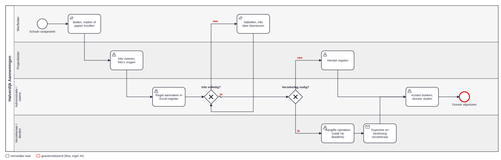

# 2 · Analyse — hoe loopt het vandaag?

## AS-IS-proces

Bron: [as-is.bpmn](bpmn/as-is.bpmn). <!--n:bpmn.c2_asis.automated-->0<!--/n--> van de <!--n:bpmn.c2_asis.tasks-->8<!--/n--> taken is geautomatiseerd. De lus "info volledig? → nabellen" is waar de tijd verloren gaat.

## Nulmeting uit het Excel-register

Bron: [claims-history.json](../data/claims-history.json), <!--n:c2.n-->40<!--/n--> fictieve dossiers uit 2025.

| Meting | Waarde |
|---|---|
| Kanalen | telefoon <!--n:c2.phone-->18<!--/n-->, mail <!--n:c2.mail-->11<!--/n-->, papier <!--n:c2.paper-->11<!--/n--> |
| Mediaan dagen tot registratie | <!--n:c2.medianRegister-->3 dagen<!--/n--> |
| Eerste melding onvolledig | <!--n:c2.incomplete-->55%<!--/n--> |
| Gemiddeld aantal keer nabellen | <!--n:c2.followUps-->1,5<!--/n--> |
| Zonder foto | <!--n:c2.noPhoto-->50%<!--/n--> |
| Verzekerde dossiers / te laat aangegeven | <!--n:c2.insured-->24<!--/n--> / <!--n:c2.lateInsurer-->13<!--/n--> (<!--n:c2.latePct-->54%<!--/n-->) |
| Mediaan doorlooptijd tot afsluiten | <!--n:c2.medianClose-->82 dagen<!--/n--> |
| Dossiers met mogelijk verhaal op derden | <!--n:c2.recoverable-->21<!--/n--> |
| Totaal geraamde schade | <!--n:c2.total-->€390.910<!--/n--> |

**Lezing:** het probleem zit niet in de beoordeling, maar in de eerste 72 uur. Daar ontbreekt informatie, en daar verstrijkt de termijn.

## Requirements

### Functioneel

| ID | Requirement | Pijn | MoSCoW |
|---|---|---|---|
| F-01 | Werfleider meldt in de app: werf, categorie, foto's, GPS, omschrijving, raming | P-01, P-02 | Must |
| F-02 | Melden werkt zonder bereik; verzenden later gebeurt zonder dubbel dossier | P-01 | Must |
| F-03 | Personenletsel stopt het formulier en verwijst naar de procedure arbeidsongeval | P-07 | Must |
| F-04 | Bij leidingschade zijn KLIP-referentie, type leiding en leidingbeheerder verplicht, en de app vraagt of de beheerder verwittigd is | P-05 | Must |
| F-05 | Bij ontvangst: dossiernummer, ernst, eigenaar, goedkeuringsketen en deadlines automatisch | P-03 | Must |
| F-06 | Betrokkenen worden automatisch verwittigd (projectleider, claims, verhuurder, leidingbeheerder) | P-05 | Must |
| F-07 | Goedkeuring per niveau volgens DT-02, in Teams/Outlook, met audit | P-03 | Must |
| F-08 | Aangifteconcept bij verzekerde schade, met bewaking van de termijn | P-04 | Must |
| F-09 | Kosten en recuperaties worden op het project geboekt in het ERP | P-06 | Should |
| F-10 | Verhaaltraject bij aansprakelijke derde | P-06 | Should |
| F-11 | Werfleider ziet de status van zijn meldingen | P-01 | Should |
| F-12 | Rechtstreekse koppeling met het portaal van de verzekeraar | P-04 | Won't (deze fase) |

### Niet-functioneel

| ID | Requirement |
|---|---|
| NF-01 | Melden duurt ≤ 3 minuten, bedienbaar met één hand |
| NF-02 | Offline: minstens 20 meldingen met 4 foto's lokaal bewaren |
| NF-03 | Dossier binnen 5 minuten na synchronisatie aangemaakt en triage uitgevoerd |
| NF-04 | Tijdlijn is alleen-toevoegen (audit voor verzekeraar en directie) |
| NF-05 | Werfleiders zien alleen hun eigen meldingen; claims ziet alles |

## Uitzonderingen

| Uitzondering | Behandeling |
|---|---|
| Schade 's nachts of in het weekend vastgesteld | melding mag; SLA-klok loopt in werkuren, kritiek (gas/elektriciteit) altijd |
| Schade door onderaannemer | categorie volgens object, "derde aansprakelijk" = ja → verhaaltraject |
| Raming onbekend | 0 mag; beoordelaar vult raming aan, keten wordt herberekend |
| Goedkeurder afwezig | vervanger uit `hv_goedkeurder`; na 5 dagen terug naar beoordelaar |
| Werf al afgesloten | melding geweigerd met uitleg; via afdelingsverantwoordelijke |
