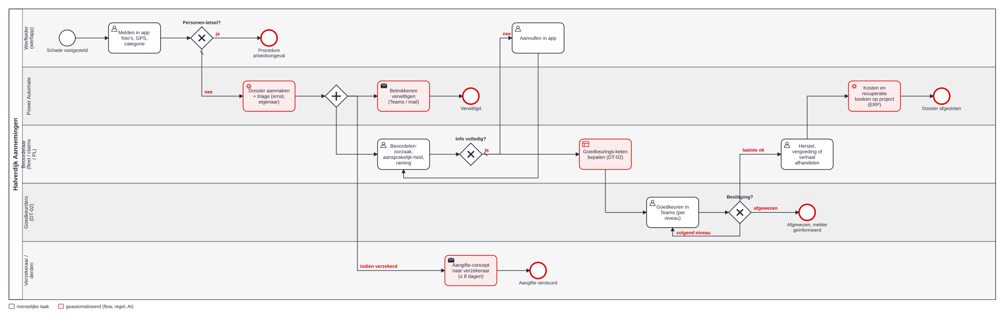
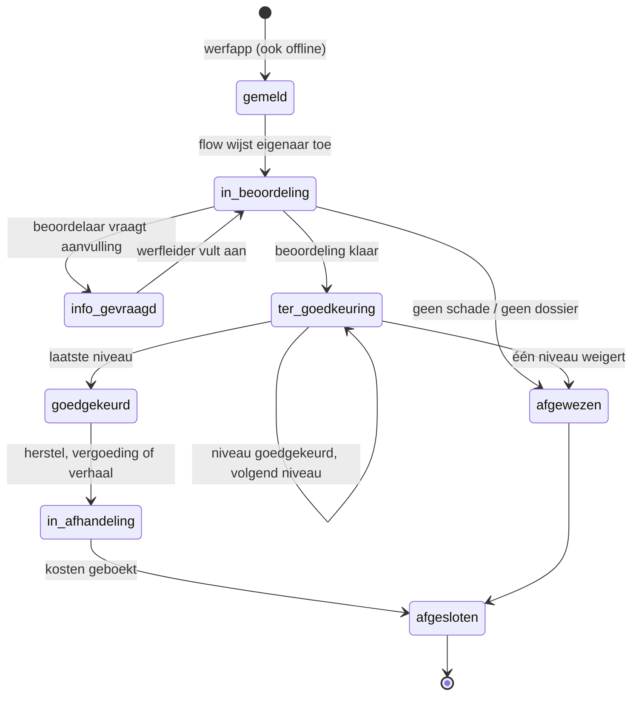
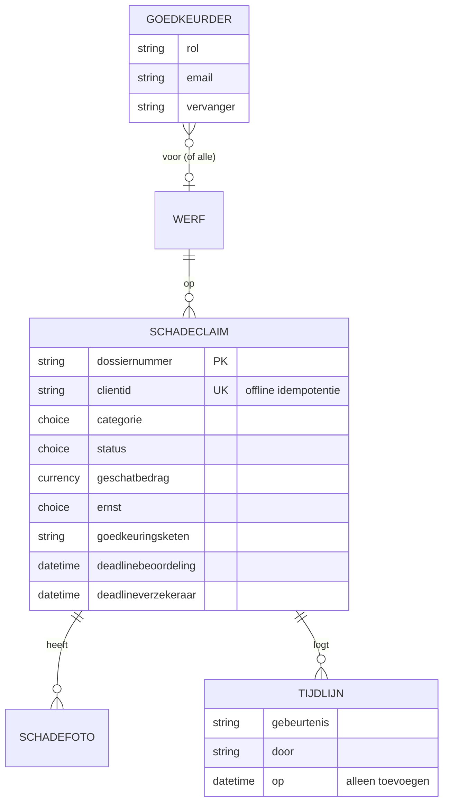

# 3 · Design — hoe moet het lopen?

## TO-BE-proces



Bron: [to-be.bpmn](bpmn/to-be.bpmn). <!--n:bpmn.c2_tobe.automated-->5<!--/n--> van de <!--n:bpmn.c2_tobe.tasks-->10<!--/n--> taken zijn geautomatiseerd. Na de triage lopen drie dingen **parallel**: verwittigen, beoordelen en (bij verzekerde schade) de aangifte voorbereiden. Dat is de belangrijkste verbetering, want de aangifte wacht niet meer op een volledig dossier.

## Validatieregels bij melden

| Veld | Regel | Waarom |
|---|---|---|
| Werf | verplicht, alleen actieve werven | kosten moeten op een open project |
| Tijdstip, locatie | verplicht; GPS automatisch, tekst als alternatief | expertise en KLIP |
| Categorie | verplicht, 5 keuzes | bepaalt beoordelaar en keten |
| Omschrijving | ≥ 20 tekens | genoeg om zonder nabellen te beoordelen |
| Foto's | ≥ 1 | de helft van de dossiers had er geen |
| Raming | verplicht, 0 mag | bepaalt keten en verzekeringsplicht |
| Personenletsel | ja → formulier stopt | een ongeval volgt een andere procedure (preventieadviseur) |
| Leidingschade | KLIP-referentie, type, beheerder verplicht; "beheerder verwittigd?" | wettelijke meldplicht, veiligheid |
| Gehuurd materieel | referentie huurcontract | verhuurder verwittigen |
| Derde betrokken | naam verplicht | aansprakelijkheid en verhaal |

Implementatie: [`validateReport()`](../src/claims.mjs), [werfapp](artefacts/power-apps/werfapp-schademelding.pa.yaml) (zelfde regels als named formula `Fouten`). De server-flow valideert opnieuw.

## Triage

| Ernst | Wanneer | Beoordelen binnen |
|---|---|---|
| kritiek | leidingschade aan gas of elektriciteit, of beheerder niet verwittigd | 2 uur |
| hoog | raming ≥ €15.000 | 24 uur |
| middel | raming ≥ €2.500 of een derde betrokken | 48 uur |
| laag | rest | 72 uur |

## Beslistabel DT-02 — wie keurt goed?

Eerst de **beoordelaar per categorie**, dan de **keten per bedrag**.

| Categorie | Beoordelaar (eerste niveau) |
|---|---|
| eigen of gehuurd materieel | Fleetmanager |
| schade aan derden, kabels en leidingen | Claims & verzekeringen |
| eigen werk / werfinrichting | (geen extra; projectleider beoordeelt) |

| Geraamd bedrag | Keten na de beoordelaar |
|---|---|
| ≤ €2.500 | Projectleider |
| €2.501 – €15.000 | Projectleider → Afdelingsverantwoordelijke |
| > €15.000 | Projectleider → Afdelingsverantwoordelijke → Directie |

Plus: raming ≥ €15.000, schade aan derden of aan leidingen → **verzekeringsaangifte binnen 8 dagen** (illustratieve polisclausule).

Implementaties die tegen dezelfde gevallen getest worden:
- JavaScript: [`approvalChain()`](../src/claims.mjs), [tests](../tests/claims.test.mjs);
- Power Fx: [dt-02-goedkeuringsketen.fx](artefacts/power-fx/dt-02-goedkeuringsketen.fx), [resultaat met de echte engine](artefacts/power-fx/RESULTS.md);
- flow-expressie: actie `Goedkeuringsketen` in [schadeclaim-intake.flow.json](artefacts/power-automate/schadeclaim-intake.flow.json).

## Statusmodel



Ongeldige overgangen worden geweigerd ([`transition()`](../src/claims.mjs)). Goedkeuren moet in de volgorde van de keten.

## Datamodel



Volledig: [dataverse.json](artefacts/dataverse.json).

## User stories

### US-01 Melden vanop de werf, ook zonder bereik
**Als** werfleider **wil ik** schade melden met foto's in minder dan 3 minuten, ook zonder bereik **zodat** ik verder kan werken en niets vergeten wordt.

```gherkin
Scenario: melding zonder bereik
  Gegeven mijn gsm heeft geen verbinding
  Als ik een volledige melding met 2 foto's verzend
  Dan toont de app "offline — wordt later verzonden"
  En wordt de melding bij verbinding één keer aangemaakt, ook als ik twee keer op verzenden drukte
```

### US-02 Leidingschade veilig afhandelen
**Als** preventieadviseur **wil ik** dat bij schade aan een gas- of elektriciteitsleiding de beheerder gegarandeerd verwittigd wordt **zodat** niemand ervan uitgaat dat een ander gebeld heeft.

```gherkin
Scenario: gasleiding geraakt
  Gegeven categorie "kabel of leiding" en type "gas"
  Als de melding binnenkomt
  Dan is de ernst "kritiek" en moet beoordeling binnen 2 uur
  En krijgen claims, projectleider, leidingbeheerder en preventieadviseur een melding
  En start het aangifteconcept met deadline = tijdstip schade + 8 dagen
```

### US-03 Goedkeuren volgens één regel
**Als** afdelingsverantwoordelijke **wil ik** alleen claims boven €2.500 te zien krijgen, in Teams, met foto's en raming **zodat** ik snel kan beslissen zonder zelf te zoeken.

```gherkin
Scenario: machineschade van €27.500
  Gegeven een claim "eigen materieel" van €27.500
  Als de beoordelaar de claim ter goedkeuring zet
  Dan is de keten Fleetmanager → Projectleider → Afdelingsverantwoordelijke → Directie
  En kan de directie niet goedkeuren voordat de afdelingsverantwoordelijke dat deed
```

### US-04 Aangifte nooit te laat
**Als** claims & verzekeringen **wil ik** twee dagen voor de termijn een waarschuwing als de aangifte nog niet vertrokken is **zodat** we geen tussenkomst meer verliezen.

```gherkin
Scenario: termijn dreigt
  Gegeven een verzekerde claim zonder verstuurde aangifte
  En de deadline verzekeraar is binnen 2 dagen
  Als de bewakingsflow draait
  Dan krijgt de afdelingsverantwoordelijke een escalatie in Teams
  En staat de claim gemarkeerd als geëscaleerd
```

## Werfapp-schermen (ontwerp)

Eén scherm "Schade melden" met bovenaan de letselvraag, daarna enkel de velden voor de gekozen categorie, foto-knop, en één rode knop "Verzenden" die pas actief wordt als alles klopt. Fouten staan in gewone taal onder het formulier. Bron: [werfapp-schademelding.pa.yaml](artefacts/power-apps/werfapp-schademelding.pa.yaml).
