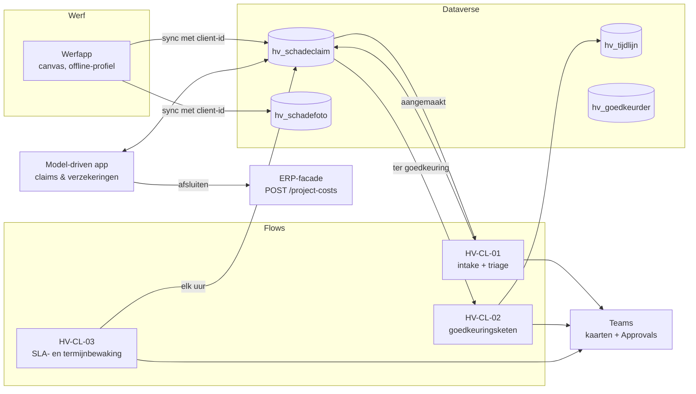

# 5 · Integrate & automate — hoe werkt het samen?

## Oplossingsarchitectuur

Conceptueel ontwerp, geen bevestiging van een bestaande architectuur. De echte integraties hangen af van het ERP, de licenties en de securityvereisten.

## Flows

> **Ontwerp en gebouwd.** De bestanden in deze tabel zijn het doelontwerp (met Teams-kaart, conceptmail en herinnering na 5 dagen). Wat echt draait in de ontwikkelomgeving staat per flow beschreven, in gewone taal en met bewijs: [HV-CL-01](../power-platform/flows/HV-CL-01.md), [HV-CL-02](../power-platform/flows/HV-CL-02.md) en [HV-CL-03](../power-platform/flows/HV-CL-03.md). Overzicht: [de zeven flows](../power-platform/flows/README.md).

| Flow | Trigger | Wat | Ontwerp |
|---|---|---|---|
| HV-CL-01 Intake en triage | Dataverse: claim aangemaakt (status Gemeld) | servervalidatie, ernst, DT-02-keten, SLA, deadlines, Teams-kaart, aangifteconcept | [schadeclaim-intake.flow.json](artefacts/power-automate/schadeclaim-intake.flow.json) |
| HV-CL-02 Goedkeuringsketen | Dataverse: status → Ter goedkeuring | per niveau Approvals (Start and wait), tijdlijn, stoppen bij weigering, terug na 5 dagen | [schadeclaim-goedkeuring.flow.json](artefacts/power-automate/schadeclaim-goedkeuring.flow.json) |
| HV-CL-03 SLA- en termijnbewaking | elk uur op werkdagen | te late beoordelingen en dreigende aangiftes escaleren | [sla-bewaking.flow.json](artefacts/power-automate/sla-bewaking.flow.json) |

Teams-kaart: [adaptive-card-nieuwe-claim.json](artefacts/adaptive-card-nieuwe-claim.json).

## ERP: kosten op het project

Bij afsluiten boekt de backoffice de definitieve kost (en later de recuperatie) op het project via `POST /project-costs` op de ERP-facade, met `Idempotency-Key = dossiernummer + type`. Contract: [erp-material-api.openapi.yaml](../03-material-requests/artefacts/erp-material-api.openapi.yaml) (gedeeld met case 03). Verzending via dezelfde outbox als case 03 ([ADR-004](../shared-methodology/adr/ADR-004-outbox-idempotency.md)).

## Offline en dubbels

1. De app maakt bij het openen van het scherm een `GUID` (`varClientId`).
2. `Patch` naar Dataverse werkt offline: de rij staat in het offline-profiel en synchroniseert later.
3. `hv_clientid` is een **alternatieve sleutel**. Een tweede sync met dezelfde sleutel geeft geen tweede rij.
4. Getest: [`syncQueue()`](../src/claims.mjs) — eerste sync maakt 2 dossiers, tweede sync met 1 extra melding maakt er alleen die ene bij.

## Waarom zo (kort)

- **Approvals in Teams** in plaats van een eigen goedkeuringsscherm: goedkeurders zitten al in Teams, en de audit zit in de Approvals-historie + `hv_tijdlijn`.
- **Rol → persoon in een tabel**: afdelingen beheren zelf wie goedkeurt en wie vervangt; de flow kent alleen rollen.
- **Aangifte als parallelle tak**: wacht niet op een volledig dossier, wat de grootste oorzaak was van te late aangiftes.
- **Servervalidatie opnieuw**: een oude app-versie of een directe API-aanroep kan de client-validatie omzeilen.
