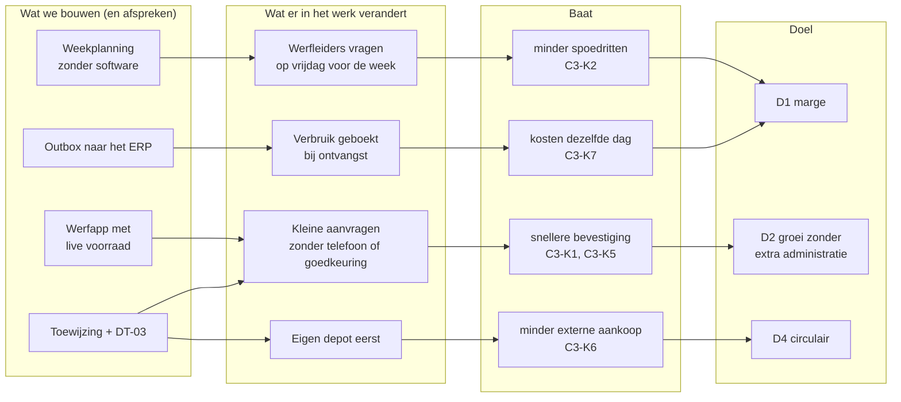

# 1 · Discover — wie heeft welk probleem?

> **Gesimuleerd.** Halverdijk is fictief. Sponsorgesprek, workshop en interviews zijn uitgeschreven als scenario: zo zou ik ze voeren, met deze verwachte uitkomst. Er is niet met echte medewerkers gesproken.

## Mandaat (stap 0 · initiate)

| | |
|---|---|
| Vraag van de sponsor | "Maak een app om materiaal te bestellen, want het depot verdrinkt in telefoons." |
| Eerste vraag terug | **Materieel of materialen?** Machines (materieel) en granulaten, buizen en asfalt (materialen) zijn twee processen met andere eigenaars. Antwoord: materialen. Materieel valt buiten scope ([D-01](raid-en-beslissingen.md#beslissingslog)). |
| Herformuleerd probleem | aanvragen komen via drie kanalen, te laat en zonder zicht op voorraad, budget en kosten |
| Scope van de analyse | materiaalaanvraag van werf tot verbruik op het project; 2 depots en de breekwerf. **Niet:** machineverhuur, ritoptimalisatie |
| Ruwe businesscase | ±<!--n:c3.reqYear-->2.600<!--/n--> aanvragen per jaar (aanname); elke spoedrit kost extra transport; de grootste baat zit waarschijnlijk in minder spoed, niet in sneller typen |
| Wat de analyse mag kosten | 5 weken analist, meelopen in het depot op 2 piekmomenten, workshop van 3 uur |
| Sponsor | afdelingsverantwoordelijke wegen & riolering, namens de directie |
| Poort | **sponsor geeft mandaat** voor discover en analyse; na stap 4 beslist hij opnieuw |

## Aanleiding

Depots en breekwerf klagen over "constante spoed". Werfleiders klagen dat leveringen te laat of onvolledig zijn. De aankoopdienst ziet bestellingen bij externe leveranciers waarvan het materiaal in een eigen depot lag. De projectleiders ontdekken kosten pas bij de maandafsluiting.

## Strategie en doelen

| Doel van de groep ([strategie](../shared-methodology/strategie-en-portfolio.md)) | Wat deze case belooft (SMART, business requirement) | Eigenaar | KPI |
|---|---|---|---|
| D1 marge per werf | BR-01: binnen 6 maanden ≤ 20% spoed (nu <!--n:c3.rushPct-->33%<!--/n-->) | afdelingsverantwoordelijken | [C3-K2](07-measure-improve.md#kpi-kaarten) |
| D2 groeien zonder extra administratie | BR-02: binnen 3 maanden ≥ 40% automatisch goedgekeurd, doorlooptijd < 1 uur | werfplanning | C3-K5, C3-K1 |
| D1 marge per werf | BR-03: vanaf go-live kosten dezelfde dag op de werf | administratie aankoop | C3-K7 |
| D4 circulair bouwen | BR-04: binnen 6 maanden geen externe aankoop van wat in een eigen depot ligt | aankoop | C3-K6 |

### Benefits map

De eerste rij is bewust geen software: de grootste baat, minder spoed, komt uit een afspraak.

## Stakeholders

De houding is een **aanname** na de eerste gesprekken (fictief), en wordt na elke workshop herbekeken ([methodiek](../shared-methodology/stakeholdermethodiek.md#houding-conflicten-en-communicatie)).

| Stakeholder | Rol | Belang | Invloed | Houding | Wil | Zorg | Betrekken via |
|---|---|---|---|---|---|---|---|
| Werfleider | vraagt aan, ontvangt | H | L | sceptisch | juist materiaal op het juiste moment | "nog een formulier" | werfbezoek 06u30 (piek), UAT |
| Depotverantwoordelijke (2 depots + breekwerf) | voorraad, laden | H | M | voorstander | minder telefoons, voorspelbare dag | "de app weet niet wat er echt ligt" | meelopen in het depot |
| Transportplanning | ritten plannen | H | M | voorstander | aanvragen op tijd, gebundeld | spoedritten met halflege wagen | workshop |
| Aankoop | externe bestellingen | M | M | neutraal | geen dubbele of onnodige aankopen | prijsafspraken omzeild | interview |
| Projectleider | budget, goedkeuring | H | M | neutraal | kosten per werf actueel | "ik keur alles goed zonder te kijken" | DT-03 samen opstellen |
| Afdelingsverantwoordelijke | budgetoverschrijding | M | H | voorstander | alleen uitzonderingen zien | – | stuurgroep |
| Administratie | kosten boeken | M | L | voorstander | geen papieren leverbonnen meer | – | interview |
| IT + ERP-partner | integratie | M | H | sceptisch | duidelijk contract | voorraad in twee systemen | architectuurworkshop |
| Duurzaamheidsverantwoordelijke | circulariteit, CO₂ | M | M | voorstander | meer gerecycleerd granulaat op eigen werven | – | input voor alternatieven-regel |

### Conflicten, en hoe ze beslecht werden

| Wie tegenover wie | Het conflict | Beslissing | Wie besliste |
|---|---|---|---|
| Depot ↔ werfleiders | het depot wil aanvragen 48 uur vooraf; werfleiders zeggen dat de werf onvoorspelbaar is | spoed blijft mogelijk, met een verplichte reden; spoed per reden wordt gemeten, zodat het gesprek over feiten gaat | afdelingsverantwoordelijken ([D-02](raid-en-beslissingen.md#beslissingslog)) |
| Financiën ↔ werf | financiën wil elke aanvraag goedkeuren; de werf wil snelheid | automatisch tot €1.000 binnen budget en op voorraad; daarboven de projectleider | afdelingsverantwoordelijke ([D-04](raid-en-beslissingen.md#beslissingslog)) |
| Duurzaamheid ↔ projectleiders | duurzaamheid wil gerecycleerd materiaal opleggen; projectleiders volgen het bestek | voorstellen, niet opleggen | projectleiders ([D-06](raid-en-beslissingen.md#beslissingslog)) |
| IT ↔ depot | het depot wil een eigen voorraadlijst; IT wil één waarheid | voorraad blijft in het ERP, eerst tellen en corrigeren | IT-architect ([D-07](raid-en-beslissingen.md#beslissingslog)) |

### Communicatieplan

| Wie | Wat | Hoe vaak | Vorm | Door |
|---|---|---|---|---|
| Sponsor en afdelingsverantwoordelijken | voortgang, spoed per werf, beslissingen | elke 4 weken | stuurgroep, één blad ([samenvatting](samenvatting.md)) | analist |
| Werfleiders | weekplanning, hoe aanvragen, ontvangst bevestigen | bij de start + elke vrijdag tijdens de pilot | toolboxmoment, vrijdagbericht van de planning | champion per afdeling |
| Depot en transportplanning | wat de app toont, wat zij nog doen | wekelijks tijdens de pilot | 15 minuten bij de dagstart | key user depot |
| Projectleiders | DT-03, budget, alternatieven | eenmalig + bij wijziging | sessie van 30 minuten | analist |
| Aankoop | aankoopaanvragen uit de app | eenmalig | werksessie | key user |
| IT en ERP-partner | API-contract, outbox, runbook | tweewekelijks | refinement, ADR's | analist + developer |

## Ontdekkingsworkshop in het depot (verslag, samengevat — gesimuleerd)

**Deelnemers:** 2 depotverantwoordelijken, transportplanner, 2 werfleiders (via telefoon ingebeld vanop de werf: zo werkt het vandaag ook).

| ID | Pijnpunt | Citaat |
|---|---|---|
| P-01 | Aanvragen via telefoon, mail en WhatsApp, niets centraal | "Tussen 6u30 en 7u30 doe ik niets anders dan telefoneren." |
| P-02 | Voorraad nakijken = rondlopen of Excel | "In het systeem staat 200 ton, op de berg ligt er 80." |
| P-03 | Spoed omdat te laat gevraagd wordt | "Morgen 7u is geen planning, dat is paniek." |
| P-04 | Externe aankoop terwijl eigen depot voorraad heeft | "We kopen porfier terwijl de breekwerf vol menggranulaat ligt." |
| P-05 | Verkeerd artikel of hoeveelheid | "Hij zei 0/31,5, hij bedoelde 0/40." |
| P-06 | Kosten pas bij maandafsluiting op het project | "Mijn nacalculatie loopt een maand achter." |
| P-07 | Goedkeuring onduidelijk | "Ik weet niet tot welk bedrag ik zelf mag beslissen." |

## Inzicht dat de scope veranderde

Spoed (P-03) is **geen depotprobleem maar een planningsprobleem**. Een app die spoedaanvragen sneller verwerkt, beloont te laat aanvragen. Daarom krijgt het ontwerp:
- een spoedreden die verplicht is en gemeten wordt (wie vraagt vaak spoed, waarom);
- de weekplanning als standaardingang ("wat heb je volgende week nodig?");
- een KPI op het aandeel spoed, met de afdelingsverantwoordelijke als eigenaar, niet IT.

## Oorzaakanalyse: vijf keer waarom

Het zichtbare probleem: "constante spoed" (P-03). Waarom?

1. **Waarom** is er zoveel spoed? Omdat werfleiders materiaal vragen voor de volgende ochtend.
2. **Waarom** vragen ze zo laat? Omdat ze pas 's avonds zien wat de ploeg morgen nodig heeft.
3. **Waarom** zien ze het pas 's avonds? Omdat er geen vaste weekplanning is tussen werfleider en planning; elke werf plant op eigen houtje.
4. **Waarom** is er geen weekplanning? Omdat bellen altijd werkt: het depot lost het op, met een spoedrit.
5. **Waarom** werkt bellen altijd? Omdat niemand de kost van spoed ziet: die zit in transport, niet op de werf.

**Grondoorzaak:** spoed kost de werf niets, dus de werf heeft er geen reden voor om te plannen. Een app die spoed sneller verwerkt, maakt het probleem groter. Daarom: (1) een **weekplanning** als afspraak, vóór er software is (de eerlijke [optie 0](04-validate-prioritise.md#opties)); (2) een **spoedreden** die gemeten wordt, per werf; (3) de spoed-KPI bij de **afdelingsverantwoordelijken**, niet bij IT. De app maakt de rest (voorraad, budget, kosten) zichtbaar.

## Probleemstelling

> Materiaalaanvragen komen via drie kanalen binnen en worden na mediaan <!--n:c3.medianHandling-->15 uur<!--/n--> bevestigd. <!--n:c3.rushPct-->33%<!--/n--> is spoed, en <!--n:c3.lateRushPct-->40%<!--/n--> van de spoedaanvragen wordt toch te laat geleverd. Voorraad, budget en kosten zijn niet zichtbaar op het moment van aanvragen. Het doel is één kanaal met live voorraad en budget, automatische goedkeuring van kleine aanvragen binnen budget, minder spoed door planning, en kosten op het project op de dag van levering.

## BA-aanpak voor deze case

| | |
|---|---|
| Aanpak | hybride: discover, analyse en replay vooraf; de weekplanning start meteen (geen software); daarna sprints van 2 weken |
| Technieken | meelopen in het depot op piekmomenten, workshop met ingebelde werfleiders (zo werkt het vandaag), datamodellering, beslistabel, replay van 60 historische aanvragen, API-contract |
| Wie keurt wat goed | scope en budget: sponsor · DT-03: afdelingsverantwoordelijke · voorraad en artikels: werfplanning · ERP-contract: IT en ERP-partner ([governance](../shared-methodology/governance.md)) |
| Requirements | [register en baseline](02-analyse.md#requirements), [traceerbaarheid](traceerbaarheid.md) |
| Beslissingen en risico's | [beslissingslog en RAID](raid-en-beslissingen.md) |
| Planning | week 1–2 discover · 3 analyse en nulmeting · 4 design en DT-03 · 5 replay, validate en stuurgroep |
