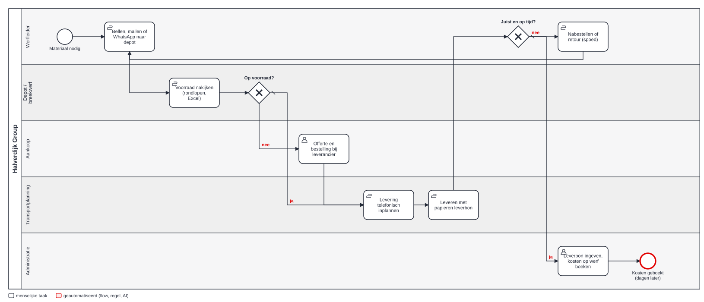
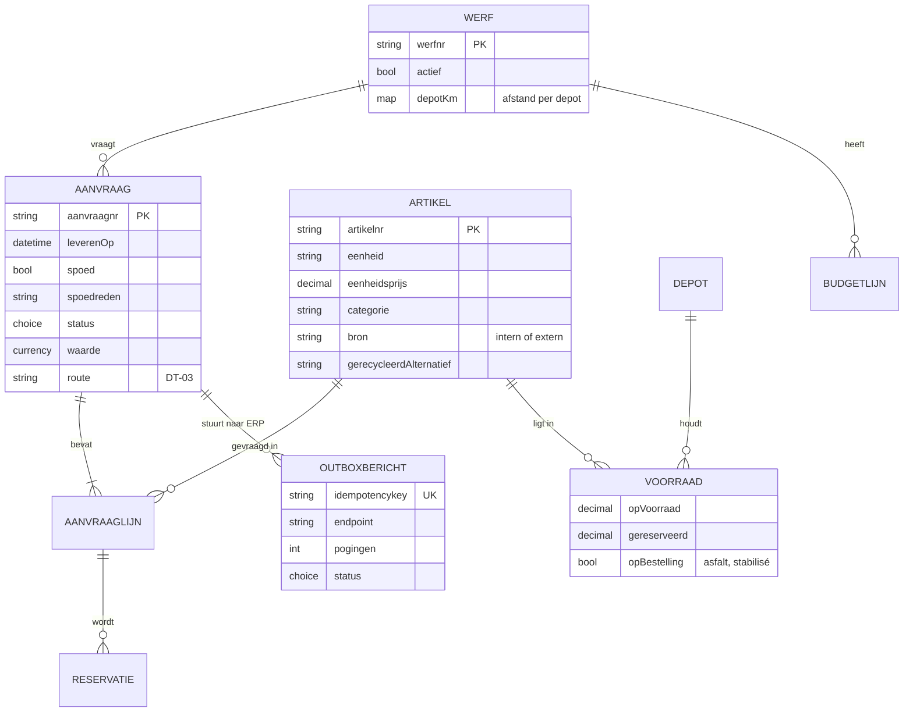

# 2 · Analyse — van aanvraag tot levering

## AS-IS-proces

Bron: [as-is.bpmn](bpmn/as-is.bpmn). <!--n:bpmn.c3_asis.tasks-->7<!--/n--> taken, geen enkele geautomatiseerd. Elke overdracht is een telefoon of een papiertje.

## Procesanalyse: waar zit de tijd?

| Stap | Wat gebeurt er | Wachttijd (typisch) | Waarom |
|---|---|---|---|
| Aanvragen | bellen of berichten | – | depot neemt niet op tijdens laden |
| Voorraad nakijken | rondlopen, Excel | 1–4 u | voorraad in ERP niet betrouwbaar per depot |
| Aankoop (indien nodig) | offerte, bestelling | 1–3 dagen | aankoop hoort het laat |
| Inplannen | telefoon naar planning | 2–20 u | planning wacht op bevestiging depot |
| Leveren | papieren leverbon | – | – |
| Boeken | leverbon overtypen | 2–10 dagen | bonnen komen per week binnen |

## Nulmeting

Bron: [requests-history.json](../data/requests-history.json), <!--n:c3.n-->60<!--/n--> fictieve aanvragen.

| Meting | Waarde |
|---|---|
| Kanalen | telefoon <!--n:c3.phone-->32<!--/n-->, mail <!--n:c3.mail-->20<!--/n-->, WhatsApp <!--n:c3.whatsapp-->8<!--/n--> |
| Spoedaanvragen (< 48 u verwittiging) | <!--n:c3.rushPct-->33%<!--/n--> |
| Mediaan tijd tot bevestiging | <!--n:c3.medianHandling-->15 uur<!--/n--> |
| Verkeerd artikel of hoeveelheid | <!--n:c3.wrongPct-->6,7%<!--/n--> |
| Te laat geleverd (alle / spoed) | <!--n:c3.latePct-->22%<!--/n--> / <!--n:c3.lateRushPct-->40%<!--/n--> |

## Datamodel (conceptueel)

**Waar staat wat?** Artikel, voorraad, depot en budget blijven in het **ERP** (principe P1) en worden live gelezen via de ERP-facade. Aanvraag, lijnen en outbox staan in **Dataverse**. Zo is er nooit een tweede voorraadadministratie. Volledig: [dataverse.json](artefacts/dataverse.json).

## Requirements

| ID | Requirement | Pijn | MoSCoW |
|---|---|---|---|
| F-01 | Aanvraag in de app: werf, artikels uit catalogus, hoeveelheid, gewenste levering | P-01, P-05 | Must |
| F-02 | Live beschikbaarheid per depot bij elke lijn | P-02 | Must |
| F-03 | Toewijzing aan het dichtstbijzijnde depot met voorraad; tekort → aankoop | P-02, P-04 | Must |
| F-04 | Spoed (< 48 u) herkennen, reden verplicht, planning verwittigen | P-03 | Must |
| F-05 | Goedkeuring volgens DT-03; kleine aanvragen binnen budget en op voorraad automatisch | P-07 | Must |
| F-06 | Reservatie en aankoopaanvraag in het ERP, betrouwbaar bij ERP-storing | P-04 | Must |
| F-07 | Ontvangst bevestigen met foto van de leverbon; verbruik op project boeken | P-06 | Must |
| F-08 | Gerecycleerd alternatief voorstellen als het op voorraad is (projectleider beslist) | P-04 | Should |
| F-09 | Weekplanning-scherm: aanvragen voor volgende week in één keer | P-03 | Should |
| F-10 | Ritten bundelen per zone | P-03 | Could |
| F-11 | Voorraad tellen in de app (depot) | P-02 | Won't (eerst ERP-voorraad op orde) |

| ID | Niet-functioneel |
|---|---|
| NF-01 | Voorraadopvraging < 3 s in de app |
| NF-02 | Geen ERP-boeking dubbel, ook niet bij herhaalde verzending |
| NF-03 | ERP-storing tot 6 u zonder verlies; daarna ticket |
| NF-04 | Elke boeking herleidbaar tot aanvraag, goedkeurder en leverbon |

## Uitzonderingen

| Uitzondering | Behandeling |
|---|---|
| Asfalt in het weekend | de app waarschuwt: de centrale draait alleen op weekdagen |
| Asfalt en stabilisé (op bestelling) | geen voorraadcheck, wel capaciteitsplanning bij de centrale (buiten MVP) |
| Werf afgesloten | aanvraag geweigerd |
| Voorraad intussen weg (409 bij reservatie) | aanvraag terug naar planning met melding |
| Gedeeltelijke levering | ontvangst per lijn bevestigen; rest blijft open |
