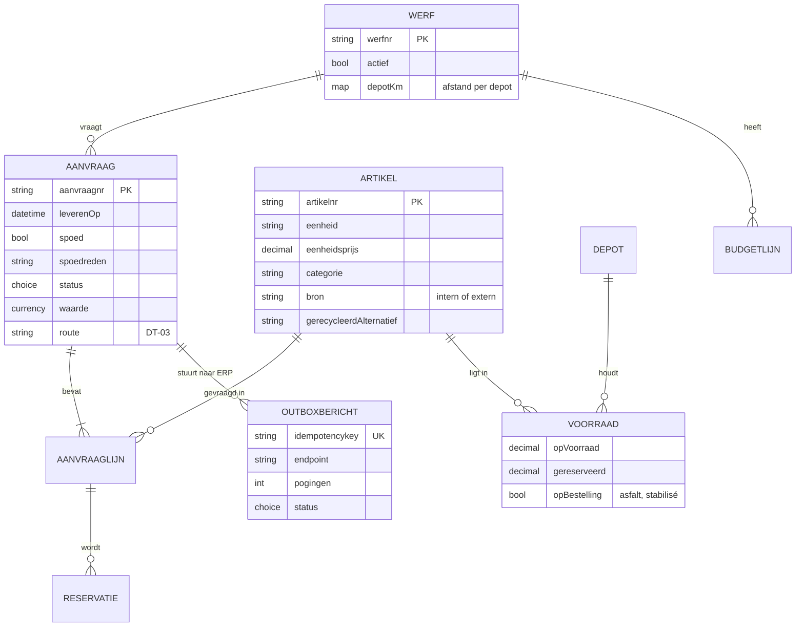

# 2 · Analyse — van aanvraag tot levering

## AS-IS-proces

Bron: [as-is.bpmn](bpmn/as-is.bpmn). <!--n:bpmn.c3_asis.tasks-->7<!--/n--> taken, geen enkele geautomatiseerd. Elke overdracht is een telefoon of een papiertje.

## Procesanalyse: waar zit de tijd?

| Stap | Wat gebeurt er | Wachttijd (typisch) | Waarom |
|---|---|---|---|
| Aanvragen | bellen of berichten | – | depot neemt niet op tijdens laden |
| Voorraad nakijken | rondlopen, Excel | 1–4 u | voorraad in ERP niet betrouwbaar per depot |
| Aankoop (indien nodig) | offerte, bestelling | 1–3 dagen | aankoop hoort het laat |
| Inplannen | telefoon naar planning | 2–20 u | planning wacht op bevestiging depot |
| Leveren | papieren leverbon | – | – |
| Boeken | leverbon overtypen | 2–10 dagen | bonnen komen per week binnen |

## Nulmeting

Bron: [requests-history.json](../data/requests-history.json), <!--n:c3.n-->60<!--/n--> fictieve aanvragen.

| Meting | Waarde |
|---|---|
| Kanalen | telefoon <!--n:c3.phone-->32<!--/n-->, mail <!--n:c3.mail-->20<!--/n-->, WhatsApp <!--n:c3.whatsapp-->8<!--/n--> |
| Spoedaanvragen (< 48 u verwittiging) | <!--n:c3.rushPct-->33%<!--/n--> |
| Mediaan tijd tot bevestiging | <!--n:c3.medianHandling-->15 uur<!--/n--> |
| Verkeerd artikel of hoeveelheid | <!--n:c3.wrongPct-->6,7%<!--/n--> |
| Te laat geleverd (alle / spoed) | <!--n:c3.latePct-->22%<!--/n--> / <!--n:c3.lateRushPct-->40%<!--/n--> |

## Datamodel (conceptueel)

**Waar staat wat?** Artikel, voorraad, depot en budget blijven in het **ERP** (principe P1) en worden live gelezen via de ERP-facade. Aanvraag, lijnen en outbox staan in **Dataverse**. Zo is er nooit een tweede voorraadadministratie. Volledig: [dataverse.json](artefacts/dataverse.json).

## Requirements

De requirements volgen de vier soorten van BABOK: **business** (wat de organisatie wil bereiken, SMART), **stakeholder** (wat een rol nodig heeft), **solution** (wat de oplossing moet doen: functioneel en niet-functioneel) en **transition** (wat nodig is om over te stappen, en daarna niet meer). Elke requirement heeft een bron, een eigenaar, een prioriteit, een stabiliteit en een status.

Dit register wordt gegenereerd uit [`data/requirements.json`](../data/requirements.json). De build faalt als een requirement verwijst naar een pijnpunt, story, BPMN-taak, flow, test of KPI die niet bestaat, of als een pijnpunt of story door geen enkele requirement gedekt is. Hoe elke requirement doorloopt tot test en KPI: [traceerbaarheid](traceerbaarheid.md). **Baseline 1.0** is gesimuleerd: in een echt project tekent de eigenaar per requirement; een wijziging daarna volgt het [wijzigingsbeheer](../shared-methodology/governance.md#wijzigingsbeheer-voor-requirements-en-regels).

<!--requirements:c3-->
#### Business

| ID | Requirement | Bron | Eigenaar | Prioriteit | Stabiliteit | Status |
|---|---|---|---|---|---|---|
| BR-01 | Binnen 6 maanden na go-live is hoogstens 20% van de aanvragen spoed (minder dan 48 uur vooraf; nu 33%). *(doel D1: Marge per werf: kosten sneller en juist op het project)* | nulmeting | Afdelingsverantwoordelijken | Must | middel | in baseline |
| BR-02 | Binnen 3 maanden wordt minstens 40% van de aanvragen automatisch goedgekeurd, met een doorlooptijd onder 1 uur. *(doel D2: Groeien zonder extra administratieve mensen)* | replay historiek | Werfplanning | Must | middel | in baseline |
| BR-03 | Vanaf go-live staan materiaalkosten dezelfde dag als de levering op de werf (nu 2 tot 10 dagen). *(doel D1: Marge per werf: kosten sneller en juist op het project)* | projectleiders | Administratie aankoop | Should | hoog | in baseline |
| BR-04 | Binnen 6 maanden geen externe aankoop meer van een artikel dat in een eigen depot op voorraad is. *(doel D4: Circulair bouwen: eigen gerecycleerd materiaal eerst)* | recyclage | Aankoop | Should | middel | in baseline |

#### Stakeholder

| ID | Requirement | Bron | Eigenaar | Prioriteit | Stabiliteit | Status |
|---|---|---|---|---|---|---|
| SR-01 | De werfleider vraagt materiaal aan met zicht op de voorraad, zonder te bellen. | ontdekkingsworkshop depot | Werfleiders | Must | hoog | in baseline |
| SR-02 | De werfplanning krijgt één lijst met tijdige aanvragen voor de juiste artikelen. | ontdekkingsworkshop depot | Werfplanning | Must | middel | in baseline |
| SR-03 | De projectleider weet tot welk bedrag hij zelf beslist, en het werfbudget wordt bewaakt. | interview projectleiders | Projectleiders | Must | middel | in baseline |
| SR-04 | Aankoop koopt niet extern als een eigen depot het artikel heeft. | interview aankoop | Aankoop | Should | hoog | in baseline |

#### Solution · functioneel

| ID | Requirement | Bron | Eigenaar | Prioriteit | Stabiliteit | Status |
|---|---|---|---|---|---|---|
| F-01 | Aanvraag in de app: werf, artikels uit de catalogus, hoeveelheid, gewenste levering. | workshop | Werfleiders | Must | hoog | gebouwd |
| F-02 | Live beschikbaarheid per depot bij elke lijn. *(uit de ERP-sandbox; het echte ERP via de facade is ontworpen)* | workshop | Werfplanning | Must | hoog | gebouwd |
| F-03 | Toewijzing aan het dichtstbijzijnde depot met voorraad; een tekort wordt een aankoop. | workshop | Werfplanning | Must | middel | gebouwd |
| F-04 | Spoed (minder dan 48 uur) herkennen, met een verplichte reden. | inzicht workshop (planningsprobleem) | Afdelingsverantwoordelijken | Must | middel | gebouwd |
| F-05 | Goedkeuring volgens DT-03; kleine aanvragen binnen budget en op voorraad gaan automatisch. | afdelingsverantwoordelijken | Afdelingsverantwoordelijken | Must | middel | gebouwd |
| F-06 | Reservatie en aankoopaanvraag in het ERP, betrouwbaar bij een ERP-storing. | IT | Functioneel beheer | Must | hoog | gebouwd |
| F-07 | Ontvangst bevestigen op de werf; het verbruik wordt op de werf geboekt. *(knop in de werfapp; de foto van de leverbon is ontworpen, niet gebouwd)* | projectleiders | Administratie aankoop | Must | middel | gebouwd |
| F-08 | Een gerecycleerd alternatief voorstellen als het op voorraad is; de projectleider beslist. | recyclage | Projectleiders | Should | middel | gebouwd |
| F-09 | Weekplanning-scherm: aanvragen voor volgende week in één keer. *(release 2; de afspraak zelf (TR-03) start eerder, zonder software)* | inzicht workshop | Werfplanning | Should | middel | ontworpen |
| F-10 | Ritten bundelen per zone. | transport | Werfplanning | Could | laag | ontworpen |
| F-11 | Voorraad tellen in de app (depot). *(eerst de ERP-voorraad op orde (TR-01))* | depot | Werfplanning | Won't | laag | buiten scope |

#### Solution · niet-functioneel

| ID | Requirement | Bron | Eigenaar | Prioriteit | Stabiliteit | Status |
|---|---|---|---|---|---|---|
| NF-01 | Voorraadopvraging in de app duurt minder dan 3 seconden. *(te meten tegen het echte ERP)* | werfleiders | Werfleiders | Must | hoog | ontworpen |
| NF-02 | Geen ERP-boeking dubbel, ook niet bij herhaalde verzending. | IT | Functioneel beheer | Must | hoog | gebouwd |
| NF-03 | Een ERP-storing tot 6 uur gaat zonder verlies; daarna een melding aan functioneel beheer. | IT | Functioneel beheer | Must | hoog | gebouwd |
| NF-04 | Elke boeking is herleidbaar tot aanvraag, goedkeurder en ontvangst. | audit | Administratie aankoop | Must | hoog | gebouwd |

#### Transition

| ID | Requirement | Bron | Eigenaar | Prioriteit | Stabiliteit | Status |
|---|---|---|---|---|---|---|
| TR-01 | De voorraad in het ERP wordt geteld en gecorrigeerd vóór go-live: de app toont wat het ERP zegt. | workshop ("200 ton in het systeem, 80 op de berg") | Werfplanning | Must | hoog | transitie |
| TR-02 | Werfbudgetten per categorie geladen, met een bevestigde eigenaar per werf. | afdelingsverantwoordelijken | Afdelingsverantwoordelijken | Must | middel | transitie |
| TR-03 | Een vaste weekplanning met de werfleiders start vóór de app (optie 0): aanvragen voor de week op vrijdag. | oorzaakanalyse | Afdelingsverantwoordelijken | Must | middel | transitie |
| TR-04 | Telefoon blijft voor noodgevallen; het depot registreert een telefonische aanvraag in de app, zodat spoed eerlijk gemeten wordt. | meetplan | Werfplanning | Must | hoog | transitie |
| TR-05 | Werfleiders en depot getraind; champion per afdeling. | change-impact | Afdelingsverantwoordelijken | Must | hoog | transitie |
<!--/requirements-->

## Uitzonderingen

| Uitzondering | Behandeling |
|---|---|
| Asfalt in het weekend | de app waarschuwt: de centrale draait alleen op weekdagen |
| Asfalt en stabilisé (op bestelling) | geen voorraadcheck, wel capaciteitsplanning bij de centrale (buiten MVP) |
| Werf afgesloten | aanvraag geweigerd |
| Voorraad intussen weg (409 bij reservatie) | aanvraag terug naar planning met melding |
| Gedeeltelijke levering | ontvangst per lijn bevestigen; rest blijft open |
