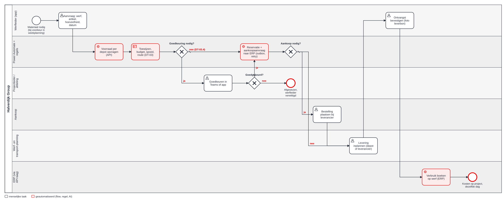
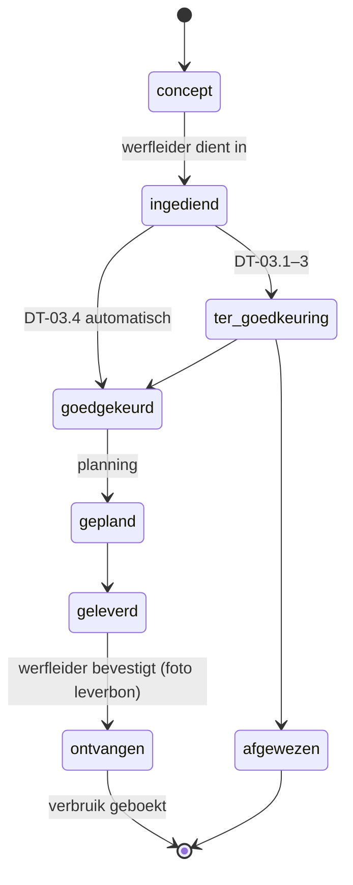

# 3 · Design — hoe moet het lopen?

## TO-BE-proces



Bron: [to-be.bpmn](bpmn/to-be.bpmn). <!--n:bpmn.c3_tobe.automated-->4<!--/n--> van de <!--n:bpmn.c3_tobe.tasks-->9<!--/n--> taken zijn geautomatiseerd. De werfleider doet nog twee dingen: aanvragen en ontvangst bevestigen.

## Toewijzing per depot

Per lijn, voor interne artikels:
1. depots met beschikbare voorraad (op voorraad − gereserveerd) zoeken;
2. sorteren op afstand tot de werf;
3. van het dichtste depot nemen, het tekort uit het volgende depot;
4. blijft er een tekort → aankoopaanvraag;
5. extern artikel → altijd aankoopaanvraag (met levertijd);
6. bestaat er een gerecycleerd alternatief op voorraad → tonen met besparing; **de projectleider beslist** (het bestek kan primair materiaal eisen).

Voorbeeld uit de tests: 240 t menggranulaat voor werf W-2604 → 160 t uit Depot Oost (4 km) + 80 t uit de breekwerf (6 km). Implementatie: [`allocateLine()`](../src/materials.mjs).

## Beslistabel DT-03 — moet er iemand goedkeuren?

Eerste passende rij wint.

| # | Voorwaarde | Goedkeuring |
|---|---|---|
| DT-03.1 | budgetlijn van de werf overschreden | Projectleider → Afdelingsverantwoordelijke |
| DT-03.2 | waarde > €10.000 | Projectleider → Afdelingsverantwoordelijke |
| DT-03.3 | waarde > €1.000, of aankoop nodig | Projectleider |
| DT-03.4 | anders (≤ €1.000, binnen budget, op voorraad) | **automatisch** |

Spoed verandert de goedkeuring niet. Wel wordt transportplanning meteen verwittigd, en de reden wordt bijgehouden.

Getest in drie lagen: [`approvalRoute()`](../src/materials.mjs), [dt-03-route.fx](artefacts/power-fx/dt-03-route.fx) ([8/8 gelijk in de echte Power Fx-engine](artefacts/power-fx/RESULTS.md)) en de actie `Route_DT03` in [de flow](artefacts/power-automate/materiaalaanvraag-verwerken.flow.json).

## Statusmodel



## User stories

### US-01 Aanvragen met zicht op voorraad
**Als** werfleider **wil ik** bij elke lijn zien of het materiaal op voorraad is en uit welk depot het komt **zodat** ik niet hoef te bellen.

```gherkin
Scenario: granulaat uit twee depots
  Gegeven werf W-2604 en 240 t MG-031
  En Depot Oost heeft 160 t beschikbaar (4 km) en de breekwerf 1.430 t (6 km)
  Als ik de lijn toevoeg
  Dan zie ik "op voorraad"
  En wijst de server 160 t toe aan Depot Oost en 80 t aan de breekwerf
```

### US-02 Kleine aanvraag automatisch goedgekeurd
**Als** projectleider **wil ik** niet lastiggevallen worden voor een paar werfhekken **zodat** ik alleen beslis waar het telt.

```gherkin
Scenario: signalisatie voor €602
  Gegeven een aanvraag van 12 borden F45 en 20 werfhekken, waarde €602
  En binnen budget en op voorraad
  Als de werfleider indient
  Dan is de route "DT-03.4 automatisch"
  En staan de reservaties binnen 2 minuten in de outbox
```

### US-03 Spoed met reden
**Als** afdelingsverantwoordelijke **wil ik** weten waarom er spoed gevraagd wordt **zodat** we de oorzaken (planning, opdrachtgever, vergeten) kunnen aanpakken.

```gherkin
Scenario: levering morgenochtend
  Gegeven nu is maandag 08:00 en de gewenste levering dinsdag 07:00
  Als ik een aanvraag indien zonder spoedreden
  Dan blokkeert de app met "Spoedaanvraag: kies een reden"
  En na het kiezen van een reden wordt transportplanning meteen verwittigd
```

### US-04 Budget bewaken
**Als** afdelingsverantwoordelijke **wil ik** elke aanvraag zien die het budget van een werf overschrijdt **zodat** ik het meerwerk kan bespreken voor het materiaal geleverd is.

```gherkin
Scenario: primair granulaat boven budget
  Gegeven werf W-2603 heeft nog €4.000 in budgetlijn granulaten
  Als de werfleider 180 t porfier (€4.320) aanvraagt
  Dan is de route Projectleider → Afdelingsverantwoordelijke (DT-03.1)
  En toont de app het gerecycleerde alternatief MG-031 met besparing €2.340
```

### US-05 ERP-storing merkt niemand op de werf
**Als** werfleider **wil ik** dat mijn goedgekeurde aanvraag doorloopt, ook als het ERP even weg is **zodat** mijn levering niet stilvalt.

```gherkin
Scenario: ERP 20 minuten onbereikbaar
  Gegeven een goedgekeurde aanvraag met 3 ERP-berichten
  En het ERP antwoordt 503 tot minuut 20
  Als de outbox verstuurt
  Dan wordt na 1, 5 en 15 minuten opnieuw geprobeerd
  En is elk bericht in poging 4 (minuut 21) precies één keer geboekt
```

## Schermen (ontwerp)

Werfapp-tegel "Materiaal": werf kiezen → datum en uur → lijnen toevoegen (zoeken in de catalogus, beschikbaarheid meteen zichtbaar) → samenvatting met waarde en verwachte route → indienen. Bron: [materiaalaanvraag.pa.yaml](artefacts/power-apps/materiaalaanvraag.pa.yaml).
