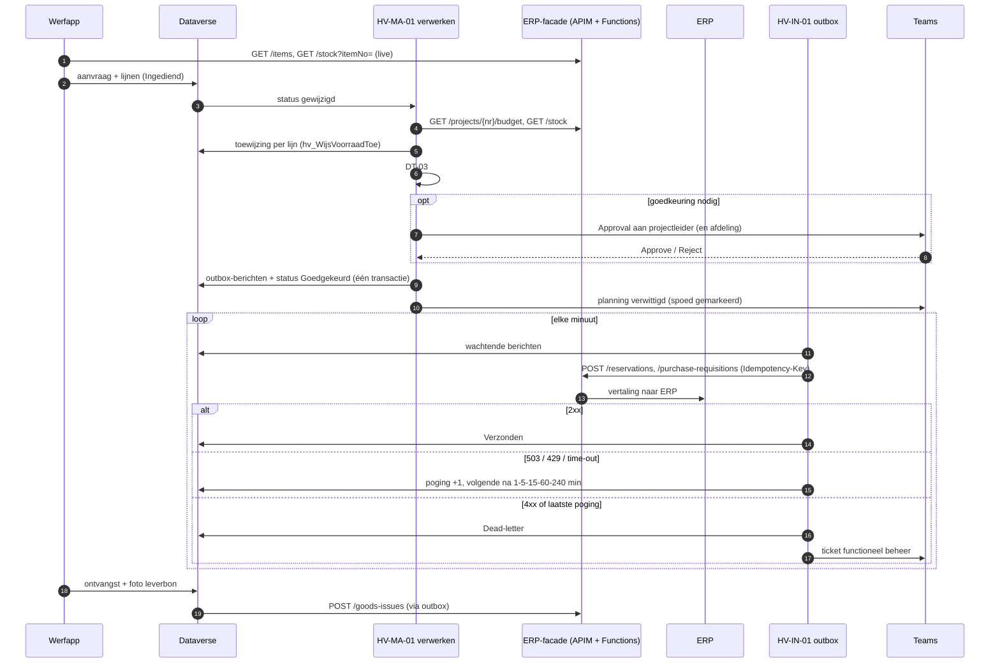

# 5 · Integrate & automate — ERP-koppeling met foutafhandeling

## Integratievoorstel

## API-contract

[erp-material-api.openapi.yaml](artefacts/erp-material-api.openapi.yaml) (OpenAPI 3.0.3), gebruikt als **custom connector** in Power Platform.

| Endpoint | Doel | Idempotent | Typische fouten |
|---|---|---|---|
| `GET /items` | catalogus | – | – |
| `GET /stock` | beschikbaarheid per depot | – | 404 artikel, 503 |
| `GET /projects/{nr}/budget` | resterend budget per categorie | – | 404 werf |
| `POST /reservations` | voorraad reserveren | ja | 409 voorraad intussen weg, 422, 429, 503 |
| `POST /purchase-requisitions` | aankoopaanvraag | ja | 422, 503 |
| `POST /goods-issues` | verbruik op werf boeken | ja | 422, 503 |
| `POST /project-costs` | schadekost op project (case 02) | ja | 422, 503 |

## Foutafhandeling

| Fout | Soort | Wat de outbox doet | Wie handelt af |
|---|---|---|---|
| 503, 429, time-out | tijdelijk | opnieuw na 1, 5, 15, 60, 240 min | niemand (automatisch) |
| na laatste poging nog altijd tijdelijk | aanhoudend | dead-letter + Teams-ticket | functioneel beheer |
| 409 voorraad weg | functioneel | dead-letter; aanvraag terug naar planning | planning |
| 422 inhoudelijk (artikel geblokkeerd, werf dicht) | functioneel | dead-letter + ticket met `correlationId` | functioneel beheer |
| antwoord verloren na geslaagde boeking | technisch | retry met dezelfde sleutel → facade antwoordt 200 "al geboekt" | niemand |

De outbox is getest: herstel na 20 minuten, dead-letter na de laatste poging, en een herhaalde verzending die niet opnieuw boekt ([tests](../tests/materials.test.mjs)). In de demo kun je het ERP uitzetten en dit zelf zien.

## Artefacten

> **Ontwerp en gebouwd.** De flowbestanden hieronder zijn het doelontwerp, met de ERP-facade. Wat echt draait in de ontwikkelomgeving staat per flow beschreven, in gewone taal en met bewijs: [HV-MA-01 Materiaalaanvraag verwerken](../power-platform/flows/HV-MA-01.md) en [HV-MA-02 ERP-outbox verzenden](../power-platform/flows/HV-MA-02.md). Overzicht: [de zeven flows](../power-platform/flows/README.md).

| Artefact | Wat |
|---|---|
| [materiaalaanvraag-verwerken.flow.json](artefacts/power-automate/materiaalaanvraag-verwerken.flow.json) | ontwerp: budget, voorraad, toewijzing, DT-03, Approvals, outbox, planning |
| [erp-outbox-verzenden.flow.json](artefacts/power-automate/erp-outbox-verzenden.flow.json) | ontwerp: outbox met retry-schema en dead-letter |
| [materiaalaanvraag.pa.yaml](artefacts/power-apps/materiaalaanvraag.pa.yaml) | werfapp-scherm met live voorraad, spoed en alternatieven |
| [dataverse.json](artefacts/dataverse.json) | aanvraag, lijnen, outbox, custom APIs |
| [dt-03-route.fx](artefacts/power-fx/dt-03-route.fx) | DT-03 in Power Fx |

## Security

- De custom connector gebruikt OAuth 2.0 met Entra ID. De app-gebruiker leest (voorraad, catalogus); schrijven gebeurt alleen door de flow met een **service principal**.
- API Management: throttling per client, logging met `correlationId`, IP-restrictie op de facade.
- Geen secrets in flows: managed identity of Key Vault.
