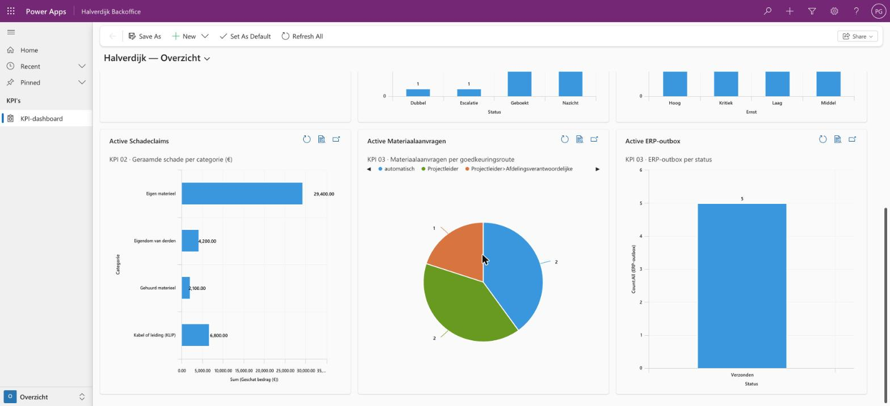

# Halverdijk Backoffice

| | |
|---|---|
| Type | Power Apps **model-driven app**, in de solution `HalverdijkTransformatie` · opgebouwd door [`provision-app.mjs`](../scripts/provision-app.mjs) |
| Cases | alle drie |
| Gebruikers | administratie recyclage, milieucoördinator, claims & verzekeringen, fleetmanager, projectleiders, aankoop & logistiek, functioneel beheer |
| Openen | [in Dynamics](https://halverdijkdev.crm17.dynamics.com/main.aspx?appid=fb7afac1-35c9-f111-a05c-6045bd29a82d) (alleen met toegang tot de ontwikkelomgeving) |

## Doel

Kantoor ziet alles wat de flows deden, per case, in lijsten en formulieren die Power Platform zelf opbouwt uit de tabellen. Hier volg je op, beoordeel je, en beheer je de stamgegevens waar de regels op steunen. Een model-driven app vraagt geen eigen code: de tabellen, de weergaven en de navigatie zijn de app.

## Navigatie

| Gebied | Groep | Tabellen |
|---|---|---|
| **Overzicht** (startpagina) | KPI's | het KPI-dashboard, zie hieronder |
| **01 Weegbonnen** | Recyclage | Weegbon, ERP-boeking (sandbox) |
| | Stamgegevens | Klant, Nummerplaat, Materiaalcode (acceptatielijst) |
| **02 Schadeclaims** | Dossiers | Schadeclaim, Tijdlijn |
| | Instellingen | Werf |
| **03 Materiaal** | Aanvragen | Materiaalaanvraag, Aanvraaglijn, ERP-outbox |
| | ERP-sandbox | Artikel, Voorraad, Depot, Afstand werf–depot, Werfbudget |
| **Beheer** | Opvolging | Melding, ERP-outbox, KPI-meting |
| | Regels en rollen | Bedrijfsregel, Rol (goedkeurder en ontvanger) |

## Wat je in de lijsten ziet

| Tabel | Kolommen |
|---|---|
| Weegbon | documentnr, status, beslissing, bonnummer, klant, materiaal, netto, laagste confidence, ERP-referentie |
| Schadeclaim | dossiernummer, status, ernst, categorie, werf, raming, eigenaar, goedkeuringsketen, deadline beoordeling, deadline verzekeraar |
| Materiaalaanvraag | aanvraagnr, status, werf, leveren op, spoed, waarde, route, regel, budget overschreden |
| ERP-outbox | sleutel, status, endpoint, pogingen, volgende poging, laatste resultaat, referentie |
| Bedrijfsregel | code, naam, parameter, eenheid, case, eigenaar |
| Melding | titel, soort, status, voor rol, kanaal, bron (flow), referentie |
| KPI-meting | naam, maand, case, KPI, waarde, eenheid, bron (simulatie of meting) |

Op de formulieren staan de gerelateerde rijen als subraster: de **tijdlijn** bij een schadeclaim, de **lijnen met toewijzing** en de **ERP-berichten** bij een aanvraag, de **budgetlijnen** en **afstanden** bij een werf.

| | |
|---|---|
|  Weegbonnen met status, beslissing en ERP-referentie |  Schadeclaims met ernst, eigenaar, keten en deadlines |
|  Aanvraaglijnen: toewijzing per depot |  ERP-outbox tijdens de storingstest |

## KPI-dashboard

De app opent op het dashboard *Halverdijk — Overzicht*: negen grafieken, rechtstreeks op de Dataverse-tabellen, dus altijd de stand van nu. Elke grafiek beantwoordt één vraag uit fase 7 (Measure & improve).

| Grafiek | De vraag erachter | Hoort bij |
|---|---|---|
| Weegbonnen per beslissing | Welk deel boekt de flow zelf, welk deel ziet een mens? | [C1-K1 automatisch geboekt](../../01-document-intelligence/07-measure-improve.md) |
| Weegbonnen per status | Hoeveel bonnen wachten op nazicht of escalatie? | werkvoorraad administratie |
| Schadeclaims per ernst | Hoeveel kritieke en hoge dossiers lopen er? | [case 02 · KPI's](../../02-construction-claims/07-measure-improve.md) |
| Geraamde schade per categorie (€) | Waar zit de schade in euro? | case 02 |
| Materiaalaanvragen per goedkeuringsroute | Welk deel gaat automatisch door (DT-03.4)? | [case 03 · KPI's](../../03-material-requests/07-measure-improve.md) |
| ERP-outbox per status | Staat er iets in dead-letter? | runbook functioneel beheer |
| Uren vrij per maand (simulatie) | Hoeveel uren komen elke maand vrij, alle cases samen? | [batenrealisatie](https://phlppgdfry.github.io/construction-digital-transformation/baten/) |
| Netto resultaat cumulatief (simulatie) | Wanneer is het programma terugverdiend? | batenrealisatie |
| Meldingen per soort | Hoeveel acties, waarschuwingen en fouten staan er? | [monitoring](../flows/README.md#monitoring-wie-ziet-een-mislukte-run-en-hoe-snel) |

De twee batengrafieken lezen de tabel *KPI-meting*. Daar staat nu de simulatie (bron *Simulatie*, scenario verwacht, geladen door [`seed-kpi.mjs`](../scripts/seed-kpi.mjs)). Na een echte go-live komen er metingen bij (bron *Meting*), en tonen dezelfde grafieken de werkelijkheid. Elke grafiek leest een eigen weergave die op één KPI filtert.

Klik op een stuk van een grafiek en je ziet de rijen erachter. Opgebouwd door [`provision-dashboard.mjs`](../scripts/provision-dashboard.mjs) (systeemgrafieken + systeemdashboard, in de solution); de lijst van grafieken staat in [`dashboard-charts.mjs`](../scripts/dashboard-charts.mjs).

## Meldingen (het belletje)

De flows verwittigen niemand rechtstreeks: ze schrijven een rij in *Melding*, en [HV-OP-01](../flows/HV-OP-01.md) levert die af als **in-app-notificatie** in deze app (het belletje rechtsboven), met een knop *Openen* naar het dossier, de bon of de aanvraag. Daarvoor staat de app-instelling *in-app notifications* aan; dat is een instelling van deze app, geen tenantinstelling. Externe partijen (verzekeraar, klant, vervoerder) krijgen een melding met kanaal *Extern*: dat kanaal is in de ontwikkelomgeving niet aangesloten.

## Regels wijzigen

*Beheer* → *Bedrijfsregels* toont elke regel in gewone taal, met de parameter en de eigenaar. Een parameter wijzigen is een configuratiewijziging: de volgende run van elke flow gebruikt de nieuwe waarde. Wie mag wijzigen en hoe de repo daarna volgt, staat in het [wijzigingsbeheer](../../shared-methodology/governance.md#wijzigingsbeheer-voor-requirements-en-regels).

| | |
|---|---|
|  Weegbonnen per beslissing en status, claims per ernst |  Schade per categorie, aanvragen per route, outbox per status |

## Wie doet hier wat

| Rol | In de app | Start een flow? |
|---|---|---|
| Administratie | weegbonnen opvolgen; nakijken gebeurt in [Weegbon Nakijken](weegbon-nakijken.md) | – |
| Milieucoördinator | de acceptatielijst (Materiaalcode) bijhouden | – |
| Claims & verzekeringen, fleetmanager | dossier beoordelen; status op *Ter goedkeuring* zetten | ja: [HV-CL-02](../flows/HV-CL-02.md) |
| Aankoop & logistiek | aanvragen, toewijzing en outbox opvolgen; budgetten en voorraad (sandbox) | – |
| Functioneel beheer | fout-meldingen en dead-letters opvolgen ([runbook](../../03-material-requests/06-implement.md#runbook-dead-letter)); rollen en bedrijfsregels bijhouden | – |
| Claims & verzekeringen | dossier afsluiten met de werkelijke kost; *Aangifte verstuurd* aanvinken | ja: [HV-CL-04](../flows/HV-CL-04.md) bij *Afgesloten* |
| Milieucoördinator, administratie | een bon weigeren of afwijzen in Weegbon Nakijken | ja: [HV-DI-03](../flows/HV-DI-03.md) |

## Grenzen

- In deze ontwikkelomgeving is er één gebruiker met alle rechten. In productie krijgt elke rol een beveiligingsrol met alleen zijn tabellen.
- De tabellen met "(ERP-sandbox)" staan voor het ERP. In productie komen die gegevens uit het ERP zelf, via de ERP-facade ([OpenAPI](../../03-material-requests/artefacts/erp-material-api.openapi.yaml)).
- Het dashboard in de app telt wat in Dataverse staat. KPI's over tijd en geld (doorlooptijd, uren, baten, trend per week) horen in Power BI, zoals ontworpen in fase 7; die cijfers staan nu op de [site](../../site/index.html), berekend uit het model.

## Opnieuw opbouwen

```sh
node power-platform/scripts/seed-kpi.mjs              # KPI-metingen (simulatie) voor de batengrafieken
node power-platform/scripts/provision-dashboard.mjs   # negen grafieken + het KPI-dashboard
node power-platform/scripts/provision-app.mjs         # formulieren, weergaven, sitemap (dashboard eerst), in-app-meldingen aan
```

De app zit in de solution-export ([`solution/`](../solution/)) en komt mee bij `pac solution import`.
