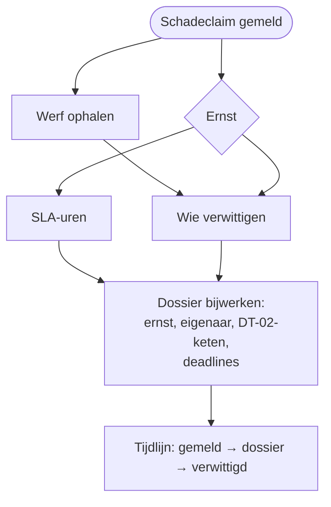

# HV-CL-01 Schadeclaim intake en triage

| | |
|---|---|
| Case | [02 Schadeclaims](../../02-construction-claims/README.md) |
| User stories | [US-02 Leidingschade veilig afhandelen](../../02-construction-claims/03-design.md#us-02-leidingschade-veilig-afhandelen), [US-03 Goedkeuren volgens één regel](../../02-construction-claims/03-design.md#us-03-goedkeuren-volgens-één-regel), [US-04 Aangifte nooit te laat](../../02-construction-claims/03-design.md#us-04-aangifte-nooit-te-laat) |
| Eigenaar | claims & verzekeringen |
| Komt na | melding in de [werfapp](../apps/werfapp.md) · **Volgende stap** [HV-CL-02](HV-CL-02.md) (goedkeuring) en [HV-CL-03](HV-CL-03.md) (bewaking) |

## Doel

Van een melding binnen een halve minuut een dossier maken: hoe ernstig, wie is eigenaar, wie moet goedkeuren, tegen wanneer, en wie moet het nu al weten. Vandaag hangt dat af van wie de mail leest. Hier volgt het één regel ([DT-02](../../02-construction-claims/03-design.md#beslistabel-dt-02--wie-keurt-goed)), en elke stap staat in de tijdlijn.

## Trigger

Een rij wordt **toegevoegd** in *Schadeclaim* (`hv_schadeclaim`). De werfapp maakt die rij aan bij *Schade melden*. De werfapp heeft de melding al gevalideerd met dezelfde motor als de tests.

## Invoer en uitvoer

| Leest | Kolommen |
|---|---|
| de nieuwe claim | `hv_categorie`, `hv_geschatbedrag`, `hv_typeleiding`, `hv_beheerderverwittigd`, `hv_derdebetrokken`, `hv_tijdstipschade`, `hv_melder`, de werf |
| Werf | `hv_werfnr`, `hv_projectleider` |

| Schrijft | Kolommen |
|---|---|
| Schadeclaim | `hv_status` → *In beoordeling*, `hv_ernst`, `hv_eigenaar`, `hv_goedkeuringsketen` (bv. `Fleetmanager>Projectleider`), `hv_goedkeuringsniveau` = 0, `hv_verwittigd`, `hv_deadlinebeoordeling`, `hv_deadlineverzekeraar` |
| Tijdlijn | drie regels: *gemeld*, *dossier aangemaakt* (met ernst, eigenaar en keten), *verwittigd* |

## Stappen

1. Tegelijk: de werf ophalen (voor de projectleider) en de **ernst** bepalen.
2. Uit de ernst de **beoordelingstermijn** (SLA) halen; uit werf, categorie en ernst de lijst van wie **verwittigd** wordt.
3. Het dossier bijwerken: status, ernst, eigenaar, keten, deadlines, verwittigd.
4. Drie regels in de tijdlijn.

## Beslisregels

| Wat | Regel |
|---|---|
| Ernst | **kritiek**: leidingschade aan gas of elektriciteit, of de beheerder is niet verwittigd · **hoog**: raming ≥ drempel (€15.000) · **middel**: raming ≥ €2.500 of een derde betrokken · **laag**: de rest ([triage](../../02-construction-claims/03-design.md#triage)) |
| Beoordelen binnen | kritiek 2 u · hoog 24 u · middel 48 u · laag 72 u |
| Eigenaar | materieel (eigen of gehuurd) → Fleetmanager · derden, kabels en leidingen → Claims & verzekeringen · eigen werk → de projectleider van de werf |
| Goedkeuringsketen ([DT-02](../../02-construction-claims/03-design.md#beslistabel-dt-02--wie-keurt-goed)) | eerst de beoordelaar per categorie, dan per bedrag: ≤ €2.500 Projectleider · tot €15.000 + Afdelingsverantwoordelijke · daarboven + Directie |
| Verzekeringsaangifte | raming ≥ drempel, schade aan derden of aan leidingen, of een derde betrokken → deadline = tijdstip schade + 8 dagen |
| Verwittigd | altijd de projectleider; + Claims & verzekeringen bij derden of leidingen; + verhuurder bij gehuurd materieel; + leidingbeheerder en preventieadviseur bij leidingschade; + afdelingsverantwoordelijke bij kritiek |

Dezelfde regels, getest: [`triage()` en `approvalChain()`](../../src/claims.mjs), en in Power Fx [dt-02-goedkeuringsketen.fx](../../02-construction-claims/artefacts/power-fx/dt-02-goedkeuringsketen.fx).

## Foutafhandeling

| Wat kan misgaan | Wat de flow doet |
|---|---|
| De werf is niet gevonden | de run faalt vóór het dossier bijgewerkt is; de claim blijft op *Gemeld* en valt op in de backoffice-weergave. Opnieuw indienen is veilig: de flow overschrijft dezelfde kolommen. |
| Geen tijdstip van de schade | de verzekeringsdeadline rekent vanaf nu (de strengste keuze). |
| Dezelfde melding twee keer verstuurd (geen bereik, later opnieuw) | de werfapp stuurt een client-id mee; de alternatieve sleutel op `hv_clientid` weigert de tweede rij, dus er start geen tweede triage. |

## Configuratie

| Wat | Waarde | Waar |
|---|---|---|
| `hv_InsurerThreshold` | €15.000 | omgevingsvariabele (polisclausule, illustratief) |
| Grenzen €2.500 en €15.000 in de keten, SLA-uren | vast in de flow | wijzigen = nieuwe versie, samen met DT-02 |
| Rol → persoon | tabel *Goedkeurder* | backoffice-app |

## Bewijs

- **5/5 identiek** met de geteste motor: ernst, eigenaar, goedkeuringsketen en verzekeringsaangifte ([VERIFICATION.md](../VERIFICATION.md#case-02--schadeclaims-flow-hv-cl-01-triage--dt-02)).
- Gaslek (SCH-26-1005): kritiek, eigenaar Claims & verzekeringen, vijf partijen verwittigd ([screenshot](../screenshots/09-app-schadeclaim-gaslek.jpg), [tijdlijn](../screenshots/10-app-schadeclaim-tijdlijn.jpg)).

## Beheer

- **Volgen:** backoffice-app → *02 Schadeclaims*; de tijdlijn per dossier is het auditspoor.
- **Regel wijzigen:** eerst [`src/claims.mjs`](../../src/claims.mjs) + test, dan [`definitions.mjs`](definitions.mjs), dan `provision-flows.mjs --only=HV-CL-01 --activate`, dan `verify.mjs`.

## Ontwerp en gebouwd

| | Doelontwerp ([schadeclaim-intake.flow.json](../../02-construction-claims/artefacts/power-automate/schadeclaim-intake.flow.json)) | Gebouwd |
|---|---|---|
| Servervalidatie | onvolledige melding → info vragen en stoppen | validatie in de werfapp, met dezelfde motor |
| Verwittigen | Teams-kaart naar de eigenaar | lijst in `hv_verwittigd` en in de tijdlijn; geen Teams-bericht |
| Verzekering | conceptmail naar claims | deadline in het dossier; geen mail |

## Technische stappen

<!--actions:HV-CL-01-->
*Gegenereerd uit [`definitions.mjs`](definitions.mjs) door `npm run build`. Niet met de hand aanpassen.* 8 acties · verbindingen: Microsoft Dataverse · omgevingsvariabelen: `hv_InsurerThreshold` (standaard 15000).

- **Trigger `Schadeclaim_gemeld`**: Dataverse, rij toegevoegd in *Schadeclaim* (`hv_schadeclaim`)
- `Werf`: één rij ophalen uit *Werf* · start parallel
- `Ernst`: berekening · start parallel
- `SLA_uren`: berekening
- `Verwittigd`: berekening
- `Dossier_bijwerken`: rij bijwerken in *Schadeclaim*: `hv_status`, `hv_ernst`, `hv_goedkeuringsketen`, `hv_goedkeuringsniveau`, `hv_eigenaar`, `hv_verwittigd`, `hv_deadlinebeoordeling`, `hv_deadlineverzekeraar`
- `Tijdlijn_gemeld`: rij toevoegen in *Tijdlijn*: `hv_gebeurtenis`, `hv_door`, `hv_opmerking`, `hv_Schadeclaim`
- `Tijdlijn_dossier`: rij toevoegen in *Tijdlijn*: `hv_gebeurtenis`, `hv_door`, `hv_opmerking`, `hv_Schadeclaim`
- `Tijdlijn_verwittigd`: rij toevoegen in *Tijdlijn*: `hv_gebeurtenis`, `hv_door`, `hv_opmerking`, `hv_Schadeclaim`
<!--/actions-->
