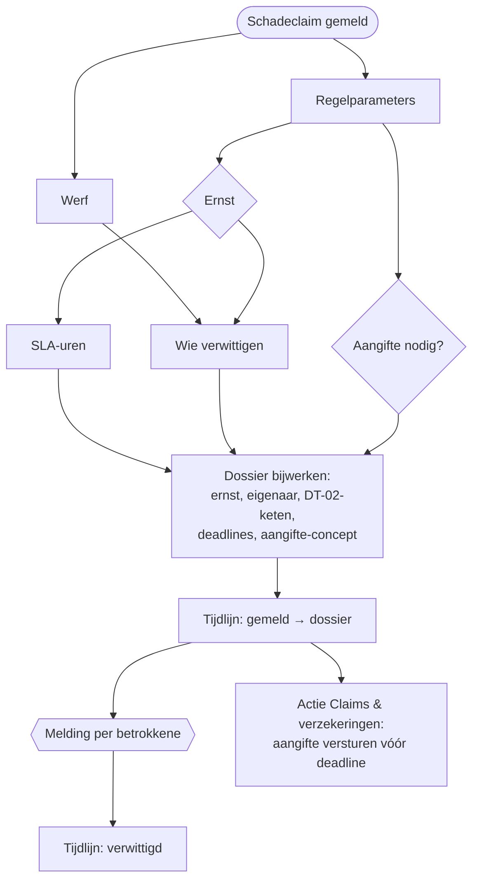

# HV-CL-01 Schadeclaim intake en triage

| | |
|---|---|
| Case | [02 Schadeclaims](../../02-construction-claims/README.md) |
| User stories | [US-02 Leidingschade veilig afhandelen](../../02-construction-claims/03-design.md#us-02-leidingschade-veilig-afhandelen), [US-03 Goedkeuren volgens één regel](../../02-construction-claims/03-design.md#us-03-goedkeuren-volgens-één-regel), [US-04 Aangifte nooit te laat](../../02-construction-claims/03-design.md#us-04-aangifte-nooit-te-laat) |
| BPMN (TO-BE) | *Dossier aanmaken + triage*, *Betrokkenen verwittigen*, *Aangifte-concept naar verzekeraar*, *Goedkeuringsketen bepalen (DT-02)* |
| Eigenaar | claims & verzekeringen |
| Komt na | melding in de [werfapp](../apps/werfapp.md) · **Volgende stap** [HV-CL-02](HV-CL-02.md) (goedkeuring) en [HV-CL-03](HV-CL-03.md) (bewaking) |

## Doel

Van een melding binnen een halve minuut een dossier maken: hoe ernstig, wie is eigenaar, wie moet goedkeuren, tegen wanneer, wie moet het nu al weten, en of de verzekeraar een aangifte moet krijgen. Vandaag hangt dat af van wie de mail leest. Hier volgt het één regel ([DT-02](../../02-construction-claims/03-design.md#beslistabel-dt-02--wie-keurt-goed)), elke betrokkene krijgt een melding, en elke stap staat in de tijdlijn.

## Trigger

Een rij wordt **toegevoegd** in *Schadeclaim* (`hv_schadeclaim`). De werfapp maakt die rij aan bij *Schade melden*, na validatie met dezelfde motor als de tests.

## Invoer en uitvoer

| Leest | Kolommen |
|---|---|
| de nieuwe claim | `hv_categorie`, `hv_geschatbedrag`, `hv_typeleiding`, `hv_beheerderverwittigd`, `hv_derdebetrokken`, `hv_naamderde`, `hv_tijdstipschade`, `hv_locatie`, `hv_omschrijving`, `hv_melder`, de werf |
| Bedrijfsregel | ER-02, DT-02.1, DT-02.2, VZ-01, VZ-02, SLA-K/H/M/L |
| Werf | `hv_werfnr`, `hv_projectleider` |

| Schrijft | Kolommen |
|---|---|
| Schadeclaim | `hv_status` → *In beoordeling*, `hv_ernst`, `hv_eigenaar`, `hv_goedkeuringsketen`, `hv_goedkeuringsniveau` = 0, `hv_verwittigd`, `hv_deadlinebeoordeling`, `hv_deadlineverzekeraar`, `hv_aangifteconcept` |
| Tijdlijn | *gemeld*, *dossier aangemaakt*, *verwittigd*, en bij een aangifte *aangifte-concept klaargezet* |
| Melding | één per betrokkene (intern in-app, extern gemarkeerd), plus een actie voor Claims & verzekeringen als er een aangifte nodig is |

## Stappen

1. Tegelijk: de regelparameters lezen en de werf ophalen.
2. De **ernst** bepalen, daaruit de **beoordelingstermijn**; bepalen of er een **aangifte** nodig is; de lijst van wie **verwittigd** wordt.
3. Het dossier bijwerken: status, ernst, eigenaar, keten, deadlines, verwittigd en, als het moet, het **aangifte-concept** (tijdstip, plaats, wat gebeurde, raming, derde, KLIP, aantal foto's).
4. Tijdlijn: *gemeld*, *dossier aangemaakt*.
5. Tegelijk: een melding per betrokkene, en bij een aangifte een actie voor Claims & verzekeringen met de deadline.
6. Tijdlijn: *verwittigd*.

## Beslisregels

Alle drempels staan in de [regelcatalogus](../../shared-methodology/regelcatalogus.md#case-02) en in de tabel *Bedrijfsregel*.

| Wat | Regel |
|---|---|
| Ernst | **kritiek** (ER-01): leidingschade aan gas of elektriciteit, of de beheerder is niet verwittigd · **hoog**: raming ≥ VZ-01 · **middel**: raming ≥ ER-02 of een derde betrokken · **laag**: de rest |
| Beoordelen binnen | SLA-K, SLA-H, SLA-M, SLA-L uur |
| Eigenaar | materieel → Fleetmanager · derden, kabels en leidingen → Claims & verzekeringen · eigen werk → de projectleider van de werf |
| Goedkeuringsketen (DT-02) | eerst de beoordelaar per categorie, dan per bedrag: ≤ DT-02.1 Projectleider · ≤ DT-02.2 + Afdelingsverantwoordelijke · daarboven + Directie |
| Verzekeringsaangifte | raming ≥ VZ-01, schade aan derden of leidingen, of een derde betrokken → deadline = tijdstip schade + VZ-02 dagen, en een concept in het dossier |
| Verwittigd | altijd de projectleider; + Claims & verzekeringen bij derden of leidingen; + verhuurder (extern) bij gehuurd materieel; + leidingbeheerder (extern) en preventieadviseur bij leidingschade; + afdelingsverantwoordelijke bij kritiek |

Dezelfde regels, getest: [`triage()` en `approvalChain()`](../../src/claims.mjs), en in Power Fx [dt-02-goedkeuringsketen.fx](../../02-construction-claims/artefacts/power-fx/dt-02-goedkeuringsketen.fx).

**Waarom de aangifte niet vanzelf vertrekt:** verzekeraars werken met een eigen portaal of een vaste mail, en een aangifte is een verklaring waarvoor iemand tekent. De flow zet het concept klaar en bewaakt de termijn ([HV-CL-03](HV-CL-03.md)); Claims & verzekeringen verstuurt en vinkt *Aangifte verstuurd* aan.

## Foutafhandeling

| Wat kan misgaan | Wat de flow doet |
|---|---|
| De werf is niet gevonden, of een andere stap faalt | `Bij_fout`: de claim krijgt status *Fout*, functioneel beheer krijgt een melding met de mislukte stap en de run-link. Opnieuw indienen is veilig: de flow overschrijft dezelfde kolommen. |
| Geen tijdstip van de schade | de verzekeringsdeadline rekent vanaf nu (de strengste keuze). |
| Dezelfde melding twee keer verstuurd (geen bereik, later opnieuw) | de werfapp stuurt een client-id mee; de alternatieve sleutel op `hv_clientid` weigert de tweede rij, dus er start geen tweede triage. |
| Een rol heeft geen persoon | de melding krijgt in [HV-OP-01](HV-OP-01.md) de status *Mislukt*, met de reden. |

## Configuratie

| Wat | Waar |
|---|---|
| Drempels en termijnen | tabel *Bedrijfsregel* (backoffice-app, *Beheer*) |
| Rol → persoon | tabel *Rol (goedkeurder en ontvanger)* |

## Bewijs

- **5/5 identiek** met de geteste motor: ernst, eigenaar, goedkeuringsketen en verzekeringsaangifte ([VERIFICATION.md](../VERIFICATION.md#case-02--schadeclaims-flow-hv-cl-01-triage--dt-02)).
- Meldingen en aangifte-concepten per dossier: [VERIFICATION.md](../VERIFICATION.md#meldingen).

## Beheer

- **Volgen:** backoffice-app → *02 Schadeclaims*; de tijdlijn per dossier is het auditspoor.
- **Drempel wijzigen:** in *Bedrijfsregel*; daarna [`src/rules.mjs`](../../src/rules.mjs) gelijkzetten (`verify.mjs` meldt het verschil).

## Ontwerp en gebouwd

| | Doelontwerp ([schadeclaim-intake.flow.json](../../02-construction-claims/artefacts/power-automate/schadeclaim-intake.flow.json)) | Gebouwd |
|---|---|---|
| Servervalidatie | onvolledige melding → info vragen en stoppen | validatie in de werfapp, met dezelfde motor |
| Verwittigen | Teams-kaart naar de eigenaar | rij in *Melding* → in-app-notificatie; externe partijen gemarkeerd |
| Verzekering | conceptmail naar claims | concept in het dossier + actie-melding; de termijn bewaakt door HV-CL-03 |

## Technische stappen

<!--actions:HV-CL-01-->
*Gegenereerd uit [`definitions.mjs`](definitions.mjs) door `npm run build`. Niet met de hand aanpassen.* 25 acties · verbindingen: Microsoft Dataverse · omgevingsvariabelen: geen · regels uit *Bedrijfsregel*: `VZ-01`, `ER-02`, `SLA-K`, `SLA-H`, `SLA-M`, `SLA-L`, `DT-02.1`, `DT-02.2`, `VZ-02`.

- **Trigger `Schadeclaim_gemeld`**: Dataverse, rij toegevoegd in *Schadeclaim* (`hv_schadeclaim`)
- `Probeer`: blok: alle stappen hieronder; faalt er één, dan gaat de run naar `Bij_fout`
  - `Regels`: rijen opzoeken in *Bedrijfsregel* · start parallel
  - `Regelparen`: lijst omzetten
  - `Parameters`: berekening
  - `Werf`: één rij ophalen uit *Werf* · start parallel
  - `Ernst`: berekening
  - `Ernst_tekst`: berekening
  - `SLA_uren`: berekening
  - `Aangifte_nodig`: berekening
  - `Te_verwittigen`: berekening
  - `Dossier_bijwerken`: rij bijwerken in *Schadeclaim*: `hv_status`, `hv_ernst`, `hv_goedkeuringsketen`, `hv_goedkeuringsniveau`, `hv_eigenaar`, `hv_verwittigd`, `hv_deadlinebeoordeling`, `hv_deadlineverzekeraar`, `hv_aangifteconcept`
  - `Tijdlijn_gemeld`: rij toevoegen in *Tijdlijn*: `hv_gebeurtenis`, `hv_door`, `hv_opmerking`, `hv_Schadeclaim`
  - `Tijdlijn_dossier`: rij toevoegen in *Tijdlijn*: `hv_gebeurtenis`, `hv_door`, `hv_opmerking`, `hv_Schadeclaim`
  - `Verwittigen`: voor elk item
    - `Melding_betrokkene`: rij toevoegen in *Melding*: `hv_titel`, `hv_tekst`, `hv_rol`, `hv_soort`, `hv_kanaal`, `hv_status`, `hv_bron`, `hv_referentie`, `hv_link`
  - `Tijdlijn_verwittigd`: rij toevoegen in *Tijdlijn*: `hv_gebeurtenis`, `hv_door`, `hv_opmerking`, `hv_Schadeclaim`
  - `Aangifte`: voorwaarde
    - als waar:
      - `Melding_aangifte`: rij toevoegen in *Melding*: `hv_titel`, `hv_tekst`, `hv_rol`, `hv_soort`, `hv_kanaal`, `hv_status`, `hv_bron`, `hv_referentie`, `hv_link`
      - `Tijdlijn_aangifte`: rij toevoegen in *Tijdlijn*: `hv_gebeurtenis`, `hv_door`, `hv_opmerking`, `hv_Schadeclaim`
- `Bij_fout`: foutafhandeling (alleen als het blok hierboven faalt)
  - `Mislukte_stappen`: lijst filteren
  - `Foutnamen`: lijst omzetten
  - `Foutmelding`: rij toevoegen in *Melding*: `hv_titel`, `hv_tekst`, `hv_rol`, `hv_soort`, `hv_kanaal`, `hv_status`, `hv_bron`, `hv_referentie`, `hv_link`
  - `Status_fout`: rij bijwerken in *Schadeclaim*: `hv_status`
  - `Run_mislukt`: run stoppen (status Failed) · loopt ook als `Status_fout` faalt
<!--/actions-->
