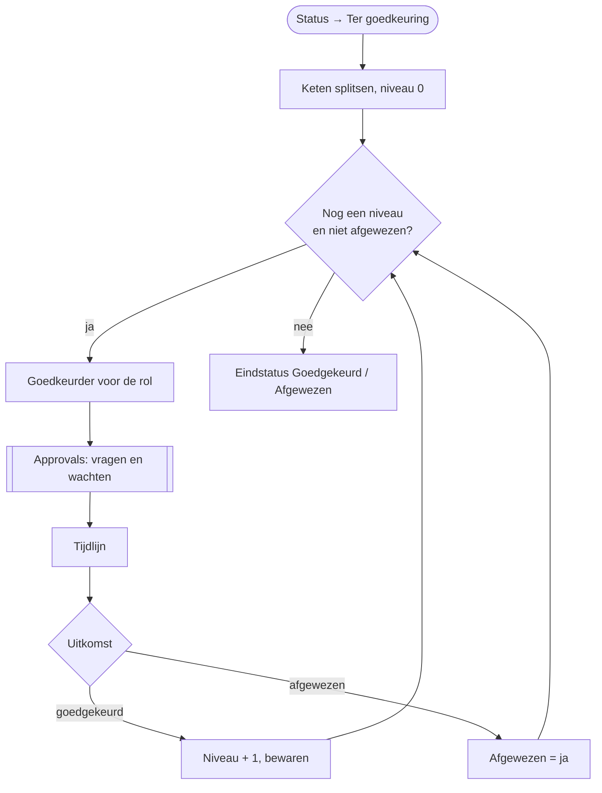

# HV-CL-02 Schadeclaim goedkeuringsketen

| | |
|---|---|
| Case | [02 Schadeclaims](../../02-construction-claims/README.md) |
| User story | [US-03 Goedkeuren volgens één regel](../../02-construction-claims/03-design.md#us-03-goedkeuren-volgens-één-regel) |
| Eigenaar | claims & verzekeringen |
| Komt na | [HV-CL-01](HV-CL-01.md) zette de keten; de eigenaar zet de claim in de [backoffice-app](../apps/backoffice.md) op *Ter goedkeuring* |

## Doel

De keten die HV-CL-01 bepaalde, niveau per niveau laten goedkeuren, zonder dat iemand mails moet doorsturen. Elke beslissing, met wie en met welke opmerking, komt in de tijdlijn. Eén afwijzing stopt de keten.

## Trigger

Een rij in *Schadeclaim* wordt **gewijzigd**, alleen als `hv_status` wijzigt naar *Ter goedkeuring* (`hv_status eq 100000003`).

## Invoer en uitvoer

| Leest | Kolommen |
|---|---|
| de claim | `hv_goedkeuringsketen` (bv. `Fleetmanager>Projectleider`), `hv_dossiernummer`, `hv_geschatbedrag`, `hv_omschrijving` |
| Goedkeurder | rol → e-mailadres (`hv_rol`, `hv_email`) |

| Schrijft | Kolommen |
|---|---|
| Approvals | één goedkeuringsaanvraag per niveau, in Teams, Outlook en Power Automate |
| Tijdlijn | per niveau: *goedgekeurd (rol)* of *afgewezen (rol)*, door wie, opmerking |
| Schadeclaim | `hv_goedkeuringsniveau` na elke goedkeuring; op het einde `hv_status` *Goedgekeurd* of *Afgewezen* |

## Stappen

1. De keten splitsen op `>`; niveau = 0; afgewezen = nee.
2. Herhalen zolang niet afgewezen en er nog een niveau is:
   1. de persoon voor de rol van dit niveau opzoeken;
   2. de goedkeuring vragen en **wachten** op het antwoord;
   3. de beslissing in de tijdlijn zetten;
   4. goedgekeurd → volgend niveau en het niveau op de claim bewaren; afgewezen → stoppen.
3. Eindstatus: *Afgewezen* als iemand afwees, anders *Goedgekeurd*.

## Beslisregels

- De keten zelf komt uit [DT-02](../../02-construction-claims/03-design.md#beslistabel-dt-02--wie-keurt-goed), bepaald door HV-CL-01. Deze flow beslist niets over wie; hij voert de keten uit.
- De volgorde is vast: de beoordelaar per categorie eerst, dan per bedrag van laag naar hoog.
- Eén afwijzing is genoeg. Een hoger niveau krijgt dan geen aanvraag meer.

## Foutafhandeling

| Wat kan misgaan | Wat de flow doet |
|---|---|
| Niemand antwoordt | de lus heeft een time-out van 14 dagen en max. 6 niveaus. Intussen bewaakt [HV-CL-03](HV-CL-03.md) de beoordelingstermijn. In het doelontwerp komt er na 5 dagen een herinnering (zie onder). |
| Een rol heeft geen persoon in *Goedkeurder* | de aanvraag kan niet starten en de run faalt; de claim blijft *Ter goedkeuring*. Oplossing: de rol invullen in de backoffice-app en de run opnieuw indienen. |
| De goedkeurder is afwezig | Approvals staat herverdelen toe (`enableReassignment`). |
| De claim wordt opnieuw op *Ter goedkeuring* gezet | er start een nieuwe keten vanaf niveau 1. Bewust: een nieuwe beslissing na nieuwe informatie. |

## Configuratie

| Wat | Waar |
|---|---|
| Rol → persoon | tabel *Goedkeurder*. In deze ontwikkelomgeving staat elke rol op hetzelfde account, zodat één persoon de hele keten kan doorlopen. |
| Verbindingen | `hv_dataverse`, `hv_approvals` |

## Bewijs

- De goedkeuringsaanvragen staan echt in Power Automate ([screenshot](../screenshots/15-approvals-ontvangen.jpg)).
- De run hieronder (SCH-26-1006) staat bij niveau 1 van `Fleetmanager>Projectleider` en wacht op het antwoord. **De volledige keten is nog niet doorlopen**: dat gebeurt zodra de goedkeuring beantwoord is. Daarna komt hier de afgewerkte run.

## Beheer

- **Volgen:** backoffice-app → claim → tijdlijn; openstaande aanvragen in Power Automate → *Goedkeuringen*.
- **Vastgelopen keten:** de run annuleren, de oorzaak oplossen (bv. een ontbrekende goedkeurder), de status opnieuw op *Ter goedkeuring* zetten.

## Ontwerp en gebouwd

| | Doelontwerp ([schadeclaim-goedkeuring.flow.json](../../02-construction-claims/artefacts/power-automate/schadeclaim-goedkeuring.flow.json)) | Gebouwd |
|---|---|---|
| Lus per niveau, Approvals, tijdlijn | ja | ja, dezelfde opbouw |
| Geen reactie | na 5 dagen terug naar de eigenaar | time-out 14 dagen; HV-CL-03 bewaakt de termijn |

## Technische stappen

<!--actions:HV-CL-02-->
*Gegenereerd uit [`definitions.mjs`](definitions.mjs) door `npm run build`. Niet met de hand aanpassen.* 12 acties · verbindingen: Microsoft Dataverse, Approvals · omgevingsvariabelen: geen.

- **Trigger `Ter_goedkeuring`**: Dataverse, rij gewijzigd in *Schadeclaim* (`hv_schadeclaim`); alleen bij wijziging van `hv_status`, voorwaarde `hv_status eq 100000003`
- `Keten`: variabele aanmaken `keten` (array)
- `Niveau`: variabele aanmaken `niveau` (integer)
- `Afgewezen`: variabele aanmaken `afgewezen` (boolean)
- `Per_niveau`: herhalen tot de voorwaarde klopt (max. 6 keer, time-out 14 dagen)
  - `Goedkeurder`: rijen opzoeken in *Goedkeurder* (eerste treffer)
  - `Goedkeuring`: goedkeuring vragen via Approvals en wachten op het antwoord
  - `Tijdlijn`: rij toevoegen in *Tijdlijn*: `hv_gebeurtenis`, `hv_door`, `hv_opmerking`, `hv_Schadeclaim`
  - `Uitkomst`: voorwaarde
    - als waar:
      - `Volgend_niveau`: variabele verhogen `niveau`
      - `Niveau_bewaren`: rij bijwerken in *Schadeclaim*: `hv_goedkeuringsniveau`
    - anders:
      - `Markeer_afgewezen`: variabele zetten `afgewezen`
- `Eindstatus`: rij bijwerken in *Schadeclaim*: `hv_status`
<!--/actions-->
