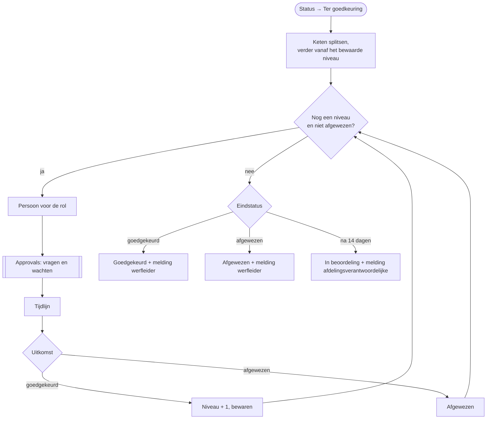

# HV-CL-02 Schadeclaim goedkeuringsketen

| | |
|---|---|
| Case | [02 Schadeclaims](../../02-construction-claims/README.md) |
| User story | [US-03 Goedkeuren volgens één regel](../../02-construction-claims/03-design.md#us-03-goedkeuren-volgens-één-regel) |
| BPMN (TO-BE) | *Goedkeuren in Teams (per niveau)* |
| Eigenaar | claims & verzekeringen |
| Komt na | [HV-CL-01](HV-CL-01.md) zette de keten; de eigenaar zet de claim in de [backoffice-app](../apps/backoffice.md) op *Ter goedkeuring* |

## Doel

De keten die HV-CL-01 bepaalde, niveau per niveau laten goedkeuren, zonder dat iemand mails moet doorsturen. Elke beslissing, met wie en met welke opmerking, komt in de tijdlijn. Eén afwijzing stopt de keten. De werfleider hoort de uitkomst.

## Trigger

Een rij in *Schadeclaim* wordt **gewijzigd**, alleen als `hv_status` wijzigt naar *Ter goedkeuring* (`hv_status eq 100000003`).

Dit is het patroon voor **wachten op een mens** in de hele solution: een status start de vraag, en de uitkomst is opnieuw een status. Dezelfde opbouw zit in [HV-MA-02](HV-MA-02.md).

## Invoer en uitvoer

| Leest | Kolommen |
|---|---|
| de claim | `hv_goedkeuringsketen` (bv. `Fleetmanager>Projectleider`), `hv_goedkeuringsniveau` (waar de keten staat), `hv_dossiernummer`, `hv_geschatbedrag`, `hv_omschrijving` |
| Rol | rol → e-mailadres |

| Schrijft | Kolommen |
|---|---|
| Approvals | één goedkeuringsaanvraag per niveau, in Teams, Outlook en Power Automate |
| Tijdlijn | per niveau: *goedgekeurd (rol)* of *afgewezen (rol)*, door wie, opmerking |
| Schadeclaim | `hv_goedkeuringsniveau` na elke goedkeuring; op het einde `hv_status` *Goedgekeurd*, *Afgewezen*, of terug *In beoordeling* als de keten verliep |
| Melding | uitkomst → werfleider · verlopen → afdelingsverantwoordelijke |

## Stappen

1. De keten splitsen op `>`; beginnen bij het bewaarde niveau (0 bij een nieuwe keten).
2. Herhalen zolang niet afgewezen en er nog een niveau is (max. 6 niveaus, 14 dagen):
   1. de persoon voor de rol van dit niveau opzoeken;
   2. de goedkeuring vragen en **wachten** op het antwoord;
   3. de beslissing in de tijdlijn;
   4. goedgekeurd → volgend niveau, en dat niveau op de claim bewaren; afgewezen → stoppen.
3. Uitkomst: *goedgekeurd*, *afgewezen* of *verlopen*, met een status en een melding.

## Beslisregels

- De keten komt uit [DT-02](../../02-construction-claims/03-design.md#beslistabel-dt-02--wie-keurt-goed), bepaald door HV-CL-01. Deze flow beslist niets over wie; hij voert de keten uit.
- De volgorde is vast: de beoordelaar per categorie eerst, dan per bedrag van laag naar hoog.
- Eén afwijzing is genoeg. Een hoger niveau krijgt dan geen aanvraag meer.

## Foutafhandeling

| Wat kan misgaan | Wat de flow doet |
|---|---|
| Niemand antwoordt | na 14 dagen stopt de lus. De claim gaat terug naar *In beoordeling* en de afdelingsverantwoordelijke krijgt een melding. Opnieuw op *Ter goedkeuring* zetten **hervat** de keten bij het bewaarde niveau; wie al goedkeurde, krijgt geen tweede vraag. |
| Een flow-run duurt maximaal 30 dagen | de time-out van 14 dagen blijft daar ruim onder. |
| Een rol heeft geen persoon | de aanvraag kan niet starten → `Bij_fout`: melding aan functioneel beheer met de run-link. Oplossing: de rol invullen, de claim opnieuw op *Ter goedkeuring* zetten. |
| De goedkeurder is afwezig | Approvals staat herverdelen toe (`enableReassignment`). |

## Configuratie

| Wat | Waar |
|---|---|
| Rol → persoon | tabel *Rol (goedkeurder en ontvanger)*. In deze ontwikkelomgeving staat elke rol op hetzelfde account, zodat één persoon de hele keten kan doorlopen. |
| Verbindingen | `hv_dataverse`, `hv_approvals` |

## Bewijs

- De goedkeuringsaanvragen staan echt in Power Automate ([screenshot](../screenshots/15-approvals-ontvangen.jpg)).
- De run hieronder wacht op het antwoord van niveau 1. **De volledige keten is nog niet doorlopen**: dat gebeurt zodra de goedkeuring beantwoord is. Daarna komt hier de afgewerkte run.

## Beheer

- **Volgen:** backoffice-app → claim → tijdlijn; openstaande aanvragen in Power Automate → *Goedkeuringen*.
- **Vastgelopen keten:** de run annuleren, de oorzaak oplossen, de status opnieuw op *Ter goedkeuring* zetten. De keten gaat verder waar ze stond.

## Ontwerp en gebouwd

| | Doelontwerp ([schadeclaim-goedkeuring.flow.json](../../02-construction-claims/artefacts/power-automate/schadeclaim-goedkeuring.flow.json)) | Gebouwd |
|---|---|---|
| Vragen | Teams-kaart (adaptive card) per niveau | Approvals per niveau (Teams, Outlook, Power Automate) |
| Herinnering | na 5 dagen | geen herinnering; na 14 dagen terug naar *In beoordeling* met melding |
| Uitkomst | Teams-bericht aan de werfleider | melding aan de rol *Werfleider* |

## Technische stappen

<!--actions:HV-CL-02-->
*Gegenereerd uit [`definitions.mjs`](definitions.mjs) door `npm run build`. Niet met de hand aanpassen.* 25 acties · verbindingen: Microsoft Dataverse, Approvals · omgevingsvariabelen: geen · regels uit *Bedrijfsregel*: geen.

- **Trigger `Ter_goedkeuring`**: Dataverse, rij gewijzigd in *Schadeclaim* (`hv_schadeclaim`); alleen bij wijziging van `hv_status`, voorwaarde `hv_status eq 100000003`
- `Probeer`: blok: alle stappen hieronder; faalt er één, dan gaat de run naar `Bij_fout`
  - `Keten`: variabele aanmaken `keten` (array)
  - `Niveau`: variabele aanmaken `niveau` (integer)
  - `Afgewezen`: variabele aanmaken `afgewezen` (boolean)
  - `Per_niveau`: herhalen tot de voorwaarde klopt (max. 6 keer, time-out 14 dagen)
    - `Goedkeurder`: rijen opzoeken in *Rol (goedkeurder en ontvanger)* (eerste treffer)
    - `Goedkeuring`: goedkeuring vragen via Approvals en wachten op het antwoord
    - `Tijdlijn`: rij toevoegen in *Tijdlijn*: `hv_gebeurtenis`, `hv_door`, `hv_opmerking`, `hv_Schadeclaim`
    - `Uitkomst`: voorwaarde
      - als waar:
        - `Volgend_niveau`: variabele verhogen `niveau`
        - `Niveau_bewaren`: rij bijwerken in *Schadeclaim*: `hv_goedkeuringsniveau`
      - anders:
        - `Markeer_afgewezen`: variabele zetten `afgewezen`
  - `Eindstatus`: berekening · loopt ook als `Per_niveau` faalt
  - `Volgens_uitkomst`: keuze
    - geval `goedgekeurd` (Goedgekeurd):
      - `Status`: rij bijwerken in *Schadeclaim*: `hv_status`
      - `Melding_werfleider`: rij toevoegen in *Melding*: `hv_titel`, `hv_tekst`, `hv_rol`, `hv_soort`, `hv_kanaal`, `hv_status`, `hv_bron`, `hv_referentie`, `hv_link`
    - geval `afgewezen` (Afgewezen):
      - `Status`: rij bijwerken in *Schadeclaim*: `hv_status`
      - `Melding_werfleider`: rij toevoegen in *Melding*: `hv_titel`, `hv_tekst`, `hv_rol`, `hv_soort`, `hv_kanaal`, `hv_status`, `hv_bron`, `hv_referentie`, `hv_link`
    - geval `verlopen` (Verlopen):
      - `Status`: rij bijwerken in *Schadeclaim*: `hv_status`
      - `Melding_eigenaar`: rij toevoegen in *Melding*: `hv_titel`, `hv_tekst`, `hv_rol`, `hv_soort`, `hv_kanaal`, `hv_status`, `hv_bron`, `hv_referentie`, `hv_link`
- `Bij_fout`: foutafhandeling (alleen als het blok hierboven faalt)
  - `Mislukte_stappen`: lijst filteren
  - `Foutnamen`: lijst omzetten
  - `Foutmelding`: rij toevoegen in *Melding*: `hv_titel`, `hv_tekst`, `hv_rol`, `hv_soort`, `hv_kanaal`, `hv_status`, `hv_bron`, `hv_referentie`, `hv_link`
  - `Run_mislukt`: run stoppen (status Failed)
<!--/actions-->
