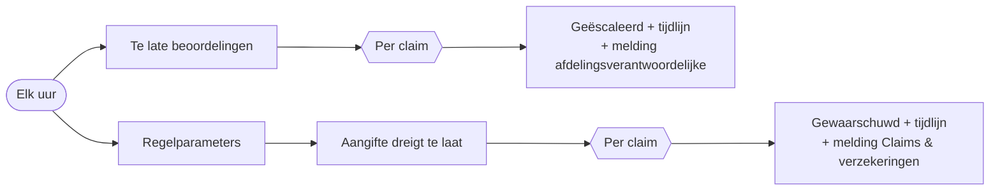

# HV-CL-03 SLA- en aangiftebewaking

| | |
|---|---|
| Case | [02 Schadeclaims](../../02-construction-claims/README.md) |
| User stories | [US-02 Leidingschade veilig afhandelen](../../02-construction-claims/03-design.md#us-02-leidingschade-veilig-afhandelen), [US-04 Aangifte nooit te laat](../../02-construction-claims/03-design.md#us-04-aangifte-nooit-te-laat) |
| BPMN (TO-BE) | bewaakt *Beoordelen* en *Aangifte-concept naar verzekeraar (≤ 8 dagen)* |
| Eigenaar | claims & verzekeringen |
| Bewaakt | de twee deadlines die [HV-CL-01](HV-CL-01.md) zette |

## Doel

Twee termijnen bewaken. De **beoordeling**: een dossier dat niet op tijd beoordeeld is (2 uur voor een gaslek, 72 uur voor een kras op een kraan), wordt geëscaleerd. De **aangifte bij de verzekeraar**: die deadline heeft financiële gevolgen, want te laat aangeven kan de dekking kosten. Twee dagen vóór de termijn krijgt Claims & verzekeringen een waarschuwing als de aangifte nog niet vertrokken is.

## Trigger

Een **schema**: elk uur. Nooit twee runs tegelijk (trigger-concurrency 1), zodat een trage run en de volgende dezelfde claim niet dubbel escaleren.

## Invoer en uitvoer

| Leest | Voorwaarde |
|---|---|
| Bedrijfsregel | VZ-03 (dagen vooraf waarschuwen) |
| Schadeclaim, beoordeling | status *In beoordeling* of *Info gevraagd*, `hv_deadlinebeoordeling` voorbij, nog niet geëscaleerd |
| Schadeclaim, aangifte | `hv_deadlineverzekeraar` gezet, *Aangifte verstuurd* nee, nog niet gewaarschuwd, deadline binnen VZ-03 dagen of al voorbij |

| Schrijft | Kolommen |
|---|---|
| Schadeclaim | `hv_geescaleerd` = ja · `hv_aangiftegewaarschuwd` = ja |
| Tijdlijn | *SLA overschreden — geëscaleerd* · *aangiftetermijn dreigt* |
| Melding | escalatie → afdelingsverantwoordelijke · aangifte → Claims & verzekeringen |

## Stappen

1. De regelparameters lezen.
2. Te late beoordelingen opzoeken; per claim: markeren, tijdlijn, melding.
3. Dreigende aangiftes opzoeken; per claim: markeren, tijdlijn, melding.

## Beslisregels

- Te laat = de deadline uit de triage is voorbij en de claim is nog niet beoordeeld.
- Aangifte dreigt = de verzekeringsdeadline valt binnen VZ-03 dagen (of is voorbij) en *Aangifte verstuurd* is niet aangevinkt.
- Eén keer per claim: de vlaggen voorkomen dat dezelfde claim elk uur een nieuwe melding geeft.

## Foutafhandeling

| Wat kan misgaan | Wat de flow doet |
|---|---|
| Een run faalt | `Bij_fout`: melding aan functioneel beheer. Het volgende uur pakt de volgende run dezelfde claims op; de vlag wordt pas gezet als de update lukt. |
| Geen enkele claim te laat | de lussen lopen niet; de run is geslaagd zonder wijziging (de normale toestand). |

## Configuratie

| Wat | Waar |
|---|---|
| VZ-03 (waarschuwen vooraf) | tabel *Bedrijfsregel* |
| Termijnen zelf | gezet door HV-CL-01 uit SLA-* en VZ-02 |

## Bewijs

- De gaslek-claim (kritiek, 2 uur) werd niet beoordeeld en is door deze flow **geëscaleerd**, met een regel in de tijdlijn.
- Aangiftes die dreigen te laat te komen: [VERIFICATION.md](../VERIFICATION.md#meldingen).

*Run van de vorige versie, die alleen de beoordelingstermijn bewaakte.*

## Beheer

- **Volgen:** backoffice-app → *02 Schadeclaims* → dossier → tijdlijn. Dossiers met een dreigende aangifte: weergave op *Aangifte: waarschuwing gestuurd*.
- Een escalatie terugdraaien kan door de vlag uit te zetten, maar de tijdlijnregel blijft (audit).

## Ontwerp en gebouwd

| | Doelontwerp ([sla-bewaking.flow.json](../../02-construction-claims/artefacts/power-automate/sla-bewaking.flow.json)) | Gebouwd |
|---|---|---|
| Schema | elk uur op werkdagen | elk uur, één run tegelijk |
| Aangiftetermijn | dreigende verzekeringsaangiftes | gebouwd, met VZ-03 uit *Bedrijfsregel* |
| Escalatie | bericht aan de afdelingsverantwoordelijke | vlag + tijdlijn + melding |
| Volume | — | polling per uur volstaat bij tientallen dossiers per maand. Bij duizenden dossiers is een wachttijd per dossier ("Delay until") een optie, maar polling blijft eenvoudiger en herstelt zichzelf na een storing. |

## Technische stappen

<!--actions:HV-CL-03-->
*Gegenereerd uit [`definitions.mjs`](definitions.mjs) door `npm run build`. Niet met de hand aanpassen.* 19 acties · verbindingen: Microsoft Dataverse · omgevingsvariabelen: geen · regels uit *Bedrijfsregel*: `VZ-03`.

- **Trigger `Elk_uur`**: schema, elk uur, nooit twee runs tegelijk
- `Probeer`: blok: alle stappen hieronder; faalt er één, dan gaat de run naar `Bij_fout`
  - `Regels`: rijen opzoeken in *Bedrijfsregel* · start parallel
  - `Regelparen`: lijst omzetten
  - `Parameters`: berekening
  - `Te_laat`: rijen opzoeken in *Schadeclaim* · start parallel
  - `Per_claim`: voor elk item
    - `Markeer`: rij bijwerken in *Schadeclaim*: `hv_geescaleerd`
    - `Tijdlijn`: rij toevoegen in *Tijdlijn*: `hv_gebeurtenis`, `hv_door`, `hv_opmerking`, `hv_Schadeclaim`
    - `Melding_escalatie`: rij toevoegen in *Melding*: `hv_titel`, `hv_tekst`, `hv_rol`, `hv_soort`, `hv_kanaal`, `hv_status`, `hv_bron`, `hv_referentie`, `hv_link`
  - `Aangifte_dreigt`: rijen opzoeken in *Schadeclaim*
  - `Per_aangifte`: voor elk item
    - `Markeer_gewaarschuwd`: rij bijwerken in *Schadeclaim*: `hv_aangiftegewaarschuwd`
    - `Tijdlijn_aangifte`: rij toevoegen in *Tijdlijn*: `hv_gebeurtenis`, `hv_door`, `hv_opmerking`, `hv_Schadeclaim`
    - `Melding_aangifte`: rij toevoegen in *Melding*: `hv_titel`, `hv_tekst`, `hv_rol`, `hv_soort`, `hv_kanaal`, `hv_status`, `hv_bron`, `hv_referentie`, `hv_link`
- `Bij_fout`: foutafhandeling (alleen als het blok hierboven faalt)
  - `Mislukte_stappen`: lijst filteren
  - `Foutnamen`: lijst omzetten
  - `Foutmelding`: rij toevoegen in *Melding*: `hv_titel`, `hv_tekst`, `hv_rol`, `hv_soort`, `hv_kanaal`, `hv_status`, `hv_bron`, `hv_referentie`, `hv_link`
  - `Run_mislukt`: run stoppen (status Failed)
<!--/actions-->
