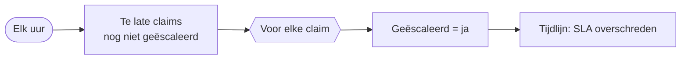

# HV-CL-03 SLA-bewaking

| | |
|---|---|
| Case | [02 Schadeclaims](../../02-construction-claims/README.md) |
| User stories | [US-02 Leidingschade veilig afhandelen](../../02-construction-claims/03-design.md#us-02-leidingschade-veilig-afhandelen), [US-04 Aangifte nooit te laat](../../02-construction-claims/03-design.md#us-04-aangifte-nooit-te-laat) |
| Eigenaar | claims & verzekeringen |
| Bewaakt | de deadline die [HV-CL-01](HV-CL-01.md) zette |

## Doel

Geen dossier blijft liggen. Een claim die niet binnen de termijn beoordeeld is (2 uur voor een gaslek, 72 uur voor een kras op een kraan), wordt automatisch geëscaleerd. Dat staat in de tijdlijn, zodat achteraf zichtbaar is dat het te laat was en wie verwittigd werd.

## Trigger

Een **schema**: elk uur.

## Invoer en uitvoer

| Leest | Voorwaarde |
|---|---|
| Schadeclaim | status *In beoordeling* of *Info gevraagd*, `hv_deadlinebeoordeling` voorbij, nog niet geëscaleerd |

| Schrijft | Kolommen |
|---|---|
| Schadeclaim | `hv_geescaleerd` = ja |
| Tijdlijn | *SLA overschreden — geëscaleerd*, door HV-CL-03 |

## Stappen

1. De te late claims opzoeken.
2. Voor elke claim: markeren als geëscaleerd, en een regel in de tijdlijn.

## Beslisregels

- Te laat = de deadline uit de triage is voorbij en de claim is nog niet beoordeeld.
- Eén keer escaleren per claim: de vlag `hv_geescaleerd` voorkomt dat dezelfde claim elk uur opnieuw een melding geeft.

## Foutafhandeling

| Wat kan misgaan | Wat de flow doet |
|---|---|
| Een run faalt | het volgende uur pakt de volgende run dezelfde claims op; de vlag wordt pas gezet als de update lukt. |
| Geen enkele claim te laat | de lus loopt niet; de run is geslaagd zonder wijziging (dat is de normale toestand). |

## Configuratie

Geen omgevingsvariabelen; de termijnen komen uit de triage in HV-CL-01. Verbinding: `hv_dataverse`.

## Bewijs

- De gaslek-claim SCH-26-1005 (kritiek, 2 uur) werd niet beoordeeld en is door deze flow **geëscaleerd**, met een regel in de tijdlijn.
- De run hieronder is een gewoon uur zonder te late claims: de stappen in de lus zijn overgeslagen.

## Beheer

- **Volgen:** backoffice-app → *02 Schadeclaims* → dossier → tijdlijn (regel *SLA overschreden — geëscaleerd*).
- Een escalatie terugdraaien kan door de vlag uit te zetten, maar de tijdlijnregel blijft (audit).

## Ontwerp en gebouwd

| | Doelontwerp ([sla-bewaking.flow.json](../../02-construction-claims/artefacts/power-automate/sla-bewaking.flow.json)) | Gebouwd |
|---|---|---|
| Schema | elk uur op werkdagen | elk uur |
| Aangiftetermijn | ook dreigende verzekeringsaangiftes | alleen de beoordelingstermijn; de aangiftedeadline staat wel in het dossier |
| Escalatie | bericht aan de afdelingsverantwoordelijke | vlag + tijdlijn; geen bericht |

## Technische stappen

<!--actions:HV-CL-03-->
*Gegenereerd uit [`definitions.mjs`](definitions.mjs) door `npm run build`. Niet met de hand aanpassen.* 4 acties · verbindingen: Microsoft Dataverse · omgevingsvariabelen: geen.

- **Trigger `Elk_uur`**: schema, elk uur
- `Te_laat`: rijen opzoeken in *Schadeclaim*
- `Per_claim`: voor elk item
  - `Markeer`: rij bijwerken in *Schadeclaim*: `hv_geescaleerd`
  - `Tijdlijn`: rij toevoegen in *Tijdlijn*: `hv_gebeurtenis`, `hv_door`, `hv_opmerking`, `hv_Schadeclaim`
<!--/actions-->
