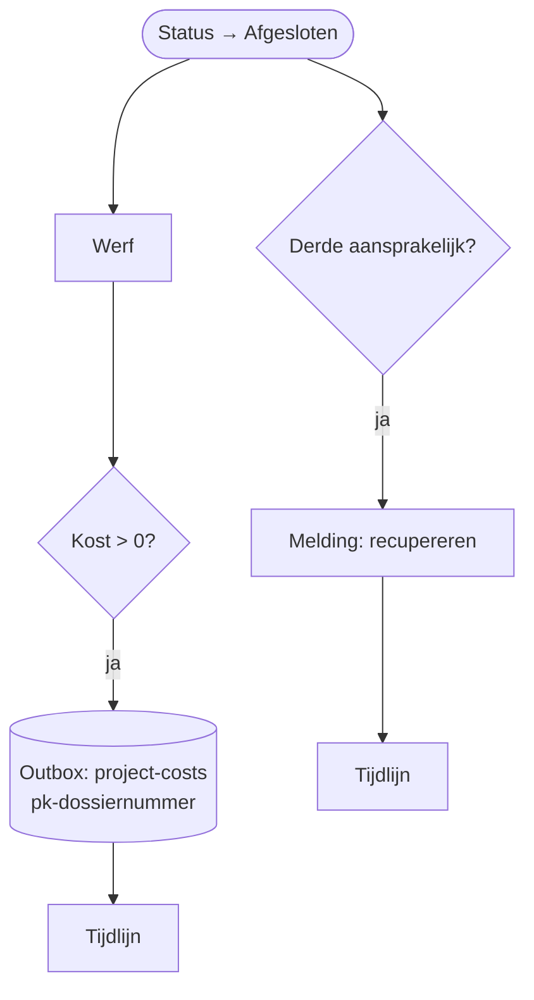

# HV-CL-04 Schadeclaim afsluiten: kosten en recuperatie

| | |
|---|---|
| Case | [02 Schadeclaims](../../02-construction-claims/README.md) |
| User story | [US-05 Kost op het juiste project](../../02-construction-claims/03-design.md#us-05-kost-op-het-juiste-project) |
| BPMN (TO-BE) | *Kosten en recuperatie boeken op project (ERP)* |
| Eigenaar | claims & verzekeringen |
| Komt na | de eigenaar sluit het dossier af in de [backoffice-app](../apps/backoffice.md) · **Volgende stap** [HV-IN-01](HV-IN-01.md) → [HV-IN-02](HV-IN-02.md) |

## Doel

Vandaag komt schade pas weken later, of nooit, op het project terecht, en een aansprakelijke derde wordt vaak niet aangesproken. Bij het afsluiten van een dossier boekt deze flow de kost op de werf (via de outbox, zoals alles wat naar het ERP gaat) en start hij de recuperatie als een derde aansprakelijk is.

## Trigger

Een rij in *Schadeclaim* wordt **gewijzigd** naar status *Afgesloten* (`hv_status eq 100000007`).

## Invoer en uitvoer

| Leest | Kolommen |
|---|---|
| de claim | `hv_werkelijkekost` (of anders de raming), `hv_categorie`, `hv_derdeaansprakelijk`, `hv_naamderde`, de werf |

| Schrijft | Kolommen |
|---|---|
| ERP-outbox | endpoint *project-costs*, sleutel `pk-<dossiernummer>`, bedrag, werf |
| Tijdlijn | *kosten naar ERP (outbox)*, *recuperatie gestart*; na de boeking zet [HV-IN-02](HV-IN-02.md) *kosten geboekt op project (ERP)* |
| Melding | recuperatie → Claims & verzekeringen (actie) |

## Stappen

1. De werf ophalen.
2. Als er een kost is: een bericht in de outbox met sleutel `pk-<dossiernummer>`, en een regel in de tijdlijn.
3. Als een derde aansprakelijk is: een actie voor Claims & verzekeringen ("start het verhaal") en een regel in de tijdlijn.

## Beslisregels

- De kost is de **werkelijke** kost als die ingevuld is, anders de raming. Wie afsluit, vult de werkelijke kost in; een raming is een terugvaloptie, en dat staat zo in de tijdlijn.
- Eén dossier, één kostenboeking: de sleutel `pk-<dossiernummer>` laat geen tweede toe, ook niet als iemand het dossier heropent en opnieuw afsluit. Een correctie loopt via het ERP (creditnota), niet via een tweede bericht.
- Ook een afgewezen claim kan een kost hebben (de schade is er, Halverdijk draagt ze). Is de kost 0, dan gaat er niets naar het ERP.

## Foutafhandeling

| Wat kan misgaan | Wat de flow doet |
|---|---|
| Het bericht staat al in de outbox | de sleutel weigert het; de flow leest dat als "al geboekt" en gaat door. |
| Het ERP is niet bereikbaar | niets in deze flow; de outbox probeert opnieuw ([HV-IN-01](HV-IN-01.md)). |
| Een andere fout | `Bij_fout`: melding aan functioneel beheer met de run-link. |

## Configuratie

Geen eigen parameters. Verbinding: `hv_dataverse`.

## Bewijs

Zie [VERIFICATION.md](../VERIFICATION.md#één-integratiepatroon-alles-via-de-outbox): het afgesloten testdossier heeft precies één projectkost in de ERP-sandbox en de regel *kosten geboekt op project (ERP)* in de tijdlijn.

## Ontwerp en gebouwd

| | Doelontwerp ([to-be BPMN](../../02-construction-claims/bpmn/to-be.svg)) | Gebouwd |
|---|---|---|
| Kostenboeking | rechtstreeks naar het ERP | via de outbox (één integratiepatroon) |
| Recuperatie | brief aan de derde | actie-melding aan Claims & verzekeringen; de brief zelf blijft mensenwerk |

## Technische stappen

<!--actions:HV-CL-04-->
*Gegenereerd uit [`definitions.mjs`](definitions.mjs) door `npm run build`. Niet met de hand aanpassen.* 15 acties · verbindingen: Microsoft Dataverse · omgevingsvariabelen: geen · regels uit *Bedrijfsregel*: geen.

- **Trigger `Afgesloten`**: Dataverse, rij gewijzigd in *Schadeclaim* (`hv_schadeclaim`); alleen bij wijziging van `hv_status`, voorwaarde `hv_status eq 100000007`
- `Probeer`: blok: alle stappen hieronder; faalt er één, dan gaat de run naar `Bij_fout`
  - `Werf`: één rij ophalen uit *Werf* · start parallel
  - `Kosten`: voorwaarde
    - als waar:
      - `Kost_naar_outbox`: rij toevoegen in *ERP-outbox*: `hv_idempotencykey`, `hv_endpoint`, `hv_body`, `hv_status`, `hv_pogingen`, `hv_volgendepoging`, `hv_referentie`, `hv_Schadeclaim`
      - `Kost_naar_outbox_controle`: voorwaarde · loopt ook als `Kost_naar_outbox` faalt
        - als waar:
          - `Kost_naar_outbox_mislukt`: run stoppen (status Failed)
      - `Tijdlijn_kost`: rij toevoegen in *Tijdlijn*: `hv_gebeurtenis`, `hv_door`, `hv_opmerking`, `hv_Schadeclaim`
  - `Recuperatie`: voorwaarde · start parallel
    - als waar:
      - `Melding_recuperatie`: rij toevoegen in *Melding*: `hv_titel`, `hv_tekst`, `hv_rol`, `hv_soort`, `hv_kanaal`, `hv_status`, `hv_bron`, `hv_referentie`, `hv_link`
      - `Tijdlijn_recuperatie`: rij toevoegen in *Tijdlijn*: `hv_gebeurtenis`, `hv_door`, `hv_opmerking`, `hv_Schadeclaim`
- `Bij_fout`: foutafhandeling (alleen als het blok hierboven faalt)
  - `Mislukte_stappen`: lijst filteren
  - `Foutnamen`: lijst omzetten
  - `Foutmelding`: rij toevoegen in *Melding*: `hv_titel`, `hv_tekst`, `hv_rol`, `hv_soort`, `hv_kanaal`, `hv_status`, `hv_bron`, `hv_referentie`, `hv_link`
  - `Run_mislukt`: run stoppen (status Failed)
<!--/actions-->
