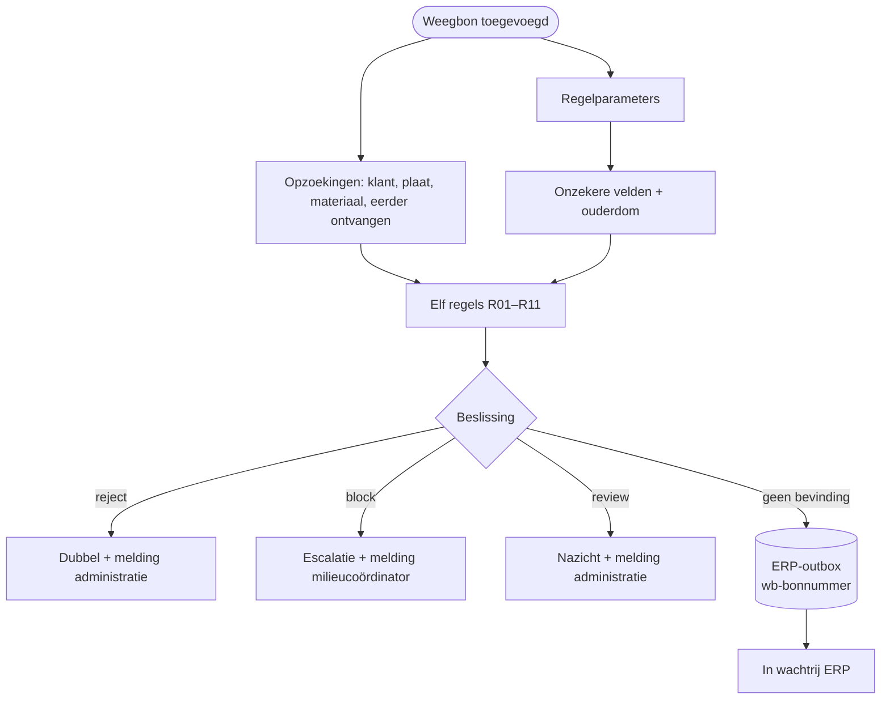

# HV-DI-01 Weegbon controleren

| | |
|---|---|
| Case | [01 Document intelligence](../../01-document-intelligence/README.md) |
| User stories | [US-01 Schone bon automatisch boeken](../../01-document-intelligence/03-design.md#us-01-schone-bon-automatisch-boeken), [US-03 Geweigerd materiaal tegenhouden](../../01-document-intelligence/03-design.md#us-03-geweigerd-materiaal-tegenhouden), [US-04 Dubbels voorkomen](../../01-document-intelligence/03-design.md#us-04-dubbels-voorkomen) |
| BPMN (TO-BE) | *Elf controles R01–R11*, *Weging boeken in ERP* (samen met [HV-IN-01](HV-IN-01.md)) |
| Eigenaar | administratie recyclage; regels R06–R08: milieucoördinator |
| Volgende stap | schone bon → outbox → [HV-IN-01](HV-IN-01.md) → [HV-IN-02](HV-IN-02.md) zet *Geboekt* · twijfel → app [Weegbon Nakijken](../apps/weegbon-nakijken.md) → [HV-DI-02](HV-DI-02.md) |

## Doel

Elke weegbon die binnenkomt, toetsen aan elf regels. Een schone bon gaat zonder mens naar het ERP. Een bon met een twijfel gaat naar een mens, met de reden erbij, en die mens krijgt een melding. Zo typt de administratie geen schone bonnen meer over, en gaat er geen asbest of dubbele bon ongemerkt door.

## Trigger

Een rij wordt **toegevoegd** in de tabel *Weegbon* (`hv_document`). In het doelontwerp maakt de intake (postvak + AI) die rij aan. Hier staat de rij er al, met de gelezen velden en een confidence per veld (zie [Ontwerp en gebouwd](#ontwerp-en-gebouwd)).

## Invoer en uitvoer

| Leest | Kolommen |
|---|---|
| de nieuwe weegbon | `hv_bonnummer`, `hv_datum`, `hv_plaat`, `hv_klantnummer`, `hv_richting`, `hv_materiaal`, `hv_bruto`, `hv_tarra`, `hv_netto`, `hv_idformulier`, `hv_traceerbaarheid`, `hv_confidence` (JSON per veld), `hv_ontvangen` |
| Bedrijfsregel | de drempels van R02, R03, R10 en R11 |
| Klant, Nummerplaat, Materiaalcode | bestaat de klant en is hij actief; hoort de plaat bij klant of vervoerder; is het materiaal toegelaten, wat is de prijs per ton |
| Weegbon | is hetzelfde bonnummer eerder ontvangen |

| Schrijft | Kolommen |
|---|---|
| Weegbon | `hv_beslissing`, `hv_bevindingen` (JSON: regel, ernst, bericht), `hv_status` (*In wachtrij ERP*, *Nazicht*, *Escalatie* of *Dubbel*), `hv_erpreferentie` |
| ERP-outbox | bij een schone bon: sleutel `wb-<bonnummer>`, endpoint *weighing-tickets*, bedrag en payload |
| Melding | nazicht → administratie · escalatie → milieucoördinator · dubbel → administratie (info) |

## Stappen

1. Tegelijk: de regelparameters lezen, en klant, nummerplaat, materiaalcode en "is dit bonnummer al ontvangen" opzoeken.
2. De velden onder de confidence-drempel oplijsten, en de ouderdom van de bon in dagen berekenen.
3. De elf regels toetsen. Elke regel die afgaat, geeft een bevinding met regel, ernst en bericht.
4. Beslissen, in deze volgorde: een *reject* → **dubbel**; anders een *block* → **escalatie**; anders minstens één bevinding → **nazicht**; geen bevinding → **automatisch**.
5. De weegbon bijwerken: beslissing, status en bevindingen.
6. Automatisch: een bericht in de ERP-outbox, de bon op *In wachtrij ERP*. Anders: een melding aan wie de bon moet bekijken.

## Beslisregels

De elf regels staan met hun eigenaar en reden in de [regelcatalogus](../../shared-methodology/regelcatalogus.md#case-01). Hun drempels staan in de tabel *Bedrijfsregel*, dezelfde waarden als in de geteste motor [`checkDocument()`](../../src/documents.mjs).

| Ernst | Regels | Uitkomst |
|---|---|---|
| review | R01, R02, R03, R04, R05, R07, R08, R10, R11 | nazicht door de administratie |
| block | R06 materiaal niet toegelaten volgens de vergunning | escalatie naar de milieucoördinator |
| reject | R09 bonnummer al ontvangen | dubbel, niet boeken |

## Foutafhandeling

| Wat kan misgaan | Wat de flow doet |
|---|---|
| Het bericht staat al in de outbox (tweede run, herstart) | de alternatieve sleutel weigert de tweede rij; de flow herkent die fout als "al in de outbox" en gaat door. Een andere fout bij de outbox stopt de run. |
| Klant, plaat of materiaal niet gevonden | geen fout: de regel gaat af (R04, R05, R06) en de bon gaat naar een mens. |
| Een stap faalt technisch | `Bij_fout`: de bon krijgt status *Fout*, functioneel beheer krijgt een melding met de mislukte stap en een link naar de run, en de run staat op mislukt. |
| Dezelfde bon wordt twee keer gescand | R09 vindt het bonnummer bij een eerdere rij die niet zelf *Dubbel* is, en zet de tweede op *Dubbel*. |
| Het ERP ligt plat | geen probleem voor deze flow: hij praat niet met het ERP. De outbox wacht ([HV-IN-01](HV-IN-01.md)). |

## Configuratie

| Wat | Waar aanpassen |
|---|---|
| Confidence-drempel (R02), tolerantie netto (R03), max. ouderdom (R10), max. bruto (R11) | tabel *Bedrijfsregel* in de backoffice-app (*Beheer*). Geen nieuwe release nodig; de volgende run gebruikt de nieuwe waarde. |
| Acceptatielijst, klanten, nummerplaten | tabellen in de backoffice-app, door de milieucoördinator en de administratie |
| Verbinding | connection reference `hv_dataverse` |

## Bewijs

- **30/30 identiek** met de geteste motor: beslissing én afgegane regels ([VERIFICATION.md](../VERIFICATION.md#case-01--weegbonnen-flow-hv-di-01)).
- De schone bonnen staan na [HV-IN-01](HV-IN-01.md) en [HV-IN-02](HV-IN-02.md) op *Geboekt*, met precies één ERP-boeking per bonnummer ([VERIFICATION.md](../VERIFICATION.md#één-integratiepatroon-alles-via-de-outbox)).

## Beheer

- **Volgen:** backoffice-app → *01 Weegbonnen*, weergave per status. Fouten: *Beheer* → *Meldingen*, soort *Fout*. Runs: `node power-platform/scripts/runs.mjs HV-DI-01`.
- **Drempel wijzigen:** in *Bedrijfsregel*. Wil je de wijziging ook in de repo (en dus getest), pas dan [`src/rules.mjs`](../../src/rules.mjs) aan; `verify.mjs` meldt elk verschil tussen de repo en de tabel.
- **Regel wijzigen** (de logica, niet de drempel): eerst [`src/documents.mjs`](../../src/documents.mjs) met een test, dan [`definitions.mjs`](definitions.mjs), dan `provision-flows.mjs --only=HV-DI-01 --activate`, dan `verify.mjs`.
- **Opnieuw verwerken:** de run opnieuw indienen in Power Automate. Dat is veilig: de outbox-sleutel laat geen tweede bericht toe.

## Ontwerp en gebouwd

| | Doelontwerp ([weegbon-verwerken.flow.json](../../01-document-intelligence/artefacts/power-automate/weegbon-verwerken.flow.json) + [child flow](../../01-document-intelligence/artefacts/power-automate/weegbon-controleren.childflow.json)) | Gebouwd (deze flow) |
|---|---|---|
| Trigger | nieuwe mail in het postvak weegbonnen | rij toegevoegd in *Weegbon* |
| Lezen van de bon | Azure AI Document Intelligence, met polling | niet aangesloten; de rij bevat de gelezen velden en de confidence al |
| Regels | in een child flow, vier regels uitgewerkt | alle elf, drempels uit *Bedrijfsregel* |
| ERP | HTTP-aanroep naar de ERP-facade | outbox → [HV-IN-01](HV-IN-01.md) → *ERP-boeking (sandbox)*, met dezelfde sleutel |
| Iemand verwittigen | Teams-kaart | rij in *Melding* → [HV-OP-01](HV-OP-01.md) → in-app-notificatie |

## Technische stappen

<!--actions:HV-DI-01-->
*Gegenereerd uit [`definitions.mjs`](definitions.mjs) door `npm run build`. Niet met de hand aanpassen.* 29 acties · verbindingen: Microsoft Dataverse · omgevingsvariabelen: geen · regels uit *Bedrijfsregel*: `R02`, `R03`, `R10`, `R11`.

- **Trigger `Weegbon_toegevoegd`**: Dataverse, rij toegevoegd in *Weegbon* (`hv_document`)
- `Probeer`: blok: alle stappen hieronder; faalt er één, dan gaat de run naar `Bij_fout`
  - `Regels`: rijen opzoeken in *Bedrijfsregel* · start parallel
  - `Regelparen`: lijst omzetten
  - `Parameters`: berekening
  - `Klant_zoeken`: rijen opzoeken in *Klant (ERP-sandbox)* (eerste treffer) · start parallel
  - `Nummerplaat_zoeken`: rijen opzoeken in *Nummerplaat* (eerste treffer) · start parallel
  - `Materiaalcode_zoeken`: rijen opzoeken in *Materiaalcode (acceptatielijst)* (eerste treffer) · start parallel
  - `Eerder_ontvangen`: rijen opzoeken in *Weegbon* (eerste treffer) · start parallel
  - `Onzekere_velden`: lijst filteren
  - `Veldnamen`: lijst omzetten
  - `Ouderdom_dagen`: berekening · start parallel
  - `Bevindingen`: berekening
  - `Afgegane_regels`: lijst omzetten
  - `Beslissing`: berekening
  - `Weegbon_bijwerken`: rij bijwerken in *Weegbon*: `hv_beslissing`, `hv_status`, `hv_bevindingen`
  - `Volgens_beslissing`: keuze
    - geval `automatisch` (Automatisch):
      - `ERP_bericht`: rij toevoegen in *ERP-outbox*: `hv_idempotencykey`, `hv_endpoint`, `hv_body`, `hv_status`, `hv_pogingen`, `hv_volgendepoging`, `hv_referentie`, `hv_Weegbon`
      - `ERP_bericht_controle`: voorwaarde · loopt ook als `ERP_bericht` faalt
        - als waar:
          - `ERP_bericht_mislukt`: run stoppen (status Failed)
      - `In_wachtrij`: rij bijwerken in *Weegbon*: `hv_status`, `hv_erpreferentie`
    - geval `nazicht` (Nazicht):
      - `Melding_administratie`: rij toevoegen in *Melding*: `hv_titel`, `hv_tekst`, `hv_rol`, `hv_soort`, `hv_kanaal`, `hv_status`, `hv_bron`, `hv_referentie`, `hv_link`
    - geval `escalatie` (Escalatie):
      - `Melding_milieu`: rij toevoegen in *Melding*: `hv_titel`, `hv_tekst`, `hv_rol`, `hv_soort`, `hv_kanaal`, `hv_status`, `hv_bron`, `hv_referentie`, `hv_link`
    - geval `dubbel` (Dubbel):
      - `Melding_dubbel`: rij toevoegen in *Melding*: `hv_titel`, `hv_tekst`, `hv_rol`, `hv_soort`, `hv_kanaal`, `hv_status`, `hv_bron`, `hv_referentie`, `hv_link`
- `Bij_fout`: foutafhandeling (alleen als het blok hierboven faalt)
  - `Mislukte_stappen`: lijst filteren
  - `Foutnamen`: lijst omzetten
  - `Foutmelding`: rij toevoegen in *Melding*: `hv_titel`, `hv_tekst`, `hv_rol`, `hv_soort`, `hv_kanaal`, `hv_status`, `hv_bron`, `hv_referentie`, `hv_link`
  - `Status_fout`: rij bijwerken in *Weegbon*: `hv_status`
  - `Run_mislukt`: run stoppen (status Failed) · loopt ook als `Status_fout` faalt
<!--/actions-->
