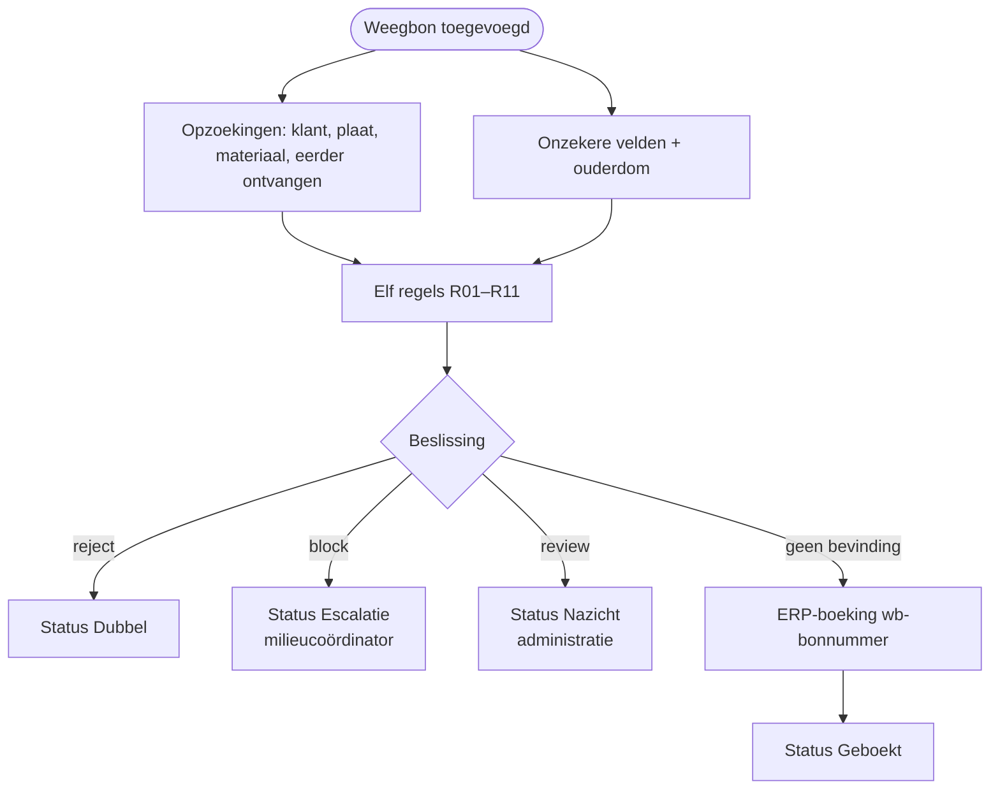

# HV-DI-01 Weegbon controleren en boeken

| | |
|---|---|
| Case | [01 Document intelligence](../../01-document-intelligence/README.md) |
| User stories | [US-01 Schone bon automatisch boeken](../../01-document-intelligence/03-design.md#us-01-schone-bon-automatisch-boeken), [US-03 Geweigerd materiaal tegenhouden](../../01-document-intelligence/03-design.md#us-03-geweigerd-materiaal-tegenhouden), [US-04 Dubbels voorkomen](../../01-document-intelligence/03-design.md#us-04-dubbels-voorkomen) |
| Eigenaar | functioneel beheer recyclage; regels: milieucoördinator + administratie |
| Volgende stap | bonnen in *Nazicht* of *Escalatie* → app [Weegbon Nakijken](../apps/weegbon-nakijken.md) → [HV-DI-02](HV-DI-02.md) |

## Doel

Elke weegbon die binnenkomt, toetsen aan elf regels. Een schone bon boekt de flow zelf in het ERP. Een bon met een twijfel gaat naar een mens, met de reden erbij. Zo typt de administratie geen schone bonnen meer over, en gaat er geen asbest of dubbele bon ongemerkt door.

## Trigger

Een rij wordt **toegevoegd** in de tabel *Weegbon* (`hv_document`). In het doelontwerp maakt de intake (postvak + Document Intelligence) die rij aan. Hier staat de rij er al, met de gelezen velden en een confidence per veld (zie [Ontwerp en gebouwd](#ontwerp-en-gebouwd)).

## Invoer en uitvoer

| Leest | Kolommen |
|---|---|
| de nieuwe weegbon | `hv_bonnummer`, `hv_datum`, `hv_plaat`, `hv_klantnummer`, `hv_richting`, `hv_materiaal`, `hv_bruto`, `hv_tarra`, `hv_netto`, `hv_idformulier`, `hv_traceerbaarheid`, `hv_confidence` (JSON per veld), `hv_ontvangen` |
| Klant (ERP-sandbox) | bestaat het klantnummer, is de klant actief |
| Nummerplaat | hoort de plaat bij de klant, of bij een geregistreerde vervoerder |
| Materiaalcode (acceptatielijst) | aanvaard, geweigerd of product; prijs per ton; bodem met traceerbaarheid |
| Weegbon | is hetzelfde bonnummer eerder ontvangen |

| Schrijft | Kolommen |
|---|---|
| Weegbon | `hv_beslissing`, `hv_status`, `hv_bevindingen` (JSON: regel, ernst, bericht), bij boeking `hv_erpreferentie` |
| ERP-boeking (sandbox) | alleen bij *automatisch*: `hv_idempotencykey` = `wb-<bonnummer>`, bedrag, payload |

## Stappen

1. Vier opzoekingen tegelijk: klant, nummerplaat, materiaalcode en "is dit bonnummer al eerder binnengekomen".
2. Tegelijk: de velden onder de confidence-drempel oplijsten, en de ouderdom van de bon in dagen berekenen.
3. De elf regels toetsen. Elke regel die afgaat, geeft een bevinding met regel, ernst en bericht.
4. Beslissen, in deze volgorde: een *reject* → **dubbel**; anders een *block* → **escalatie**; anders minstens één bevinding → **nazicht**; geen bevinding → **automatisch**.
5. De weegbon bijwerken: beslissing, status en de bevindingen.
6. Alleen bij *automatisch*: een ERP-boeking maken met sleutel `wb-<bonnummer>` en de bon op *Geboekt* zetten.

## Beslisregels

De elf regels staan met hun reden in [03 Design → Regels na extractie](../../01-document-intelligence/03-design.md#regels-na-extractie). Ze zijn dezelfde als in de geteste motor [`checkDocument()`](../../src/documents.mjs).

| Ernst | Regels | Uitkomst |
|---|---|---|
| review | R01 verplichte velden, R02 confidence, R03 netto = bruto − tarra (± 20 kg), R04 klant, R05 nummerplaat, R07 identificatieformulier, R08 traceerbaarheid bodem, R10 datum, R11 bruto ≤ 44.000 kg | nazicht door de administratie |
| block | R06 materiaal niet toegelaten volgens de vergunning | escalatie naar de milieucoördinator |
| reject | R09 bonnummer al ontvangen | dubbel, niet boeken |

## Foutafhandeling

| Wat kan misgaan | Wat de flow doet |
|---|---|
| De ERP-boeking bestaat al (tweede run, herstart) | De alternatieve sleutel `hv_idempotencykey` weigert de tweede rij. `Status_geboekt` loopt ook na die fout en schrijft "(al geboekt, idempotent)". Er komt nooit een tweede boeking. |
| Klant, plaat of materiaal niet gevonden | Geen fout: de regel gaat af (R04, R05, R06) en de bon gaat naar een mens. |
| Een opzoeking faalt technisch | De beslissing loopt niet. De bon blijft op *Ontvangen* en valt op in de backoffice-weergave. De run staat als mislukt in Power Automate en kan opnieuw ingediend worden; dat is veilig dankzij de sleutel. |
| Dezelfde bon wordt twee keer gescand | R09 vindt het bonnummer bij een eerdere rij die niet zelf *Dubbel* is, en zet de tweede op *Dubbel*. |

## Configuratie

| Wat | Waarde | Waar aanpassen |
|---|---|---|
| `hv_ConfidenceThreshold` | 0,85 | omgevingsvariabele in de solution; herijken na de pilot |
| Tolerantie netto (20 kg), max. bruto (44.000 kg), max. ouderdom (30 dagen) | vast in de flow | wijzigen = nieuwe versie van de flow (bewust: wettelijke of fysieke grenzen) |
| Acceptatielijst, klanten, nummerplaten | tabellen | backoffice-app, door de milieucoördinator en de administratie |
| Verbinding | `hv_dataverse` | connection reference |

## Bewijs

- **30/30 identiek** met de geteste motor: 20 automatisch geboekt, 8 nazicht, 1 escalatie (asbest), 1 dubbel tegengehouden ([VERIFICATION.md](../VERIFICATION.md#case-01--weegbonnen-flow-hv-di-01)).
- Eén echte run: de opzoekingen lopen parallel, daarna regels, beslissing en boeking.

## Beheer

- **Volgen:** backoffice-app → *01 Weegbonnen*, weergave per status. Runs: `node power-platform/scripts/runs.mjs HV-DI-01`.
- **Regel wijzigen:** eerst in [`src/documents.mjs`](../../src/documents.mjs) met een test, dan in [`definitions.mjs`](definitions.mjs), dan `provision-flows.mjs --only=HV-DI-01 --activate`, dan `verify.mjs`. De build faalt als deze spec niet meer klopt.
- **Opnieuw verwerken:** de run opnieuw indienen in Power Automate. Dat is veilig: de boeking is idempotent.

## Ontwerp en gebouwd

| | Doelontwerp ([weegbon-verwerken.flow.json](../../01-document-intelligence/artefacts/power-automate/weegbon-verwerken.flow.json) + [child flow](../../01-document-intelligence/artefacts/power-automate/weegbon-controleren.childflow.json)) | Gebouwd (deze flow) |
|---|---|---|
| Trigger | nieuwe mail in het postvak weegbonnen | rij toegevoegd in *Weegbon* |
| Lezen van de bon | Azure AI Document Intelligence, met polling | niet aangesloten; de rij bevat de gelezen velden en de confidence al |
| Regels | in een child flow, vier regels uitgewerkt | alle elf regels, in één flow |
| ERP | HTTP-aanroep naar de ERP-facade | rij in *ERP-boeking (sandbox)* met dezelfde sleutel |

## Technische stappen

<!--actions:HV-DI-01-->
*Gegenereerd uit [`definitions.mjs`](definitions.mjs) door `npm run build`. Niet met de hand aanpassen.* 13 acties · verbindingen: Microsoft Dataverse · omgevingsvariabelen: `hv_ConfidenceThreshold` (standaard 0.85).

- **Trigger `Weegbon_toegevoegd`**: Dataverse, rij toegevoegd in *Weegbon* (`hv_document`)
- `Klant_zoeken`: rijen opzoeken in *Klant (ERP-sandbox)* (eerste treffer) · start parallel
- `Nummerplaat_zoeken`: rijen opzoeken in *Nummerplaat* (eerste treffer) · start parallel
- `Materiaalcode_zoeken`: rijen opzoeken in *Materiaalcode (acceptatielijst)* (eerste treffer) · start parallel
- `Eerder_ontvangen`: rijen opzoeken in *Weegbon* (eerste treffer) · start parallel
- `Onzekere_velden`: lijst filteren · start parallel
- `Veldnamen`: lijst omzetten
- `Ouderdom_dagen`: berekening · start parallel
- `Bevindingen`: berekening
- `Beslissing`: berekening
- `Weegbon_bijwerken`: rij bijwerken in *Weegbon*: `hv_beslissing`, `hv_status`, `hv_bevindingen`
- `Automatisch_boeken`: voorwaarde
  - als waar:
    - `ERP_boeking`: rij toevoegen in *ERP-boeking (sandbox)*: `hv_idempotencykey`, `hv_soort`, `hv_referentie`, `hv_bedrag`, `hv_payload`
    - `Status_geboekt`: rij bijwerken in *Weegbon*: `hv_status`, `hv_erpreferentie` · loopt ook als `ERP_boeking` faalt (bewust: idempotentie)
<!--/actions-->
