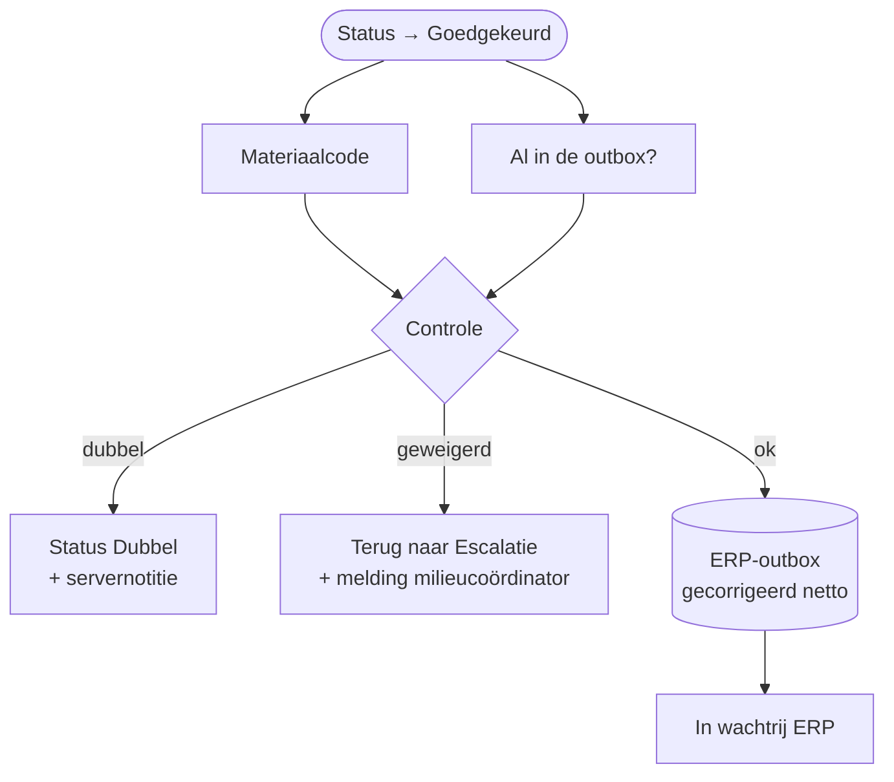

# HV-DI-02 Weegbon na nazicht boeken

| | |
|---|---|
| Case | [01 Document intelligence](../../01-document-intelligence/README.md) |
| User stories | [US-02 Afwijkende bon nakijken](../../01-document-intelligence/03-design.md#us-02-afwijkende-bon-nakijken), [US-04 Dubbels voorkomen](../../01-document-intelligence/03-design.md#us-04-dubbels-voorkomen) |
| BPMN (TO-BE) | *Weging boeken in ERP*, na *Gemarkeerde velden nakijken en corrigeren* |
| Eigenaar | administratie recyclage |
| Komt na | [HV-DI-01](HV-DI-01.md) → app [Weegbon Nakijken](../apps/weegbon-nakijken.md) · **Volgende stap** [HV-IN-01](HV-IN-01.md) |

## Doel

Een bon die een mens nakeek en goedkeurde, naar het ERP sturen met de **gecorrigeerde** waarden. Maar niet blind: de flow controleert zelf nog eens of het bonnummer al geboekt of onderweg is, en of het materiaal wel toegelaten is. Wat de app ook stuurde, of iemand de bon rechtstreeks in de tabel op *Goedgekeurd* zette: een dubbel of geweigerd materiaal gaat nooit naar het ERP.

## Trigger

Een rij in *Weegbon* wordt **gewijzigd**, alleen als `hv_status` wijzigt, en alleen als de nieuwe status *Goedgekeurd* is (`hv_status eq 100000006`). De app Weegbon Nakijken zet die status bij *Goedkeuren*, samen met de correcties.

## Invoer en uitvoer

| Leest | Kolommen |
|---|---|
| de goedgekeurde weegbon | `hv_bonnummer`, `hv_richting`, `hv_materiaal`, `hv_netto` (gecorrigeerd), `hv_reviewer`, `hv_reviewopmerking` |
| Materiaalcode | soort (aanvaard, geweigerd, product), prijs per ton |
| ERP-outbox | staat er al een bericht `wb-<bonnummer>` van een **andere** bon |

| Schrijft | Kolommen |
|---|---|
| ERP-outbox | sleutel `wb-<bonnummer>`, bedrag uit het gecorrigeerde netto, `approvedBy` = de reviewer |
| Weegbon | `hv_status` (*In wachtrij ERP*, *Dubbel* of terug naar *Escalatie*), `hv_erpreferentie`, of een servernotitie in `hv_reviewopmerking` |
| Melding | terug naar escalatie → milieucoördinator |

## Stappen

1. Tegelijk: de materiaalcode opzoeken, en zoeken of een andere bon met hetzelfde bonnummer al in de outbox staat.
2. Controle: al in de outbox → `dubbel`; materiaal onbekend, of niet de juiste soort voor de richting → `geweigerd`; anders `ok`.
3. Volgens de controle:
   - `dubbel`: status *Dubbel*, met "Server: bonnummer al geboekt of in de outbox" in de opmerking;
   - `geweigerd`: terug naar *Escalatie*, met de reden in de opmerking, en een melding aan de milieucoördinator;
   - `ok`: bericht in de ERP-outbox met de gecorrigeerde waarden, status *In wachtrij ERP*.

## Beslisregels

| Controle | Waarom op de server, en niet alleen in de app |
|---|---|
| R09 opnieuw: bonnummer al in de outbox of geboekt | de app kent alleen de bon die openstaat; twee mensen kunnen twee kopieën tegelijk goedkeuren |
| R06 opnieuw: materiaal toegelaten voor de richting | de app laat bij een escalatie alleen *weigeren* toe, maar een rechtstreekse wijziging in de tabel omzeilt de app |

De andere regels controleert de app live bij elke correctie, met dezelfde motor als de tests ([`recheck()`](../../src/review.mjs)).

## Foutafhandeling

| Wat kan misgaan | Wat de flow doet |
|---|---|
| Dezelfde bon wordt twee keer goedgekeurd | de controle kijkt naar berichten van **andere** bonnen, dus de tweede goedkeuring van dezelfde bon zet hem niet op *Dubbel*. De outbox-sleutel weigert het tweede bericht en de flow leest dat als "al in de outbox". |
| Een escalatie (asbest) wordt buiten de app goedgekeurd | terug naar *Escalatie*, met de reden; de milieucoördinator krijgt een melding. |
| Een stap faalt technisch | `Bij_fout`: melding aan functioneel beheer met de run-link; de bon blijft op *Goedgekeurd* en de run opnieuw indienen is veilig. |

## Configuratie

Geen eigen parameters. Verbinding: `hv_dataverse`. Wie mag goedkeuren, bepaalt de app (rol); in productie een beveiligingsrol op de tabel.

## Bewijs

- **3/3 zoals verwacht** ([VERIFICATION.md](../VERIFICATION.md#case-01--nakijken-app-weegbon-nakijken--flow-hv-di-02)):
  - DOC-006 gecorrigeerd (netto 13350 → 18350) en geboekt met het juiste gewicht;
  - DOC-013 (asbest), buiten de app op *Goedgekeurd* gezet → terug naar *Escalatie*, niet geboekt;
  - DOC-019 (kopie van DOC-004), buiten de app goedgekeurd → *Dubbel*, niet opnieuw geboekt.

*Run van de vorige versie, die nog rechtstreeks boekte; nu gaat de boeking via de outbox.*

## Beheer

- **Volgen:** backoffice-app → *01 Weegbonnen*; `hv_reviewopmerking` toont waarom de server een goedkeuring tegenhield.
- **Opnieuw testen:** `node power-platform/scripts/review-scenario.mjs`, enkele minuten wachten (de outbox loopt elke 5 minuten), dan `verify.mjs`.

## Ontwerp en gebouwd

Het doelontwerp zet een bon op *Nazicht*, maar beschrijft geen flow voor wat er na het nakijken gebeurt. Die stap kwam erbij met het nakijkscherm, en de laatste controle zit op de server, omdat een app omzeild kan worden. In het doelontwerp heet de child flow met de regels ook "HV-DI-02" ([weegbon-controleren.childflow.json](../../01-document-intelligence/artefacts/power-automate/weegbon-controleren.childflow.json)). In de gebouwde versie zitten die regels in HV-DI-01, en is HV-DI-02 deze flow.

## Technische stappen

<!--actions:HV-DI-02-->
*Gegenereerd uit [`definitions.mjs`](definitions.mjs) door `npm run build`. Niet met de hand aanpassen.* 17 acties · verbindingen: Microsoft Dataverse · omgevingsvariabelen: geen · regels uit *Bedrijfsregel*: geen.

- **Trigger `Weegbon_goedgekeurd`**: Dataverse, rij gewijzigd in *Weegbon* (`hv_document`); alleen bij wijziging van `hv_status`, voorwaarde `hv_status eq 100000006`
- `Probeer`: blok: alle stappen hieronder; faalt er één, dan gaat de run naar `Bij_fout`
  - `Materiaalcode`: rijen opzoeken in *Materiaalcode (acceptatielijst)* (eerste treffer) · start parallel
  - `Al_in_outbox`: rijen opzoeken in *ERP-outbox* (eerste treffer) · start parallel
  - `Controle`: berekening
  - `Volgens_controle`: keuze
    - geval `dubbel` (Dubbel):
      - `Status_dubbel`: rij bijwerken in *Weegbon*: `hv_status`, `hv_reviewopmerking`
    - geval `geweigerd` (Geweigerd):
      - `Status_escalatie`: rij bijwerken in *Weegbon*: `hv_status`, `hv_reviewopmerking`
      - `Melding_milieu`: rij toevoegen in *Melding*: `hv_titel`, `hv_tekst`, `hv_rol`, `hv_soort`, `hv_kanaal`, `hv_status`, `hv_bron`, `hv_referentie`, `hv_link`
    - geval `ok` (Boeken):
      - `ERP_bericht`: rij toevoegen in *ERP-outbox*: `hv_idempotencykey`, `hv_endpoint`, `hv_body`, `hv_status`, `hv_pogingen`, `hv_volgendepoging`, `hv_referentie`, `hv_Weegbon`
      - `ERP_bericht_controle`: voorwaarde · loopt ook als `ERP_bericht` faalt
        - als waar:
          - `ERP_bericht_mislukt`: run stoppen (status Failed)
      - `In_wachtrij`: rij bijwerken in *Weegbon*: `hv_status`, `hv_erpreferentie`
- `Bij_fout`: foutafhandeling (alleen als het blok hierboven faalt)
  - `Mislukte_stappen`: lijst filteren
  - `Foutnamen`: lijst omzetten
  - `Foutmelding`: rij toevoegen in *Melding*: `hv_titel`, `hv_tekst`, `hv_rol`, `hv_soort`, `hv_kanaal`, `hv_status`, `hv_bron`, `hv_referentie`, `hv_link`
  - `Run_mislukt`: run stoppen (status Failed)
<!--/actions-->
