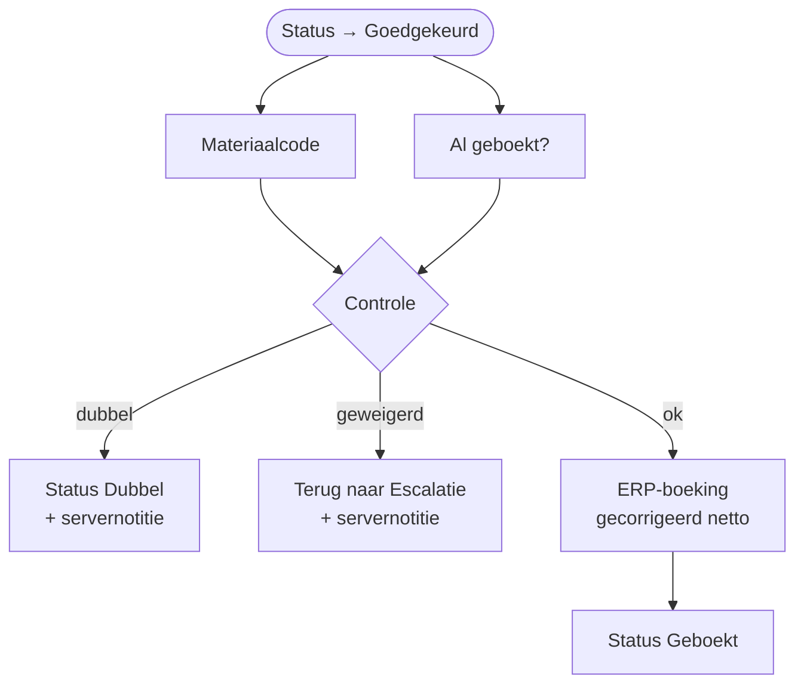

# HV-DI-02 Weegbon na nazicht boeken

| | |
|---|---|
| Case | [01 Document intelligence](../../01-document-intelligence/README.md) |
| User stories | [US-02 Afwijkende bon nakijken](../../01-document-intelligence/03-design.md#us-02-afwijkende-bon-nakijken), [US-04 Dubbels voorkomen](../../01-document-intelligence/03-design.md#us-04-dubbels-voorkomen) |
| Eigenaar | functioneel beheer recyclage |
| Komt na | [HV-DI-01](HV-DI-01.md) → app [Weegbon Nakijken](../apps/weegbon-nakijken.md) |

## Doel

Een bon die een mens nakeek en goedkeurde, boeken met de **gecorrigeerde** waarden. Maar niet blind: de flow controleert zelf nog eens of het bonnummer al geboekt is en of het materiaal wel toegelaten is. Wat de app ook stuurde, of iemand de bon rechtstreeks in de tabel op *Goedgekeurd* zette: een dubbel of geweigerd materiaal wordt nooit geboekt.

## Trigger

Een rij in *Weegbon* wordt **gewijzigd**, alleen als `hv_status` wijzigt, en alleen als de nieuwe status *Goedgekeurd* is (`hv_status eq 100000006`). De app Weegbon Nakijken zet die status bij *Goedkeuren*, samen met de correcties.

## Invoer en uitvoer

| Leest | Kolommen |
|---|---|
| de goedgekeurde weegbon | `hv_bonnummer`, `hv_richting`, `hv_materiaal`, `hv_netto` (gecorrigeerd), `hv_reviewer`, `hv_reviewopmerking` |
| Materiaalcode (acceptatielijst) | soort (aanvaard / geweigerd / product), prijs per ton |
| Weegbon | is een andere bon met hetzelfde bonnummer al *Geboekt* |

| Schrijft | Kolommen |
|---|---|
| Weegbon | `hv_status` (*Geboekt*, *Dubbel* of terug naar *Escalatie*), `hv_erpreferentie`, of een servernotitie in `hv_reviewopmerking` |
| ERP-boeking (sandbox) | sleutel `wb-<bonnummer>`, bedrag uit het gecorrigeerde netto, `approvedBy` = de reviewer |

## Stappen

1. Tegelijk: de materiaalcode opzoeken, en zoeken of een andere bon met hetzelfde bonnummer al geboekt is.
2. Controle: al geboekt → `dubbel`; materiaal onbekend, of niet de juiste soort voor de richting → `geweigerd`; anders `ok`.
3. Volgens de controle:
   - `dubbel`: status *Dubbel*, met "Server: bonnummer al geboekt" in de opmerking;
   - `geweigerd`: terug naar *Escalatie*, met "Server: materiaal niet toegelaten" in de opmerking;
   - `ok`: ERP-boeking met de gecorrigeerde waarden, status *Geboekt*.

## Beslisregels

| Controle | Waarom op de server, en niet alleen in de app |
|---|---|
| R09 opnieuw: bonnummer al geboekt | de app kent alleen de bon die openstaat; twee mensen kunnen twee kopieën tegelijk goedkeuren |
| R06 opnieuw: materiaal toegelaten voor de richting (aanvoer = aanvaard afval, afvoer = product) | de app laat bij een escalatie alleen *weigeren* toe, maar een rechtstreekse wijziging in de tabel omzeilt de app |

De andere regels (R01–R05, R07, R08, R10, R11) controleert de app live bij elke correctie, met dezelfde motor als de tests ([`recheck()`](../../src/review.mjs)).

## Foutafhandeling

| Wat kan misgaan | Wat de flow doet |
|---|---|
| Dezelfde bon wordt twee keer goedgekeurd | de tweede run vindt de geboekte bon → *Dubbel*. Komt de tweede run toch tot de boeking, dan weigert de sleutel `wb-<bonnummer>` de tweede rij en schrijft `Status_geboekt` "(al geboekt, idempotent)". |
| Een escalatie (asbest) wordt buiten de app goedgekeurd | terug naar *Escalatie*, met de reden in de opmerking. De milieucoördinator ziet de bon opnieuw. |
| De opzoeking faalt | de bon blijft op *Goedgekeurd* en valt op in de backoffice-weergave; de run opnieuw indienen is veilig. |

## Configuratie

Geen eigen omgevingsvariabelen. Verbinding: `hv_dataverse`. Wie mag goedkeuren, bepaalt de app (rol); in productie een beveiligingsrol op de tabel.

## Bewijs

- **3/3 zoals verwacht** ([VERIFICATION.md](../VERIFICATION.md#case-01--nakijken-app-weegbon-nakijken--flow-hv-di-02)):
  - DOC-006 gecorrigeerd (netto 13350 → 18350) en geboekt met het juiste gewicht;
  - DOC-013 (asbest), buiten de app op *Goedgekeurd* gezet → terug naar *Escalatie*, niet geboekt;
  - DOC-019 (kopie van DOC-004), buiten de app goedgekeurd → *Dubbel*, niet opnieuw geboekt.
- De run hieronder toont de keuze met de drie gevallen.

## Beheer

- **Volgen:** backoffice-app → *01 Weegbonnen*; `hv_reviewopmerking` toont waarom de server een goedkeuring tegenhield.
- **Opnieuw testen:** `node power-platform/scripts/review-scenario.mjs`, een minuut wachten, dan `verify.mjs`.

## Ontwerp en gebouwd

Het doelontwerp zet een bon op *Nazicht*, maar beschrijft geen flow voor wat er na het nakijken gebeurt. Die stap kwam erbij met het nakijkscherm, en de laatste controle zit op de server, omdat een app omzeild kan worden. Let op: in het doelontwerp heet de child flow met de regels ook "HV-DI-02" ([weegbon-controleren.childflow.json](../../01-document-intelligence/artefacts/power-automate/weegbon-controleren.childflow.json)). In de gebouwde versie zitten die regels in HV-DI-01, en is HV-DI-02 deze flow.

## Technische stappen

<!--actions:HV-DI-02-->
*Gegenereerd uit [`definitions.mjs`](definitions.mjs) door `npm run build`. Niet met de hand aanpassen.* 8 acties · verbindingen: Microsoft Dataverse · omgevingsvariabelen: geen.

- **Trigger `Weegbon_goedgekeurd`**: Dataverse, rij gewijzigd in *Weegbon* (`hv_document`); alleen bij wijziging van `hv_status`, voorwaarde `hv_status eq 100000006`
- `Materiaalcode`: rijen opzoeken in *Materiaalcode (acceptatielijst)* (eerste treffer) · start parallel
- `Al_geboekt`: rijen opzoeken in *Weegbon* (eerste treffer) · start parallel
- `Controle`: berekening
- `Volgens_controle`: keuze
  - geval `dubbel` (Dubbel):
    - `Status_dubbel`: rij bijwerken in *Weegbon*: `hv_status`, `hv_reviewopmerking`
  - geval `geweigerd` (Geweigerd):
    - `Status_escalatie`: rij bijwerken in *Weegbon*: `hv_status`, `hv_reviewopmerking`
  - geval `ok` (Boeken):
    - `ERP_boeking`: rij toevoegen in *ERP-boeking (sandbox)*: `hv_idempotencykey`, `hv_soort`, `hv_referentie`, `hv_bedrag`, `hv_payload`
    - `Status_geboekt`: rij bijwerken in *Weegbon*: `hv_status`, `hv_erpreferentie` · loopt ook als `ERP_boeking` faalt (bewust: idempotentie)
<!--/actions-->
