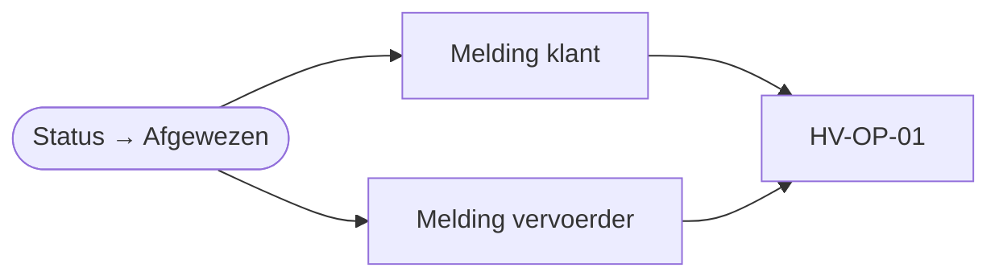

# HV-DI-03 Weigering melden

| | |
|---|---|
| Case | [01 Document intelligence](../../01-document-intelligence/README.md) |
| User story | [US-03 Geweigerd materiaal tegenhouden](../../01-document-intelligence/03-design.md#us-03-geweigerd-materiaal-tegenhouden) |
| BPMN (TO-BE) | *Klant en vervoerder verwittigen* |
| Eigenaar | milieucoördinator |
| Komt na | de milieucoördinator of de administratie weigert een bon in [Weegbon Nakijken](../apps/weegbon-nakijken.md) |

## Doel

Een geweigerde lading moet de klant en de vervoerder bereiken, met de reden. Vandaag belt iemand, of niet. Hier maakt de flow twee meldingen met dezelfde tekst, zodat achteraf vaststaat wie wat hoorde en wanneer.

## Trigger

Een rij in *Weegbon* wordt **gewijzigd** naar status *Afgewezen* (`hv_status eq 100000007`).

## Invoer en uitvoer

| Leest | Kolommen |
|---|---|
| de geweigerde weegbon | `hv_bonnummer`, `hv_datum`, `hv_plaat`, `hv_klantnummer`, `hv_materiaal`, `hv_reviewopmerking` (de reden) |

| Schrijft | Kolommen |
|---|---|
| Melding | twee rijen, kanaal *Extern*: één voor de klant, één voor de vervoerder |

## Stappen

1. Een melding voor de klant en een voor de vervoerder, tegelijk.
2. [HV-OP-01](HV-OP-01.md) pakt ze op. Het externe kanaal (mail of klantenportaal) is in deze omgeving niet aangesloten; de melding krijgt dan de status *Extern: kanaal niet aangesloten (demo)*.

## Beslisregels

- De reden komt uit de opmerking van wie weigerde. Zonder opmerking zet de app een standaardreden ("Geweigerd materiaal: lading geweigerd" of "Afgewezen bij nazicht"). In productie maak je de opmerking beter verplicht: een klant wil weten waarom.
- Elke weigering wordt gemeld, ook die van de administratie (bv. een onleesbare bon).

## Foutafhandeling

Standaard (zie [afspraken](README.md#afspraken-voor-alle-flows)): bij een fout een melding aan functioneel beheer met de run-link.

## Configuratie

Geen. Het externe kanaal hoort bij [HV-OP-01](HV-OP-01.md).

## Bewijs

Zie [VERIFICATION.md](../VERIFICATION.md#meldingen) (meldingen per bron en kanaal).

## Ontwerp en gebouwd

| | Doelontwerp | Gebouwd |
|---|---|---|
| Kanaal | mail aan klant en vervoerder | melding met kanaal *Extern*; de mail zelf is niet aangesloten |

## Technische stappen

<!--actions:HV-DI-03-->
*Gegenereerd uit [`definitions.mjs`](definitions.mjs) door `npm run build`. Niet met de hand aanpassen.* 8 acties · verbindingen: Microsoft Dataverse · omgevingsvariabelen: geen · regels uit *Bedrijfsregel*: geen.

- **Trigger `Weegbon_afgewezen`**: Dataverse, rij gewijzigd in *Weegbon* (`hv_document`); alleen bij wijziging van `hv_status`, voorwaarde `hv_status eq 100000007`
- `Probeer`: blok: alle stappen hieronder; faalt er één, dan gaat de run naar `Bij_fout`
  - `Klant_verwittigen`: rij toevoegen in *Melding*: `hv_titel`, `hv_tekst`, `hv_rol`, `hv_soort`, `hv_kanaal`, `hv_status`, `hv_bron`, `hv_referentie`, `hv_link` · start parallel
  - `Vervoerder_verwittigen`: rij toevoegen in *Melding*: `hv_titel`, `hv_tekst`, `hv_rol`, `hv_soort`, `hv_kanaal`, `hv_status`, `hv_bron`, `hv_referentie`, `hv_link` · start parallel
- `Bij_fout`: foutafhandeling (alleen als het blok hierboven faalt)
  - `Mislukte_stappen`: lijst filteren
  - `Foutnamen`: lijst omzetten
  - `Foutmelding`: rij toevoegen in *Melding*: `hv_titel`, `hv_tekst`, `hv_rol`, `hv_soort`, `hv_kanaal`, `hv_status`, `hv_bron`, `hv_referentie`, `hv_link`
  - `Run_mislukt`: run stoppen (status Failed)
<!--/actions-->
