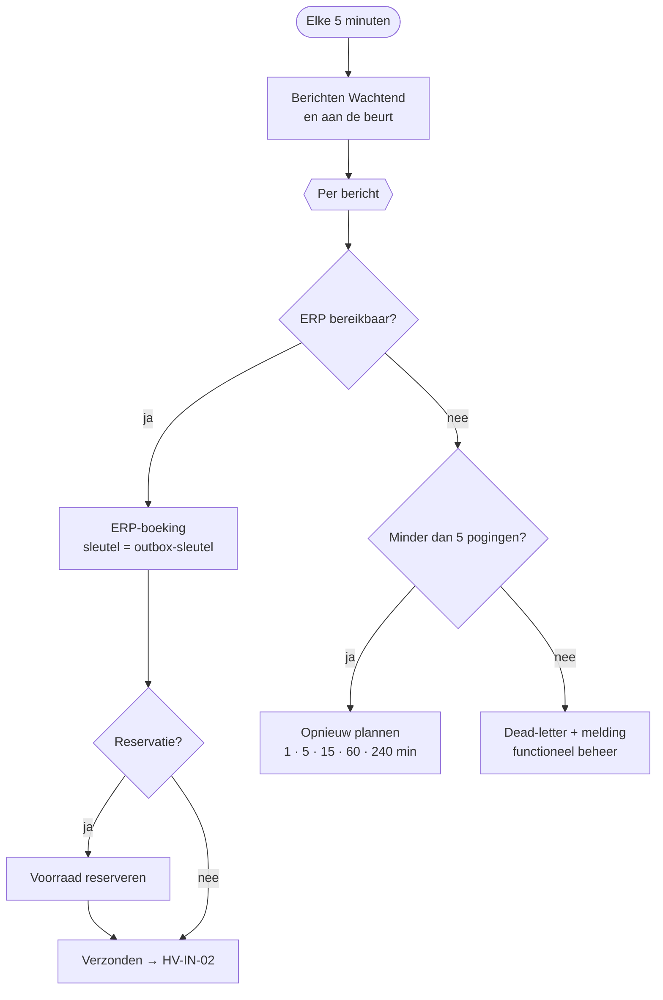

# HV-IN-01 ERP-outbox verzenden

| | |
|---|---|
| Cases | alle drie: weegtickets (01), projectkosten (02), reservaties, aankoopaanvragen en verbruik (03) |
| User story | [US-05 ERP-storing merkt niemand op de werf](../../03-material-requests/03-design.md#us-05-erp-storing-merkt-niemand-op-de-werf) |
| BPMN (TO-BE) | *Weging boeken in ERP* (01), *Kosten en recuperatie boeken op project* (02), *Reservatie + aankoopaanvraag naar ERP* en *Verbruik boeken op werf* (03) |
| Eigenaar | functioneel beheer |
| Komt na | elke flow die een bericht in de outbox zet · **Volgende stap** [HV-IN-02](HV-IN-02.md) |
| Ontwerpkeuze | [ADR-004 Outbox en idempotentie](../../shared-methodology/adr/ADR-004-outbox-idempotency.md) |

## Doel

**Eén weg naar het ERP, voor alle cases.** Geen enkele flow praat rechtstreeks met het ERP: ze zetten een bericht in de outbox, en deze flow brengt het over. Is het ERP even weg, dan probeert hij later opnieuw, met steeds langere pauzes. Lukt het na zes pogingen nog niet, dan gaat het bericht naar *dead-letter* en krijgt functioneel beheer een melding. Een bericht dat twee keer aankomt, wordt nooit twee keer geboekt.

Vroeger boekte case 01 rechtstreeks en ging alleen case 03 via de outbox. Bij een ERP-storing faalde case 01 dan, terwijl case 03 netjes wachtte. Nu gedragen alle cases zich bij een storing hetzelfde.

## Trigger

Een **schema**: elke 5 minuten. Nooit twee runs tegelijk (trigger-concurrency 1).

## Invoer en uitvoer

| Leest | Voorwaarde |
|---|---|
| ERP-outbox | status *Wachtend* en `hv_volgendepoging` ≤ nu; oudste eerst, max. 50 per run |
| omgevingsvariabele `hv_ErpBeschikbaar` | stelt in deze omgeving het ERP voor: aan = bereikbaar, uit = storing |

| Schrijft | Kolommen |
|---|---|
| ERP-boeking (sandbox) | `hv_idempotencykey` (= de outbox-sleutel), soort (volgt het endpoint), payload, referentie, bedrag |
| Voorraad (ERP-sandbox) | bij een reservatie: `hv_gereserveerd` + hoeveelheid |
| ERP-outbox | `hv_status` (*Verzonden* / *Dead-letter*), `hv_pogingen`, `hv_volgendepoging`, `hv_laatstefout` |
| Melding | bij dead-letter → functioneel beheer (soort *Fout*) |

## Stappen

1. De berichten ophalen die nu aan de beurt zijn.
2. Per bericht, één voor één:
   - **ERP bereikbaar**: de boeking maken; bij een reservatie de voorraad reserveren; het bericht op *Verzonden*, met "201 geboekt" of "200 al geboekt (idempotent)".
   - **ERP niet bereikbaar** en nog geen 5 pogingen: poging + 1, volgende poging na 1, 5, 15, 60 of 240 minuten, fout "503".
   - **ERP niet bereikbaar** en al 5 pogingen: *Dead-letter* en een melding aan functioneel beheer.

## Beslisregels

| Wat | Regel |
|---|---|
| Retryschema | na poging 1, 2, 3, 4, 5: wachten 1, 5, 15, 60, 240 minuten. Samen ruim 5 uur: een korte storing lost zichzelf op, een lange wordt een melding. |
| Dead-letter | bij de 6e mislukte poging |
| Volgorde | oudste bericht eerst, één voor één (geen parallelle reservaties op dezelfde voorraad) |
| Endpoints | *weighing-tickets* (01), *project-costs* (02), *reservations*, *purchase-requisitions*, *goods-issues* (03) |

Het retryschema is techniek, geen bedrijfsregel: het staat in de flow en in [`deliverOutbox()`](../../src/materials.mjs), niet in *Bedrijfsregel*.

## Foutafhandeling

Deze flow **is** de foutafhandeling van de integratie. Daarnaast:

| Wat kan misgaan | Wat de flow doet |
|---|---|
| De boeking bestaat al (vorige run viel weg na de boeking) | de alternatieve sleutel weigert de tweede rij; `Verzonden` loopt ook na die fout en schrijft "200 al geboekt (idempotent)". |
| Twee runs tegelijk | kan niet: trigger-concurrency 1. Mocht het toch gebeuren, dan vangt de sleutel het op. |
| Dead-letter | melding aan functioneel beheer, met het [runbook](../../03-material-requests/06-implement.md#runbook-dead-letter). |
| De flow zelf faalt | `Bij_fout`: melding aan functioneel beheer met de run-link; de berichten blijven *Wachtend* en de volgende run neemt ze mee. |

## Configuratie

| Wat | Waarde | Waar |
|---|---|---|
| `hv_ErpBeschikbaar` | ja | omgevingsvariabele; op *nee* zetten simuleert een storing |
| Retryschema, max. pogingen | vast in de flow | nieuwe versie |
| Verbinding | `hv_dataverse` | connection reference |

## Bewijs

- **Storingstest:** met `hv_ErpBeschikbaar = no` kregen twee pogingen "503 ERP niet bereikbaar", met een nieuwe poging na 1 en daarna 5 minuten. Na het herstel boekte de derde poging: **3 berichten, precies 3 ERP-boekingen** ([outbox tijdens de storing](../screenshots/13-app-outbox-tijdens-storing.jpg), [na het herstel](../screenshots/14-app-outbox-na-herstel.jpg)).
- **Alle cases via de outbox:** precies één ERP-boeking per sleutel, per endpoint ([VERIFICATION.md](../VERIFICATION.md#één-integratiepatroon-alles-via-de-outbox)).

## Beheer

- **Volgen:** backoffice-app → *03 Materiaal* → *ERP-outbox*; filter op *Dead-letter*. Het dashboard toont de outbox per status.
- **Dead-letter opnieuw proberen:** status terug op *Wachtend*, pogingen op 0, volgende poging = nu. De sleutel maakt dat veilig.
- **Storing simuleren:** `node power-platform/scripts/set-env.mjs hv_ErpBeschikbaar no`, en daarna weer `yes`.

## Ontwerp en gebouwd

| | Doelontwerp ([erp-outbox-verzenden.flow.json](../../03-material-requests/artefacts/power-automate/erp-outbox-verzenden.flow.json)) | Gebouwd |
|---|---|---|
| Versturen | HTTP naar de ERP-facade, met `Idempotency-Key`-header | rij in *ERP-boeking (sandbox)* met dezelfde sleutel als alternatieve sleutel |
| Fouten | onderscheid tijdelijk (5xx, 429) en definitief (4xx) | alleen "niet bereikbaar" (de schakelaar); een definitieve fout bestaat in de sandbox niet |
| Dead-letter | ticket bij functioneel beheer | status *Dead-letter* + melding |
| Schema | elke minuut | elke 5 minuten (minder runs in de ontwikkelomgeving) |
| Bereik | case 03 | alle cases |

## Technische stappen

<!--actions:HV-IN-01-->
*Gegenereerd uit [`definitions.mjs`](definitions.mjs) door `npm run build`. Niet met de hand aanpassen.* 18 acties · verbindingen: Microsoft Dataverse · omgevingsvariabelen: `hv_ErpBeschikbaar` (standaard true) · regels uit *Bedrijfsregel*: geen.

- **Trigger `Elke_5_minuten`**: schema, elke 5 minuten, nooit twee runs tegelijk
- `Probeer`: blok: alle stappen hieronder; faalt er één, dan gaat de run naar `Bij_fout`
  - `Klaar`: rijen opzoeken in *ERP-outbox*
  - `Per_bericht`: voor elk item, één voor één
    - `ERP_bereikbaar`: voorwaarde
      - als waar:
        - `ERP_boeking`: rij toevoegen in *ERP-boeking (sandbox)*: `hv_idempotencykey`, `hv_soort`, `hv_payload`, `hv_referentie`, `hv_bedrag`
        - `Reservatie`: voorwaarde
          - als waar:
            - `Voorraad`: rijen opzoeken in *Voorraad (ERP-sandbox)* (eerste treffer)
            - `Reserveren`: rij bijwerken in *Voorraad (ERP-sandbox)*: `hv_gereserveerd`
        - `Verzonden`: rij bijwerken in *ERP-outbox*: `hv_status`, `hv_pogingen`, `hv_laatstefout` · loopt ook als `Reservatie` faalt
      - anders:
        - `Nog_pogingen`: voorwaarde
          - als waar:
            - `Opnieuw_plannen`: rij bijwerken in *ERP-outbox*: `hv_pogingen`, `hv_volgendepoging`, `hv_laatstefout`
          - anders:
            - `Dead_letter`: rij bijwerken in *ERP-outbox*: `hv_status`, `hv_pogingen`, `hv_laatstefout`
            - `Melding_dead_letter`: rij toevoegen in *Melding*: `hv_titel`, `hv_tekst`, `hv_rol`, `hv_soort`, `hv_kanaal`, `hv_status`, `hv_bron`, `hv_referentie`, `hv_link`
- `Bij_fout`: foutafhandeling (alleen als het blok hierboven faalt)
  - `Mislukte_stappen`: lijst filteren
  - `Foutnamen`: lijst omzetten
  - `Foutmelding`: rij toevoegen in *Melding*: `hv_titel`, `hv_tekst`, `hv_rol`, `hv_soort`, `hv_kanaal`, `hv_status`, `hv_bron`, `hv_referentie`, `hv_link`
  - `Run_mislukt`: run stoppen (status Failed)
<!--/actions-->
