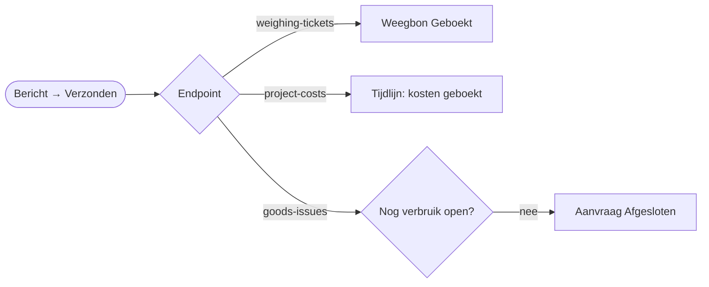

# HV-IN-02 ERP-bevestiging terugschrijven

| | |
|---|---|
| Cases | alle drie |
| BPMN (TO-BE) | het einde van *Weging boeken* (01), *Kosten boeken op project* (02), *Verbruik boeken* (03) |
| Eigenaar | functioneel beheer |
| Komt na | [HV-IN-01](HV-IN-01.md) zette een bericht op *Verzonden* |

## Doel

Als het ERP een bericht geboekt heeft, moet de bron dat weten. Anders zegt de backoffice "in wachtrij" terwijl het al lang geboekt is. Deze flow werkt de bron bij: de weegbon op *Geboekt*, een regel in de tijdlijn van de schadeclaim, de materiaalaanvraag op *Afgesloten* als al het verbruik geboekt is.

HV-IN-01 blijft zo algemeen: hij weet niets van weegbonnen of claims. Wie een nieuw soort bericht toevoegt, voegt hier een geval toe.

## Trigger

Een rij in *ERP-outbox* wordt **gewijzigd** naar *Verzonden* (`hv_status eq 100000001`).

## Invoer en uitvoer

| Leest | Kolommen |
|---|---|
| het verzonden bericht | `hv_endpoint`, `hv_idempotencykey`, `hv_laatstefout`, de gekoppelde weegbon, schadeclaim of aanvraag |
| ERP-outbox | bij verbruik: staan er nog verbruiksberichten van dezelfde aanvraag open |

| Schrijft | Kolommen |
|---|---|
| Weegbon | `hv_status` *Geboekt*, `hv_erpreferentie` (de sleutel, met "(al geboekt, idempotent)" als het ERP hem al kende) |
| Tijdlijn | *kosten geboekt op project (ERP)* |
| Materiaalaanvraag | `hv_status` *Afgesloten* |

## Stappen

Volgens het endpoint:

| Endpoint | Wat de flow doet |
|---|---|
| *weighing-tickets* | de weegbon op *Geboekt*, met de ERP-referentie |
| *project-costs* | een regel in de tijdlijn van de claim |
| *goods-issues* | als er geen open verbruiksbericht meer is voor die aanvraag: de aanvraag op *Afgesloten* |
| *reservations*, *purchase-requisitions* | niets: de aanvraag wacht op de planning en de levering |

## Foutafhandeling

Standaard (`Bij_fout`, melding aan functioneel beheer). Het outbox-bericht staat dan wel op *Verzonden*: het ERP heeft het. Wat ontbreekt, is alleen de status aan de bron; die kan beheer met de hand zetten, of de run opnieuw indienen.

## Bewijs

Zie [VERIFICATION.md](../VERIFICATION.md#één-integratiepatroon-alles-via-de-outbox): de geboekte weegbonnen, de tijdlijnregel van het afgesloten dossier, en de afgesloten aanvraag.

## Technische stappen

<!--actions:HV-IN-02-->
*Gegenereerd uit [`definitions.mjs`](definitions.mjs) door `npm run build`. Niet met de hand aanpassen.* 12 acties · verbindingen: Microsoft Dataverse · omgevingsvariabelen: geen · regels uit *Bedrijfsregel*: geen.

- **Trigger `Bericht_verzonden`**: Dataverse, rij gewijzigd in *ERP-outbox* (`hv_outbox`); alleen bij wijziging van `hv_status`, voorwaarde `hv_status eq 100000001`
- `Probeer`: blok: alle stappen hieronder; faalt er één, dan gaat de run naar `Bij_fout`
  - `Volgens_endpoint`: keuze
    - geval `100000000` (Weegticket):
      - `Weegbon_geboekt`: rij bijwerken in *Weegbon*: `hv_status`, `hv_erpreferentie`
    - geval `100000004` (Projectkost):
      - `Tijdlijn_geboekt`: rij toevoegen in *Tijdlijn*: `hv_gebeurtenis`, `hv_door`, `hv_opmerking`, `hv_Schadeclaim`
    - geval `100000003` (Verbruik):
      - `Nog_open`: rijen opzoeken in *ERP-outbox* (eerste treffer)
      - `Alles_geboekt`: voorwaarde
        - als waar:
          - `Aanvraag_afgesloten`: rij bijwerken in *Materiaalaanvraag*: `hv_status`
- `Bij_fout`: foutafhandeling (alleen als het blok hierboven faalt)
  - `Mislukte_stappen`: lijst filteren
  - `Foutnamen`: lijst omzetten
  - `Foutmelding`: rij toevoegen in *Melding*: `hv_titel`, `hv_tekst`, `hv_rol`, `hv_soort`, `hv_kanaal`, `hv_status`, `hv_bron`, `hv_referentie`, `hv_link`
  - `Run_mislukt`: run stoppen (status Failed)
<!--/actions-->
