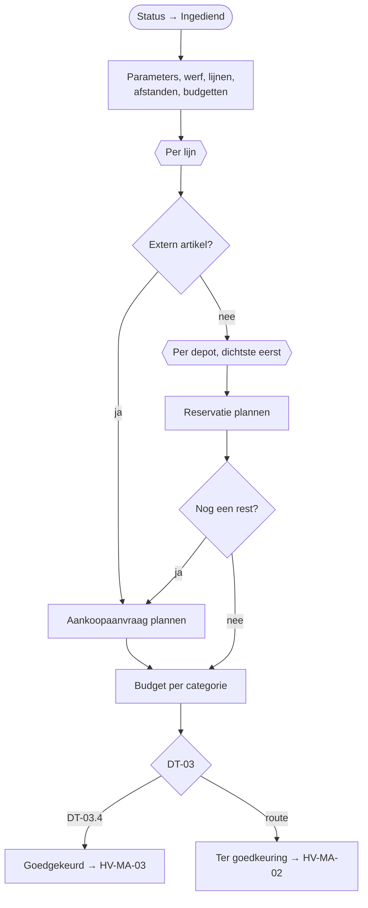

# HV-MA-01 Materiaalaanvraag verwerken en beslissen

| | |
|---|---|
| Case | [03 Materiaalaanvragen](../../03-material-requests/README.md) |
| User stories | [US-01 Aanvragen met zicht op voorraad](../../03-material-requests/03-design.md#us-01-aanvragen-met-zicht-op-voorraad), [US-02 Kleine aanvraag automatisch goedgekeurd](../../03-material-requests/03-design.md#us-02-kleine-aanvraag-automatisch-goedgekeurd), [US-03 Spoed met reden](../../03-material-requests/03-design.md#us-03-spoed-met-reden), [US-04 Budget bewaken](../../03-material-requests/03-design.md#us-04-budget-bewaken) |
| BPMN (TO-BE) | *Voorraad per depot opvragen*, *Toewijzen, budget, spoed, route (DT-03)* |
| Eigenaar | werfplanning; DT-03: afdelingsverantwoordelijke |
| Komt na | aanvraag in de [werfapp](../apps/werfapp.md) · **Volgende stap** *Goedgekeurd* → [HV-MA-03](HV-MA-03.md) · *Ter goedkeuring* → [HV-MA-02](HV-MA-02.md) |

## Doel

Een aanvraag van de werf in één keer beoordelen: per lijn uit welk depot het materiaal komt (het dichtste eerst), wat er moet worden aangekocht, of het binnen het werfbudget blijft, of het spoed is, en of iemand moet goedkeuren ([DT-03](../../03-material-requests/03-design.md#beslistabel-dt-03--moet-er-iemand-goedkeuren)). Een kleine aanvraag op voorraad gaat zonder mens door.

Deze flow **beslist** alleen. Hij vraagt geen goedkeuring en stuurt niets naar het ERP. De ERP-berichten die nodig zijn, plant hij op de aanvraag; [HV-MA-03](HV-MA-03.md) verstuurt ze pas als de aanvraag goedgekeurd is. Zo is elke flow klein genoeg om apart te testen en opnieuw te starten.

## Trigger

Een rij in *Materiaalaanvraag* wordt **toegevoegd of gewijzigd**, alleen als `hv_status` wijzigt naar *Ingediend* (`hv_status eq 100000001`). De werfapp maakt eerst de aanvraag en de lijnen aan, en zet daarna de status op *Ingediend*. Zo zijn alle lijnen er als de flow start.

## Invoer en uitvoer

| Leest | Kolommen |
|---|---|
| de aanvraag | werf, `hv_aanvraagnr`, `hv_leverenop` |
| Bedrijfsregel | DT-03.2, DT-03.3, SP-01 |
| Aanvraaglijn + Artikel | hoeveelheid; per artikel eenheidsprijs, categorie, bron (intern / extern), gerecycleerd alternatief |
| Afstand werf–depot | depots, gesorteerd op km |
| Voorraad (ERP-sandbox) | op voorraad en gereserveerd, per artikel en depot |
| Werfbudget | budget per categorie |

| Schrijft | Kolommen |
|---|---|
| Aanvraaglijn | `hv_waarde`, `hv_toewijzing` (bv. "160 uit DEP-OOST (4 km); 80 uit REC-BRK (6 km)"), `hv_tekort`, `hv_aankoop`, `hv_alternatief` |
| Materiaalaanvraag | `hv_waarde`, `hv_aankoopnodig`, `hv_budgetoverschreden`, `hv_route`, `hv_regel`, `hv_spoed`, `hv_berichten` (de geplande ERP-berichten, JSON), `hv_goedkeuringsniveau` = 0, `hv_status` |

## Stappen

1. Tegelijk: regelparameters, werf, lijnen (met artikel), afstanden en budgetten ophalen.
2. Per lijn, één voor één:
   - de waarde optellen, totaal en per categorie;
   - **extern artikel** → aankoopaanvraag plannen; gerecycleerd alternatief tonen, de projectleider beslist;
   - **intern artikel** → per depot van dichtbij naar ver nemen wat vrij is (op voorraad − gereserveerd), tot de hoeveelheid er is; een reservatie per depot plannen; een rest wordt een aankoopaanvraag.
3. Budget per categorie vergelijken; DT-03 toepassen → route en regel.
4. De aanvraag bijwerken, met de geplande berichten. Route *automatisch* → *Goedgekeurd*, anders *Ter goedkeuring*.

## Beslisregels

| Wat | Regel |
|---|---|
| Toewijzing | dichtste depot eerst; nemen wat vrij is; de rest uit het volgende depot; wat overblijft → aankoop ([toewijzing per depot](../../03-material-requests/03-design.md#toewijzing-per-depot)) |
| DT-03, eerste passende rij wint | .1 budgetlijn overschreden → Projectleider → Afdelingsverantwoordelijke · .2 waarde > DT-03.2 → idem · .3 waarde > DT-03.3 of aankoop nodig → Projectleider · .4 anders → **automatisch** |
| Spoed | levering binnen SP-01 uur → `hv_spoed`; verandert de goedkeuring niet |

Alle drempels: [regelcatalogus](../../shared-methodology/regelcatalogus.md#case-03). Dezelfde regels, getest: [`allocateLine()` en `approvalRoute()`](../../src/materials.mjs), en in Power Fx [dt-03-route.fx](../../03-material-requests/artefacts/power-fx/dt-03-route.fx).

## Foutafhandeling

| Wat kan misgaan | Wat de flow doet |
|---|---|
| Het ERP is niet bereikbaar | niets: deze flow praat niet met het ERP. |
| Twee aanvragen voor hetzelfde artikel kort na elkaar | de reservatie gebeurt pas bij het versturen ([HV-IN-01](HV-IN-01.md)), die telt op wat al gereserveerd is. Een tekort zie je bij de volgende aanvraag. In productie reserveert het ERP zelf. |
| De run wordt opnieuw ingediend | de flow overschrijft dezelfde kolommen; er gaat nog niets naar het ERP. De sleutels van de geplande berichten blijven dezelfde. |
| Een stap faalt technisch | `Bij_fout`: de aanvraag krijgt status *Fout*, functioneel beheer krijgt een melding met de run-link. Na het herstel de status terug op *Ingediend* zetten. |

## Configuratie

| Wat | Waar |
|---|---|
| DT-03.2, DT-03.3, SP-01 | tabel *Bedrijfsregel* |
| Budgetten, afstanden, voorraad | tabellen in de backoffice-app |

## Bewijs

- **4/4 identiek** met de geteste motor: waarde, DT-03-route en budgetcontrole ([VERIFICATION.md](../VERIFICATION.md#case-03--materiaalaanvragen-flows-hv-ma-01-tot-hv-ma-04)).
- 240 t menggranulaat voor W-2604 → **160 t uit Depot Oost (4 km) + 80 t uit de breekwerf (6 km)**, zoals in de tests.

## Beheer

- **Volgen:** backoffice-app → *03 Materiaal* → aanvraag → lijnen (toewijzing) en de geplande berichten.
- **Regel wijzigen:** [`src/materials.mjs`](../../src/materials.mjs) + test, dan [`definitions.mjs`](definitions.mjs), dan `provision-flows.mjs --only=HV-MA-01 --activate`, dan `verify.mjs`.

## Ontwerp en gebouwd

| | Doelontwerp ([materiaalaanvraag-verwerken.flow.json](../../03-material-requests/artefacts/power-automate/materiaalaanvraag-verwerken.flow.json)) | Gebouwd |
|---|---|---|
| Voorraad | opvragen bij de ERP-facade (OpenAPI) | tabel *Voorraad (ERP-sandbox)* |
| Opbouw | één flow: beslissen, goedkeuren en versturen | drie flows: beslissen (deze), goedkeuren ([HV-MA-02](HV-MA-02.md)), uitvoeren ([HV-MA-03](HV-MA-03.md)) |
| Planning | transportplanning verwittigen | spoed wordt gemarkeerd; de werfplanning krijgt een melding na de goedkeuring |

## Technische stappen

<!--actions:HV-MA-01-->
*Gegenereerd uit [`definitions.mjs`](definitions.mjs) door `npm run build`. Niet met de hand aanpassen.* 60 acties · verbindingen: Microsoft Dataverse · omgevingsvariabelen: geen · regels uit *Bedrijfsregel*: `DT-03.2`, `DT-03.3`, `SP-01`.

- **Trigger `Aanvraag_ingediend`**: Dataverse, rij toegevoegd of gewijzigd in *Materiaalaanvraag* (`hv_materiaalaanvraag`); alleen bij wijziging van `hv_status`, voorwaarde `hv_status eq 100000001`
- `Probeer`: blok: alle stappen hieronder; faalt er één, dan gaat de run naar `Bij_fout`
  - `Regels`: rijen opzoeken in *Bedrijfsregel* · start parallel
  - `Regelparen`: lijst omzetten
  - `Parameters`: berekening
  - `Werf`: één rij ophalen uit *Werf* · start parallel
  - `Lijnen`: rijen opzoeken in *Aanvraaglijn* · start parallel
  - `Afstanden`: rijen opzoeken in *Afstand werf–depot* · start parallel
  - `Budgetten`: rijen opzoeken in *Werfbudget* · start parallel
  - `Berichten`: variabele aanmaken `berichten` (array) · start parallel
  - `Waarde`: variabele aanmaken `waarde` (float)
  - `Aankoop`: variabele aanmaken `aankoop` (boolean)
  - `Rest`: variabele aanmaken `rest` (float)
  - `Toewijzing`: variabele aanmaken `toewijzing` (string)
  - `Cat_init_100000000`: variabele aanmaken `cat_100000000` (float)
  - `Cat_init_100000001`: variabele aanmaken `cat_100000001` (float)
  - `Cat_init_100000002`: variabele aanmaken `cat_100000002` (float)
  - `Cat_init_100000003`: variabele aanmaken `cat_100000003` (float)
  - `Cat_init_100000004`: variabele aanmaken `cat_100000004` (float)
  - `Per_lijn`: voor elk item, één voor één
    - `Lijnwaarde`: berekening
    - `Waarde_tellen`: variabele verhogen `waarde`
    - `Categorie_tellen`: keuze
      - geval `100000000` (Cat_100000000):
        - `Tel_100000000`: variabele verhogen `cat_100000000`
      - geval `100000001` (Cat_100000001):
        - `Tel_100000001`: variabele verhogen `cat_100000001`
      - geval `100000002` (Cat_100000002):
        - `Tel_100000002`: variabele verhogen `cat_100000002`
      - geval `100000003` (Cat_100000003):
        - `Tel_100000003`: variabele verhogen `cat_100000003`
      - geval `100000004` (Cat_100000004):
        - `Tel_100000004`: variabele verhogen `cat_100000004`
    - `Toewijzing_leeg`: variabele zetten `toewijzing`
    - `Bron`: voorwaarde
      - als waar:
        - `Extern_markeren`: variabele zetten `aankoop`
        - `Extern_bericht`: bericht toevoegen aan lijst `berichten`
        - `Lijn_extern`: rij bijwerken in *Aanvraaglijn*: `hv_waarde`, `hv_aankoop`, `hv_tekort`, `hv_toewijzing`, `hv_alternatief`
      - anders:
        - `Rest_init`: variabele zetten `rest`
        - `Per_depot`: voor elk item, één voor één
          - `Voorraad`: rijen opzoeken in *Voorraad (ERP-sandbox)* (eerste treffer)
          - `Beschikbaar`: berekening
          - `Neem`: berekening
          - `Iets_te_nemen`: voorwaarde
            - als waar:
              - `Toewijzing_tekst`: tekst toevoegen aan `toewijzing`
              - `Reservatie_bericht`: bericht toevoegen aan lijst `berichten`
              - `Rest_bijwerken`: variabele verlagen `rest`
        - `Tekort`: voorwaarde
          - als waar:
            - `Tekort_markeren`: variabele zetten `aankoop`
            - `Tekort_bericht`: bericht toevoegen aan lijst `berichten`
        - `Lijn_intern`: rij bijwerken in *Aanvraaglijn*: `hv_waarde`, `hv_tekort`, `hv_aankoop`, `hv_toewijzing`
  - `Budget_100000000`: lijst filteren
  - `Budget_100000001`: lijst filteren
  - `Budget_100000002`: lijst filteren
  - `Budget_100000003`: lijst filteren
  - `Budget_100000004`: lijst filteren
  - `Budget_overschreden`: berekening
  - `Route`: berekening
  - `Regel`: berekening
  - `Aanvraag_beslissen`: rij bijwerken in *Materiaalaanvraag*: `hv_waarde`, `hv_aankoopnodig`, `hv_budgetoverschreden`, `hv_route`, `hv_regel`, `hv_berichten`, `hv_goedkeuringsniveau`, `hv_spoed`, `hv_status`
- `Bij_fout`: foutafhandeling (alleen als het blok hierboven faalt)
  - `Mislukte_stappen`: lijst filteren
  - `Foutnamen`: lijst omzetten
  - `Foutmelding`: rij toevoegen in *Melding*: `hv_titel`, `hv_tekst`, `hv_rol`, `hv_soort`, `hv_kanaal`, `hv_status`, `hv_bron`, `hv_referentie`, `hv_link`
  - `Status_fout`: rij bijwerken in *Materiaalaanvraag*: `hv_status`
  - `Run_mislukt`: run stoppen (status Failed) · loopt ook als `Status_fout` faalt
<!--/actions-->
