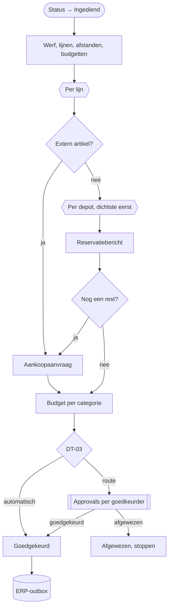

# HV-MA-01 Materiaalaanvraag verwerken

| | |
|---|---|
| Case | [03 Materiaalaanvragen](../../03-material-requests/README.md) |
| User stories | [US-01 Aanvragen met zicht op voorraad](../../03-material-requests/03-design.md#us-01-aanvragen-met-zicht-op-voorraad), [US-02 Kleine aanvraag automatisch goedgekeurd](../../03-material-requests/03-design.md#us-02-kleine-aanvraag-automatisch-goedgekeurd), [US-04 Budget bewaken](../../03-material-requests/03-design.md#us-04-budget-bewaken) |
| Eigenaar | aankoop & logistiek |
| Komt na | aanvraag in de [werfapp](../apps/werfapp.md) · **Volgende stap** [HV-MA-02](HV-MA-02.md) verstuurt de berichten naar het ERP |

## Doel

Een aanvraag van de werf in één keer verwerken: per lijn uit welk depot het materiaal komt (het dichtste eerst), wat er moet worden aangekocht, of het binnen het werfbudget blijft, en of iemand moet goedkeuren ([DT-03](../../03-material-requests/03-design.md#beslistabel-dt-03--moet-er-iemand-goedkeuren)). Een kleine aanvraag op voorraad gaat zonder mens door. De berichten voor het ERP gaan in een outbox, zodat een ERP-storing de werf niet blokkeert.

## Trigger

Een rij in *Materiaalaanvraag* wordt **toegevoegd of gewijzigd**, alleen als `hv_status` wijzigt naar *Ingediend* (`hv_status eq 100000001`). De werfapp maakt eerst de aanvraag en de lijnen aan, en zet daarna de status op *Ingediend*. Zo zijn alle lijnen er als de flow start.

## Invoer en uitvoer

| Leest | Kolommen |
|---|---|
| de aanvraag | werf, `hv_aanvraagnr`, `hv_leverenop` |
| Aanvraaglijn + Artikel | hoeveelheid; per artikel eenheidsprijs, categorie, bron (intern / extern), gerecycleerd alternatief |
| Afstand werf–depot | depots, gesorteerd op km |
| Voorraad (ERP-sandbox) | op voorraad en gereserveerd, per artikel en depot |
| Werfbudget | budget per categorie |

| Schrijft | Kolommen |
|---|---|
| Aanvraaglijn | `hv_waarde`, `hv_toewijzing` (bv. "160 uit DEP-OOST (4 km); 80 uit REC-BRK (6 km)"), `hv_tekort`, `hv_aankoop`, `hv_alternatief` |
| Materiaalaanvraag | `hv_waarde`, `hv_aankoopnodig`, `hv_budgetoverschreden`, `hv_route`, `hv_regel`, `hv_spoed`, `hv_status` |
| Approvals | per goedkeurder in de route één aanvraag |
| ERP-outbox | één rij per reservatie en per aankoopaanvraag, met een vaste sleutel, status *Wachtend* |

## Stappen

1. Tegelijk: werf, lijnen (met artikel), afstanden en budgetten ophalen.
2. Per lijn, één voor één:
   - de waarde optellen, totaal en per categorie;
   - **extern artikel** → aankoopaanvraag; gerecycleerd alternatief tonen, de projectleider beslist;
   - **intern artikel** → per depot van dichtbij naar ver nemen wat vrij is (op voorraad − gereserveerd), tot de hoeveelheid er is; een reservatiebericht per depot; een rest wordt een aankoopaanvraag.
3. Budget per categorie vergelijken; DT-03 toepassen → route en regel.
4. De aanvraag bijwerken. Route *automatisch* → *Goedgekeurd*, anders *Ter goedkeuring*.
5. Als er een route is: goedkeuring per goedkeurder, na elkaar; één afwijzing → *Afgewezen*, stoppen, **geen** berichten naar het ERP.
6. Alle berichten in de ERP-outbox.

## Beslisregels

| Wat | Regel |
|---|---|
| Toewijzing | dichtste depot eerst; nemen wat vrij is; de rest uit het volgende depot; wat overblijft → aankoop ([toewijzing per depot](../../03-material-requests/03-design.md#toewijzing-per-depot)) |
| DT-03, eerste passende rij wint | .1 budgetlijn overschreden → Projectleider → Afdelingsverantwoordelijke · .2 waarde > €10.000 → idem · .3 waarde > €1.000 of aankoop nodig → Projectleider · .4 anders → **automatisch** |
| Spoed | levering binnen 48 uur → `hv_spoed`; verandert de goedkeuring niet |

Dezelfde regels, getest: [`allocateLine()` en `approvalRoute()`](../../src/materials.mjs), en in Power Fx [dt-03-route.fx](../../03-material-requests/artefacts/power-fx/dt-03-route.fx).

## Foutafhandeling

| Wat kan misgaan | Wat de flow doet |
|---|---|
| Het ERP is niet bereikbaar | niets: deze flow praat niet met het ERP. Hij schrijft in de outbox; [HV-MA-02](HV-MA-02.md) verstuurt en probeert opnieuw. |
| Twee aanvragen voor hetzelfde artikel kort na elkaar | de reservatie gebeurt pas bij het versturen. HV-MA-02 telt dan op wat al gereserveerd is; een tekort zie je bij de volgende aanvraag. In productie reserveert het ERP zelf. |
| De run wordt opnieuw ingediend | de outbox-sleutel (`<aanvraag>-<artikel>-<depot>` of `-PR`) weigert dezelfde berichten een tweede keer. |
| Afwijzing | status *Afgewezen*, run stopt, geen berichten. |
| Geen antwoord op de goedkeuring | de run wacht (maximaal de looptijd van een flow, 30 dagen). De aanvraag staat zichtbaar op *Ter goedkeuring*. |

## Configuratie

| Wat | Waarde | Waar |
|---|---|---|
| `hv_AutoApproveMax` | €1.000 | omgevingsvariabele |
| `hv_PlApproveMax` | €10.000 | omgevingsvariabele |
| Budgetten, afstanden, voorraad, goedkeurders | tabellen | backoffice-app |
| Verbindingen | `hv_dataverse`, `hv_approvals` | connection references |

## Bewijs

- **4/4 identiek** met de geteste motor: waarde, DT-03-route en budgetcontrole ([VERIFICATION.md](../VERIFICATION.md#case-03--materiaalaanvragen-flows-hv-ma-01-en-hv-ma-02)).
- 240 t menggranulaat voor W-2604 → **160 t uit Depot Oost (4 km) + 80 t uit de breekwerf (6 km)**, zoals in de tests.
- De run hieronder: vier opzoekingen parallel, daarna de variabelen en de lus per lijn.
- Drie aanvragen (MA-26-1000, -1001, -1003) wachten op een goedkeuring. Hun berichten staan nog niet in de outbox: dat gebeurt pas na de goedkeuring.

## Beheer

- **Volgen:** backoffice-app → *03 Materiaal* → aanvraag → lijnen (toewijzing) en outbox.
- **Regel wijzigen:** [`src/materials.mjs`](../../src/materials.mjs) + test, dan [`definitions.mjs`](definitions.mjs), dan `provision-flows.mjs --only=HV-MA-01 --activate`, dan `verify.mjs`.

## Ontwerp en gebouwd

| | Doelontwerp ([materiaalaanvraag-verwerken.flow.json](../../03-material-requests/artefacts/power-automate/materiaalaanvraag-verwerken.flow.json)) | Gebouwd |
|---|---|---|
| Voorraad | opvragen bij de ERP-facade (OpenAPI) | tabel *Voorraad (ERP-sandbox)* |
| Goedkeuring | projectleider, tweede niveau apart | elke goedkeurder uit de route, na elkaar |
| Planning | transportplanning verwittigen | spoed wordt gemarkeerd; geen bericht |

## Technische stappen

<!--actions:HV-MA-01-->
*Gegenereerd uit [`definitions.mjs`](definitions.mjs) door `npm run build`. Niet met de hand aanpassen.* 64 acties · verbindingen: Microsoft Dataverse, Approvals · omgevingsvariabelen: `hv_AutoApproveMax` (standaard 1000), `hv_PlApproveMax` (standaard 10000).

- **Trigger `Aanvraag_ingediend`**: Dataverse, rij toegevoegd of gewijzigd in *Materiaalaanvraag* (`hv_materiaalaanvraag`); alleen bij wijziging van `hv_status`, voorwaarde `hv_status eq 100000001`
- `Werf`: één rij ophalen uit *Werf* · start parallel
- `Lijnen`: rijen opzoeken in *Aanvraaglijn* · start parallel
- `Afstanden`: rijen opzoeken in *Afstand werf–depot* · start parallel
- `Budgetten`: rijen opzoeken in *Werfbudget* · start parallel
- `Berichten`: variabele aanmaken `berichten` (array) · start parallel
- `Waarde`: variabele aanmaken `waarde` (float)
- `Aankoop`: variabele aanmaken `aankoop` (boolean)
- `Rest`: variabele aanmaken `rest` (float)
- `Toewijzing`: variabele aanmaken `toewijzing` (string)
- `Afgewezen_init`: variabele aanmaken `afgewezen` (boolean)
- `Cat_init_100000000`: variabele aanmaken `cat_100000000` (float)
- `Cat_init_100000001`: variabele aanmaken `cat_100000001` (float)
- `Cat_init_100000002`: variabele aanmaken `cat_100000002` (float)
- `Cat_init_100000003`: variabele aanmaken `cat_100000003` (float)
- `Cat_init_100000004`: variabele aanmaken `cat_100000004` (float)
- `Per_lijn`: voor elk item, één voor één
  - `Lijnwaarde`: berekening
  - `Waarde_tellen`: variabele verhogen `waarde`
  - `Categorie_tellen`: keuze
    - geval `100000000` (Cat_100000000):
      - `Tel_100000000`: variabele verhogen `cat_100000000`
    - geval `100000001` (Cat_100000001):
      - `Tel_100000001`: variabele verhogen `cat_100000001`
    - geval `100000002` (Cat_100000002):
      - `Tel_100000002`: variabele verhogen `cat_100000002`
    - geval `100000003` (Cat_100000003):
      - `Tel_100000003`: variabele verhogen `cat_100000003`
    - geval `100000004` (Cat_100000004):
      - `Tel_100000004`: variabele verhogen `cat_100000004`
  - `Toewijzing_leeg`: variabele zetten `toewijzing`
  - `Bron`: voorwaarde
    - als waar:
      - `Extern_markeren`: variabele zetten `aankoop`
      - `Extern_bericht`: bericht toevoegen aan lijst `berichten`
      - `Lijn_extern`: rij bijwerken in *Aanvraaglijn*: `hv_waarde`, `hv_aankoop`, `hv_tekort`, `hv_toewijzing`, `hv_alternatief`
    - anders:
      - `Rest_init`: variabele zetten `rest`
      - `Per_depot`: voor elk item, één voor één
        - `Voorraad`: rijen opzoeken in *Voorraad (ERP-sandbox)* (eerste treffer)
        - `Beschikbaar`: berekening
        - `Neem`: berekening
        - `Iets_te_nemen`: voorwaarde
          - als waar:
            - `Toewijzing_tekst`: tekst toevoegen aan `toewijzing`
            - `Reservatie_bericht`: bericht toevoegen aan lijst `berichten`
            - `Rest_bijwerken`: variabele verlagen `rest`
      - `Tekort`: voorwaarde
        - als waar:
          - `Tekort_markeren`: variabele zetten `aankoop`
          - `Tekort_bericht`: bericht toevoegen aan lijst `berichten`
      - `Lijn_intern`: rij bijwerken in *Aanvraaglijn*: `hv_waarde`, `hv_tekort`, `hv_aankoop`, `hv_toewijzing`
- `Budget_100000000`: lijst filteren
- `Budget_100000001`: lijst filteren
- `Budget_100000002`: lijst filteren
- `Budget_100000003`: lijst filteren
- `Budget_100000004`: lijst filteren
- `Budget_overschreden`: berekening
- `Route`: berekening
- `Regel`: berekening
- `Aanvraag_evaluatie`: rij bijwerken in *Materiaalaanvraag*: `hv_waarde`, `hv_aankoopnodig`, `hv_budgetoverschreden`, `hv_route`, `hv_regel`, `hv_spoed`, `hv_status`
- `Goedkeuring_nodig`: voorwaarde
  - als waar:
    - `Per_goedkeurder`: voor elk item, één voor één
      - `Nog_niet_afgewezen`: voorwaarde
        - als waar:
          - `Goedkeurder`: rijen opzoeken in *Goedkeurder* (eerste treffer)
          - `Goedkeuring`: goedkeuring vragen via Approvals en wachten op het antwoord
          - `Afwijzing_onthouden`: voorwaarde
            - als waar:
              - `Markeer_afgewezen`: variabele zetten `afgewezen`
    - `Uitkomst`: voorwaarde
      - als waar:
        - `Status_afgewezen`: rij bijwerken in *Materiaalaanvraag*: `hv_status`
        - `Stoppen`: run stoppen (status Succeeded)
      - anders:
        - `Status_goedgekeurd`: rij bijwerken in *Materiaalaanvraag*: `hv_status`
- `Naar_outbox`: voor elk item
  - `Outbox_rij`: rij toevoegen in *ERP-outbox*: `hv_idempotencykey`, `hv_endpoint`, `hv_body`, `hv_status`, `hv_pogingen`, `hv_volgendepoging`, `hv_referentie`, `hv_Aanvraag`
<!--/actions-->
