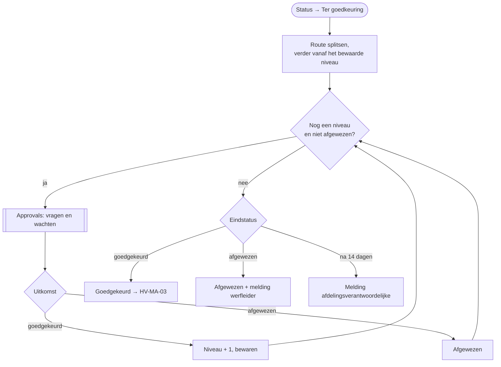

# HV-MA-02 Materiaalaanvraag goedkeuren

| | |
|---|---|
| Case | [03 Materiaalaanvragen](../../03-material-requests/README.md) |
| User stories | [US-04 Budget bewaken](../../03-material-requests/03-design.md#us-04-budget-bewaken) |
| BPMN (TO-BE) | *Goedkeuren in Teams of app* |
| Eigenaar | afdelingsverantwoordelijke |
| Komt na | [HV-MA-01](HV-MA-01.md) zette *Ter goedkeuring* · **Volgende stap** *Goedgekeurd* → [HV-MA-03](HV-MA-03.md) |

## Doel

De route die HV-MA-01 bepaalde (bv. `Projectleider>Afdelingsverantwoordelijke`), niveau per niveau laten goedkeuren. Eén afwijzing stopt de keten en de werfleider hoort waarom.

## Trigger

Een rij in *Materiaalaanvraag* wordt **gewijzigd** naar *Ter goedkeuring* (`hv_status eq 100000002`).

Dit is hetzelfde patroon als [HV-CL-02](HV-CL-02.md): **een status start de vraag, de uitkomst is een status.** Vroeger wachtte HV-MA-01 zelf op de goedkeuring. Dat had twee nadelen: een run duurt maximaal 30 dagen, en een herstart halverwege deed alles opnieuw, ook de toewijzing. Nu is het wachten een eigen flow, die verdergaat bij het bewaarde niveau.

## Invoer en uitvoer

| Leest | Kolommen |
|---|---|
| de aanvraag | `hv_route`, `hv_goedkeuringsniveau`, `hv_aanvraagnr`, `hv_waarde`, `hv_regel`, `hv_aanvrager` |
| Rol | rol → e-mailadres |

| Schrijft | Kolommen |
|---|---|
| Approvals | één aanvraag per niveau |
| Materiaalaanvraag | `hv_goedkeuringsniveau` na elke goedkeuring; op het einde *Goedgekeurd* of *Afgewezen* |
| Melding | afgewezen → werfleider (met de opmerking) · verlopen → afdelingsverantwoordelijke |

## Stappen

1. De route splitsen op `>`; beginnen bij het bewaarde niveau.
2. Per niveau: de persoon opzoeken, de goedkeuring vragen en wachten; goedgekeurd → volgend niveau bewaren; afgewezen → stoppen (max. 14 dagen).
3. Uitkomst: *Goedgekeurd* (dan start [HV-MA-03](HV-MA-03.md)), *Afgewezen* met een melding aan de werfleider, of verlopen met een melding aan de afdelingsverantwoordelijke.

## Beslisregels

- De route komt uit DT-03 (HV-MA-01). Deze flow voert ze uit, hij beslist niet wie.
- Eén afwijzing is genoeg; er gaat dan niets naar het ERP.

## Foutafhandeling

| Wat kan misgaan | Wat de flow doet |
|---|---|
| Niemand antwoordt binnen 14 dagen | melding aan de afdelingsverantwoordelijke; de aanvraag blijft *Ter goedkeuring*. Opnieuw op *Ter goedkeuring* zetten hervat de keten. |
| Een rol heeft geen persoon | `Bij_fout`: de aanvraag krijgt status *Fout*, melding aan functioneel beheer. |

## Configuratie

Rol → persoon in de tabel *Rol (goedkeurder en ontvanger)*. Verbindingen: `hv_dataverse`, `hv_approvals`.

## Bewijs

De aanvragen boven €1.000 staan in [VERIFICATION.md](../VERIFICATION.md#case-03--materiaalaanvragen-flows-hv-ma-01-tot-hv-ma-04) op *Ter goedkeuring*, met een open goedkeuring in Power Automate. **De keten is nog niet doorlopen**: dat gebeurt zodra iemand de goedkeuringen beantwoordt.

## Ontwerp en gebouwd

| | Doelontwerp | Gebouwd |
|---|---|---|
| Vragen | Teams-kaart voor de projectleider, tweede niveau apart | Approvals per niveau uit de route |
| Plaats | in de verwerkingsflow | eigen flow op een status (zie Trigger) |

## Technische stappen

<!--actions:HV-MA-02-->
*Gegenereerd uit [`definitions.mjs`](definitions.mjs) door `npm run build`. Niet met de hand aanpassen.* 23 acties · verbindingen: Microsoft Dataverse, Approvals · omgevingsvariabelen: geen · regels uit *Bedrijfsregel*: geen.

- **Trigger `Ter_goedkeuring`**: Dataverse, rij gewijzigd in *Materiaalaanvraag* (`hv_materiaalaanvraag`); alleen bij wijziging van `hv_status`, voorwaarde `hv_status eq 100000002`
- `Keten`: variabele aanmaken `keten` (array)
- `Niveau`: variabele aanmaken `niveau` (integer)
- `Afgewezen`: variabele aanmaken `afgewezen` (boolean)
- `Probeer`: foutafhandeling (alleen als het blok hierboven faalt)
  - `Per_niveau`: herhalen tot de voorwaarde klopt (max. 6 keer, time-out 14 dagen)
    - `Goedkeurder`: rijen opzoeken in *Rol (goedkeurder en ontvanger)* (eerste treffer)
    - `Goedkeuring`: goedkeuring vragen via Approvals en wachten op het antwoord
    - `Uitkomst`: voorwaarde
      - als waar:
        - `Volgend_niveau`: variabele verhogen `niveau`
        - `Niveau_bewaren`: rij bijwerken in *Materiaalaanvraag*: `hv_goedkeuringsniveau`
      - anders:
        - `Markeer_afgewezen`: variabele zetten `afgewezen`
  - `Eindstatus`: berekening · loopt ook als `Per_niveau` faalt
  - `Volgens_uitkomst`: keuze
    - geval `goedgekeurd` (Goedgekeurd):
      - `Status_goedgekeurd`: rij bijwerken in *Materiaalaanvraag*: `hv_status`
    - geval `afgewezen` (Afgewezen):
      - `Status_afgewezen`: rij bijwerken in *Materiaalaanvraag*: `hv_status`
      - `Melding_afgewezen`: rij toevoegen in *Melding*: `hv_titel`, `hv_tekst`, `hv_rol`, `hv_soort`, `hv_kanaal`, `hv_status`, `hv_bron`, `hv_referentie`, `hv_link`
    - geval `verlopen` (Verlopen):
      - `Melding_verlopen`: rij toevoegen in *Melding*: `hv_titel`, `hv_tekst`, `hv_rol`, `hv_soort`, `hv_kanaal`, `hv_status`, `hv_bron`, `hv_referentie`, `hv_link`
- `Bij_fout`: foutafhandeling (alleen als het blok hierboven faalt)
  - `Mislukte_stappen`: lijst filteren
  - `Foutnamen`: lijst omzetten
  - `Foutmelding`: rij toevoegen in *Melding*: `hv_titel`, `hv_tekst`, `hv_rol`, `hv_soort`, `hv_kanaal`, `hv_status`, `hv_bron`, `hv_referentie`, `hv_link`
  - `Status_fout`: rij bijwerken in *Materiaalaanvraag*: `hv_status`
  - `Run_mislukt`: run stoppen (status Failed) · loopt ook als `Status_fout` faalt
<!--/actions-->
