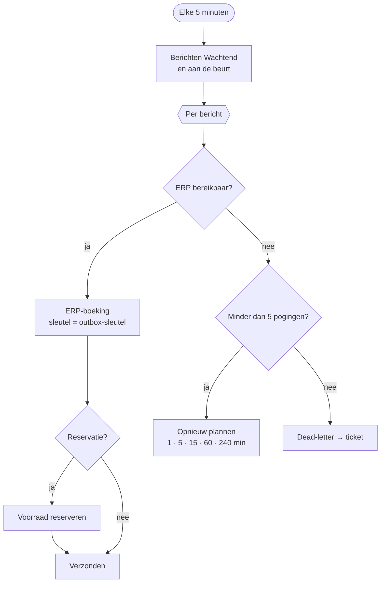

# HV-MA-02 ERP-outbox verzenden

| | |
|---|---|
| Case | [03 Materiaalaanvragen](../../03-material-requests/README.md) |
| User story | [US-05 ERP-storing merkt niemand op de werf](../../03-material-requests/03-design.md#us-05-erp-storing-merkt-niemand-op-de-werf) |
| Eigenaar | functioneel beheer ERP |
| Komt na | [HV-MA-01](HV-MA-01.md) zette berichten in de outbox |
| Ontwerpkeuze | [ADR-004 Outbox en idempotentie](../../shared-methodology/adr/ADR-004-outbox-idempotency.md) |

## Doel

De berichten uit de outbox betrouwbaar in het ERP krijgen. Is het ERP even weg, dan probeert de flow later opnieuw, met steeds langere pauzes. Lukt het na zes pogingen nog niet, dan gaat het bericht naar *dead-letter* en is het een ticket voor functioneel beheer. Een bericht dat twee keer aankomt, wordt nooit twee keer geboekt.

## Trigger

Een **schema**: elke 5 minuten.

## Invoer en uitvoer

| Leest | Voorwaarde |
|---|---|
| ERP-outbox | status *Wachtend* en `hv_volgendepoging` ≤ nu; oudste eerst, max. 50 per run |
| omgevingsvariabele `hv_ErpBeschikbaar` | stelt in deze omgeving het ERP voor: aan = bereikbaar, uit = storing |

| Schrijft | Kolommen |
|---|---|
| ERP-boeking (sandbox) | `hv_idempotencykey` (= de outbox-sleutel), soort, payload, referentie |
| Voorraad (ERP-sandbox) | bij een reservatie: `hv_gereserveerd` + hoeveelheid |
| ERP-outbox | `hv_status` (*Verzonden* / *Dead-letter*), `hv_pogingen`, `hv_volgendepoging`, `hv_laatstefout` |

## Stappen

1. De berichten ophalen die nu aan de beurt zijn.
2. Per bericht, één voor één:
   - **ERP bereikbaar**: de boeking maken; bij een reservatie de voorraad reserveren; het bericht op *Verzonden*, met "201 geboekt" of "200 al geboekt (idempotent)".
   - **ERP niet bereikbaar** en nog geen 5 pogingen geteld: poging + 1, volgende poging na 1, 5, 15, 60 of 240 minuten, fout "503".
   - **ERP niet bereikbaar** en al 5 pogingen geteld: *Dead-letter*.

## Beslisregels

| Wat | Regel |
|---|---|
| Retryschema | na poging 1, 2, 3, 4, 5: wachten 1, 5, 15, 60, 240 minuten. Samen ruim 5 uur: een korte storing lost zichzelf op, een lange wordt een ticket. |
| Dead-letter | bij de 6e mislukte poging |
| Volgorde | oudste bericht eerst, één voor één (geen parallelle reservaties op dezelfde voorraad) |

## Foutafhandeling

Deze flow **is** de foutafhandeling van case 03. Daarnaast:

| Wat kan misgaan | Wat de flow doet |
|---|---|
| De boeking bestaat al (vorige run viel weg na de boeking) | de alternatieve sleutel weigert de tweede rij; `Verzonden` loopt ook na die fout en schrijft "200 al geboekt (idempotent)". |
| Twee runs tegelijk | elke run neemt alleen berichten die nog *Wachtend* zijn; de sleutel vangt een overlap op. |
| Dead-letter | in productie een ticket bij functioneel beheer ([runbook](../../03-material-requests/06-implement.md#runbook-dead-letter)); hier blijft het bericht zichtbaar in de backoffice-app. |

## Configuratie

| Wat | Waarde | Waar |
|---|---|---|
| `hv_ErpBeschikbaar` | ja | omgevingsvariabele; op *nee* zetten simuleert een storing |
| Retryschema, max. pogingen | vast in de flow | nieuwe versie |
| Verbinding | `hv_dataverse` | connection reference |

## Bewijs

- **Storingstest:** met `hv_ErpBeschikbaar = no` kregen twee pogingen "503 ERP niet bereikbaar", met een nieuwe poging na 1 en daarna 5 minuten. Na het herstel boekte de derde poging: **3 berichten, precies 3 ERP-boekingen** ([VERIFICATION.md](../VERIFICATION.md#erp-outbox-door-hv-ma-02-naar-de-erp-sandbox), [outbox tijdens de storing](../screenshots/13-app-outbox-tijdens-storing.jpg), [na het herstel](../screenshots/14-app-outbox-na-herstel.jpg)).
- De run hieronder is er één uit de storing: de tak *Onwaar* (ERP niet bereikbaar) liep, de boeking is overgeslagen.

## Beheer

- **Volgen:** backoffice-app → *03 Materiaal* → *ERP-outbox*; filter op *Dead-letter*.
- **Dead-letter opnieuw proberen:** status terug op *Wachtend*, pogingen op 0, volgende poging = nu. De sleutel maakt dat veilig.
- **Storing simuleren:** `node power-platform/scripts/set-env.mjs hv_ErpBeschikbaar no`, en daarna weer `yes`.

## Ontwerp en gebouwd

| | Doelontwerp ([erp-outbox-verzenden.flow.json](../../03-material-requests/artefacts/power-automate/erp-outbox-verzenden.flow.json)) | Gebouwd |
|---|---|---|
| Versturen | HTTP naar de ERP-facade, met `Idempotency-Key`-header | rij in *ERP-boeking (sandbox)* met dezelfde sleutel als alternatieve sleutel |
| Fouten | onderscheid tijdelijk (5xx, 429) en definitief (4xx) | alleen "niet bereikbaar" (de schakelaar); een definitieve fout bestaat in de sandbox niet |
| Dead-letter | ticket bij functioneel beheer | status *Dead-letter*; geen ticket |
| Schema | elke minuut | elke 5 minuten (minder runs in de ontwikkelomgeving) |

## Technische stappen

<!--actions:HV-MA-02-->
*Gegenereerd uit [`definitions.mjs`](definitions.mjs) door `npm run build`. Niet met de hand aanpassen.* 11 acties · verbindingen: Microsoft Dataverse · omgevingsvariabelen: `hv_ErpBeschikbaar` (standaard true).

- **Trigger `Elke_5_minuten`**: schema, elke 5 minuten
- `Klaar`: rijen opzoeken in *ERP-outbox*
- `Per_bericht`: voor elk item, één voor één
  - `ERP_bereikbaar`: voorwaarde
    - als waar:
      - `ERP_boeking`: rij toevoegen in *ERP-boeking (sandbox)*: `hv_idempotencykey`, `hv_soort`, `hv_payload`, `hv_referentie`
      - `Reservatie`: voorwaarde
        - als waar:
          - `Voorraad`: rijen opzoeken in *Voorraad (ERP-sandbox)* (eerste treffer)
          - `Reserveren`: rij bijwerken in *Voorraad (ERP-sandbox)*: `hv_gereserveerd`
      - `Verzonden`: rij bijwerken in *ERP-outbox*: `hv_status`, `hv_pogingen`, `hv_laatstefout` · loopt ook als `Reservatie` faalt (bewust: idempotentie)
    - anders:
      - `Nog_pogingen`: voorwaarde
        - als waar:
          - `Opnieuw_plannen`: rij bijwerken in *ERP-outbox*: `hv_pogingen`, `hv_volgendepoging`, `hv_laatstefout`
        - anders:
          - `Dead_letter`: rij bijwerken in *ERP-outbox*: `hv_status`, `hv_pogingen`, `hv_laatstefout`
<!--/actions-->
