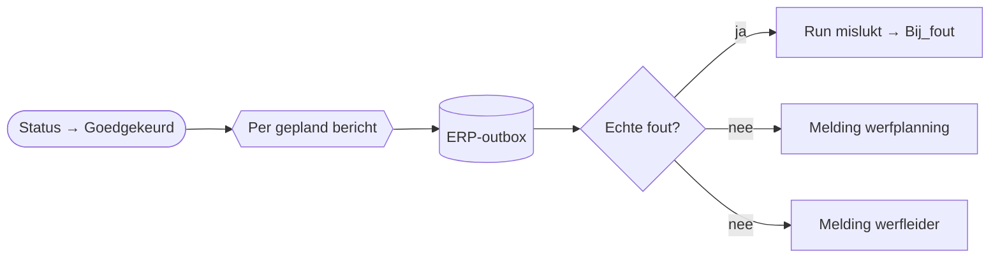

# HV-MA-03 Materiaalaanvraag uitvoeren

| | |
|---|---|
| Case | [03 Materiaalaanvragen](../../03-material-requests/README.md) |
| User stories | [US-02 Kleine aanvraag automatisch goedgekeurd](../../03-material-requests/03-design.md#us-02-kleine-aanvraag-automatisch-goedgekeurd), [US-05 ERP-storing merkt niemand op de werf](../../03-material-requests/03-design.md#us-05-erp-storing-merkt-niemand-op-de-werf) |
| BPMN (TO-BE) | *Reservatie + aankoopaanvraag naar ERP (outbox, retry)* |
| Eigenaar | werfplanning |
| Komt na | *Goedgekeurd*, door [HV-MA-01](HV-MA-01.md) (automatisch) of [HV-MA-02](HV-MA-02.md) · **Volgende stap** [HV-IN-01](HV-IN-01.md) |

## Doel

Pas als een aanvraag goedgekeurd is, gaan de reservaties en aankoopaanvragen naar het ERP. Deze flow zet de berichten die HV-MA-01 plande in de outbox, en verwittigt de werfplanning (inplannen) en de werfleider (goedgekeurd).

## Trigger

Een rij in *Materiaalaanvraag* wordt **gewijzigd** naar *Goedgekeurd* (`hv_status eq 100000003`).

## Invoer en uitvoer

| Leest | Kolommen |
|---|---|
| de aanvraag | `hv_berichten` (JSON: sleutel, endpoint, inhoud), `hv_aanvraagnr`, `hv_regel`, `hv_leverenop` |

| Schrijft | Kolommen |
|---|---|
| ERP-outbox | één rij per gepland bericht: *reservations* of *purchase-requisitions*, met de geplande sleutel, gekoppeld aan de aanvraag |
| Melding | werfplanning (actie: inplannen) · werfleider (info: goedgekeurd) |

## Stappen

1. Per gepland bericht: een rij in de outbox. Een bericht dat er al staat (zelfde sleutel), telt als in orde.
2. Faalde een bericht om een andere reden, dan stopt de run (de meldingen vertrekken dan niet).
3. Tegelijk: melding aan de werfplanning en aan de werfleider.

## Beslisregels

Geen. Wat er naar het ERP gaat, is beslist in HV-MA-01; of het mag, in HV-MA-02.

## Foutafhandeling

| Wat kan misgaan | Wat de flow doet |
|---|---|
| De aanvraag wordt twee keer op *Goedgekeurd* gezet | de outbox-sleutels weigeren de tweede reeks; de flow leest dat als "al in de outbox". |
| Een bericht kan om een andere reden niet in de outbox | de flow telt het, en stopt na de lus met een fout. `Bij_fout` meldt het aan functioneel beheer. |
| Het ERP ligt plat | niets in deze flow; de outbox wacht ([HV-IN-01](HV-IN-01.md)). |

## Configuratie

Geen. Verbinding: `hv_dataverse`.

## Bewijs

Zie [VERIFICATION.md](../VERIFICATION.md#case-03--materiaalaanvragen-flows-hv-ma-01-tot-hv-ma-04): de automatisch goedgekeurde aanvraag heeft haar berichten in de outbox, en de aanvragen die op een goedkeuring wachten nog niet.

## Ontwerp en gebouwd

In het doelontwerp zat dit in de verwerkingsflow. Apart is het kleiner en te herstarten zonder de toewijzing opnieuw te doen.

## Technische stappen

<!--actions:HV-MA-03-->
*Gegenereerd uit [`definitions.mjs`](definitions.mjs) door `npm run build`. Niet met de hand aanpassen.* 15 acties · verbindingen: Microsoft Dataverse · omgevingsvariabelen: geen · regels uit *Bedrijfsregel*: geen.

- **Trigger `Goedgekeurd`**: Dataverse, rij gewijzigd in *Materiaalaanvraag* (`hv_materiaalaanvraag`); alleen bij wijziging van `hv_status`, voorwaarde `hv_status eq 100000003`
- `Probeer`: blok: alle stappen hieronder; faalt er één, dan gaat de run naar `Bij_fout`
  - `Outboxfouten`: variabele aanmaken `outboxfouten` (integer)
  - `Naar_outbox`: voor elk item
    - `Outbox_rij`: rij toevoegen in *ERP-outbox*: `hv_idempotencykey`, `hv_endpoint`, `hv_body`, `hv_status`, `hv_pogingen`, `hv_volgendepoging`, `hv_referentie`, `hv_Aanvraag`
    - `Outbox_rij_controle`: voorwaarde · loopt ook als `Outbox_rij` faalt
      - als waar:
        - `Outbox_rij_tellen`: variabele verhogen `outboxfouten`
  - `Outbox_gelukt`: voorwaarde · loopt ook als `Naar_outbox` faalt
    - als waar:
      - `Outbox_mislukt`: run stoppen (status Failed)
  - `Melding_planning`: rij toevoegen in *Melding*: `hv_titel`, `hv_tekst`, `hv_rol`, `hv_soort`, `hv_kanaal`, `hv_status`, `hv_bron`, `hv_referentie`, `hv_link`
  - `Melding_werfleider`: rij toevoegen in *Melding*: `hv_titel`, `hv_tekst`, `hv_rol`, `hv_soort`, `hv_kanaal`, `hv_status`, `hv_bron`, `hv_referentie`, `hv_link`
- `Bij_fout`: foutafhandeling (alleen als het blok hierboven faalt)
  - `Mislukte_stappen`: lijst filteren
  - `Foutnamen`: lijst omzetten
  - `Foutmelding`: rij toevoegen in *Melding*: `hv_titel`, `hv_tekst`, `hv_rol`, `hv_soort`, `hv_kanaal`, `hv_status`, `hv_bron`, `hv_referentie`, `hv_link`
  - `Run_mislukt`: run stoppen (status Failed)
<!--/actions-->
