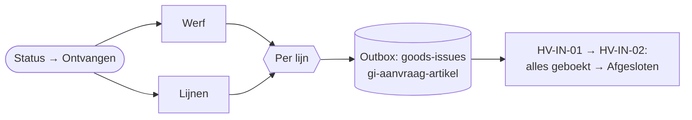

# HV-MA-04 Ontvangst: verbruik boeken

| | |
|---|---|
| Case | [03 Materiaalaanvragen](../../03-material-requests/README.md) |
| User story | [US-06 Ontvangst bevestigen, verbruik op de werf](../../03-material-requests/03-design.md#us-06-ontvangst-bevestigen-verbruik-op-de-werf) |
| BPMN (TO-BE) | *Verbruik boeken op werf (ERP)*, na *Ontvangst bevestigen* |
| Eigenaar | werfplanning |
| Komt na | de werfleider bevestigt de ontvangst in de [werfapp](../apps/werfapp.md) · **Volgende stap** [HV-IN-01](HV-IN-01.md) → [HV-IN-02](HV-IN-02.md) zet de aanvraag op *Afgesloten* |

## Doel

Vandaag staan de kosten van materiaal pas dagen later, of op de verkeerde werf. Zodra de werfleider de levering bevestigt, boekt deze flow het verbruik per lijn op de werf, via de outbox. Als alle lijnen geboekt zijn, is de aanvraag afgesloten.

## Trigger

Een rij in *Materiaalaanvraag* wordt **gewijzigd** naar *Ontvangen* (`hv_status eq 100000006`). De werfapp zet die status met de knop *Ontvangst bevestigen*.

## Invoer en uitvoer

| Leest | Kolommen |
|---|---|
| de aanvraag | `hv_aanvraagnr`, de werf |
| Aanvraaglijn + Artikel | artikelnummer, hoeveelheid, waarde |

| Schrijft | Kolommen |
|---|---|
| ERP-outbox | per lijn: endpoint *goods-issues*, sleutel `gi-<aanvraag>-<artikel>`, hoeveelheid, werf, bedrag |

## Stappen

1. Tegelijk: de werf en de lijnen ophalen.
2. Per lijn een verbruiksbericht in de outbox (een bestaand bericht telt als in orde).
3. Faalde een bericht om een andere reden, dan stopt de run.

## Beslisregels

- De geboekte hoeveelheid is de **aangevraagde** hoeveelheid. Een afwijking (minder geleverd, breuk) meldt de werfleider in de opmerking; het ERP corrigeert met een retour. In een volgende versie vult de werfleider per lijn de ontvangen hoeveelheid in.

## Foutafhandeling

| Wat kan misgaan | Wat de flow doet |
|---|---|
| De ontvangst wordt twee keer bevestigd | de sleutels weigeren de tweede reeks. |
| Een andere fout | de aanvraag krijgt status *Fout*, functioneel beheer krijgt een melding. |

## Configuratie

Geen. Verbinding: `hv_dataverse`.

## Bewijs

Zie [VERIFICATION.md](../VERIFICATION.md#case-03--materiaalaanvragen-flows-hv-ma-01-tot-hv-ma-04): de testaanvraag ging van *Ontvangen* naar *Afgesloten*, met één verbruiksboeking per lijn.

## Ontwerp en gebouwd

| | Doelontwerp | Gebouwd |
|---|---|---|
| Ontvangst | foto van de leverbon in de app | knop *Ontvangst bevestigen*; geen foto |
| Verbruik | rechtstreeks naar het ERP | via de outbox |

## Technische stappen

<!--actions:HV-MA-04-->
*Gegenereerd uit [`definitions.mjs`](definitions.mjs) door `npm run build`. Niet met de hand aanpassen.* 16 acties · verbindingen: Microsoft Dataverse · omgevingsvariabelen: geen · regels uit *Bedrijfsregel*: geen.

- **Trigger `Ontvangen`**: Dataverse, rij gewijzigd in *Materiaalaanvraag* (`hv_materiaalaanvraag`); alleen bij wijziging van `hv_status`, voorwaarde `hv_status eq 100000006`
- `Outboxfouten`: variabele aanmaken `outboxfouten` (integer)
- `Probeer`: foutafhandeling (alleen als het blok hierboven faalt)
  - `Werf`: één rij ophalen uit *Werf* · start parallel
  - `Lijnen`: rijen opzoeken in *Aanvraaglijn* · start parallel
  - `Per_lijn`: voor elk item
    - `Verbruik_naar_outbox`: rij toevoegen in *ERP-outbox*: `hv_idempotencykey`, `hv_endpoint`, `hv_body`, `hv_status`, `hv_pogingen`, `hv_volgendepoging`, `hv_referentie`, `hv_Aanvraag`
    - `Verbruik_naar_outbox_controle`: voorwaarde · loopt ook als `Verbruik_naar_outbox` faalt
      - als waar:
        - `Verbruik_naar_outbox_tellen`: variabele verhogen `outboxfouten`
  - `Outbox_gelukt`: voorwaarde · loopt ook als `Per_lijn` faalt
    - als waar:
      - `Outbox_mislukt`: run stoppen (status Failed)
- `Bij_fout`: foutafhandeling (alleen als het blok hierboven faalt)
  - `Mislukte_stappen`: lijst filteren
  - `Foutnamen`: lijst omzetten
  - `Foutmelding`: rij toevoegen in *Melding*: `hv_titel`, `hv_tekst`, `hv_rol`, `hv_soort`, `hv_kanaal`, `hv_status`, `hv_bron`, `hv_referentie`, `hv_link`
  - `Status_fout`: rij bijwerken in *Materiaalaanvraag*: `hv_status`
  - `Run_mislukt`: run stoppen (status Failed) · loopt ook als `Status_fout` faalt
<!--/actions-->
