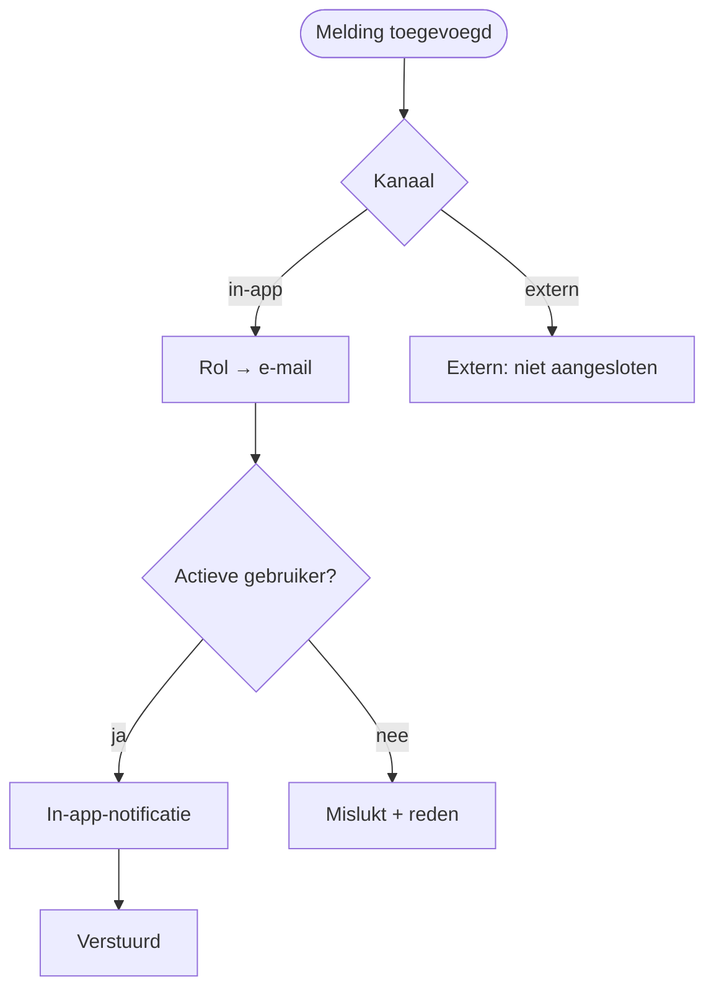
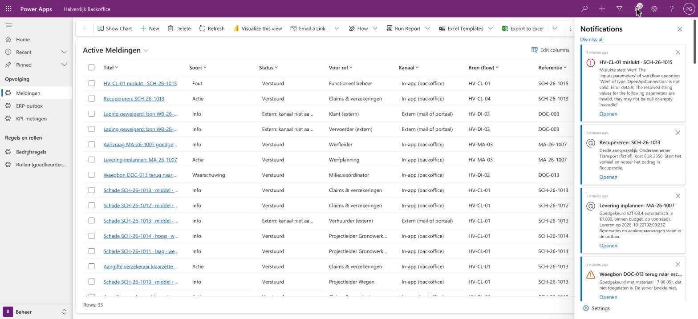
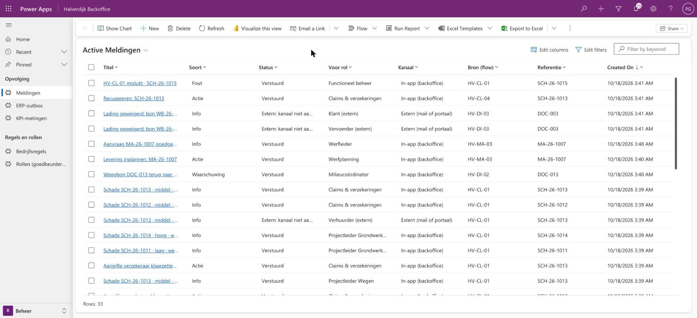

# HV-OP-01 Meldingen versturen

| | |
|---|---|
| Cases | alle drie, en de foutafhandeling van elke flow |
| BPMN (TO-BE) | *Betrokkenen verwittigen* (02), *Klant en vervoerder verwittigen* (01), en elke "verwittigd"-stap |
| Eigenaar | functioneel beheer |
| Komt na | elke flow die een rij in *Melding* maakt |

## Doel

"Verwittigen" moet echt iemand bereiken, en achteraf moet je kunnen zien wie wat kreeg en wanneer. Geen enkele flow stuurt zelf een bericht: elke flow schrijft een **melding** (titel, tekst, voor welke rol, soort, kanaal, link), en deze ene flow levert ze af.

Waarom één flow: het kanaal kiezen (in-app, Teams, mail) gebeurt op één plaats. Wil Halverdijk later Teams in plaats van in-app, dan verandert alleen deze flow. En de tabel *Melding* is het auditspoor van alle communicatie.

## Trigger

Een rij wordt **toegevoegd** in *Melding* (`hv_melding`).

## Invoer en uitvoer

| Leest | Kolommen |
|---|---|
| de melding | `hv_titel`, `hv_tekst`, `hv_rol`, `hv_soort`, `hv_kanaal`, `hv_link` |
| Rol | rol → e-mailadres |
| Gebruiker (systeem) | e-mailadres → actieve gebruiker in de omgeving |

| Schrijft | Kolommen |
|---|---|
| In-app-notificatie (systeem) | titel, tekst, eigenaar = de gebruiker, icoon volgens de soort, een knop *Openen* met de link |
| Melding | `hv_status`: *Verstuurd*, *Extern: kanaal niet aangesloten (demo)* of *Mislukt* (met de reden) |

## Stappen

1. **Intern** (in-app): de rol opzoeken, dan de gebruiker met dat e-mailadres. Gevonden → een in-app-notificatie in de backoffice-app (het belletje rechtsboven) en de melding op *Verstuurd*. Niet gevonden → *Mislukt*, met de reden in de tekst.
2. **Extern** (verzekeraar, klant, vervoerder, verhuurder, leidingbeheerder): dat kanaal is in de ontwikkelomgeving niet aangesloten. De melding krijgt die status, zodat zichtbaar blijft wat er in productie zou vertrekken.

## Beslisregels

| Soort | Icoon | Wanneer |
|---|---|---|
| Info | informatie | iemand moet het weten (dossier aangemaakt, goedgekeurd) |
| Actie | vermelding | iemand moet iets doen (nakijken, aangifte versturen, inplannen) |
| Waarschuwing | waarschuwing | een termijn dreigt of is voorbij |
| Fout | fout | een flow faalde, of een bericht staat in dead-letter |

## Foutafhandeling

Deze flow meldt zijn eigen fouten **niet** als melding: dat zou een lus kunnen geven. Faalt het afleveren, dan krijgt de melding status *Mislukt*. Beheer ziet die in *Beheer* → *Meldingen*.

## Configuratie

| Wat | Waar |
|---|---|
| Rol → persoon | tabel *Rol (goedkeurder en ontvanger)*. In de ontwikkelomgeving wijzen alle rollen naar hetzelfde account. |
| In-app-notificaties | instelling van de backoffice-app (*In-app notifications* aan), gezet door [`provision-app.mjs`](../scripts/provision-app.mjs) |

## Bewijs

Meldingen per bron, soort en status: [VERIFICATION.md](../VERIFICATION.md#meldingen).

## Ontwerp en gebouwd

| | Doelontwerp | Gebouwd |
|---|---|---|
| Kanaal intern | Teams-kaart of mail | in-app-notificatie in de backoffice-app |
| Kanaal extern | mail of portaal | gemarkeerd, niet verstuurd |
| Plaats | in elke flow | één flow; elke andere flow schrijft alleen een melding |

## Technische stappen

<!--actions:HV-OP-01-->
*Gegenereerd uit [`definitions.mjs`](definitions.mjs) door `npm run build`. Niet met de hand aanpassen.* 9 acties · verbindingen: Microsoft Dataverse · omgevingsvariabelen: geen · regels uit *Bedrijfsregel*: geen.

- **Trigger `Melding_aangemaakt`**: Dataverse, rij toegevoegd in *Melding* (`hv_melding`)
- `Kanaal`: voorwaarde
  - als waar:
    - `Rol`: rijen opzoeken in *Rol (goedkeurder en ontvanger)* (eerste treffer)
    - `Gebruiker`: rijen opzoeken in *Gebruiker (systeem)* (eerste treffer)
    - `Gevonden`: voorwaarde
      - als waar:
        - `Notificatie`: rij toevoegen in *In-app-notificatie (systeem)*: `title`, `body`, `ownerid`, `icontype`, `toasttype`, `ttlinseconds`, `data`
        - `Verstuurd`: rij bijwerken in *Melding*: `hv_status`
      - anders:
        - `Geen_gebruiker`: rij bijwerken in *Melding*: `hv_status`, `hv_tekst`
  - anders:
    - `Extern`: rij bijwerken in *Melding*: `hv_status`
- `Bij_fout`: rij bijwerken in *Melding*: `hv_status` · alleen als `Kanaal` faalt
<!--/actions-->
