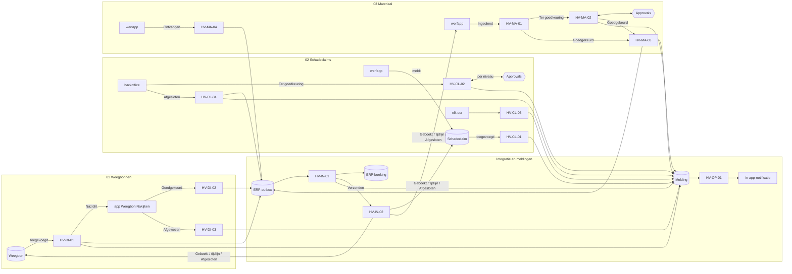
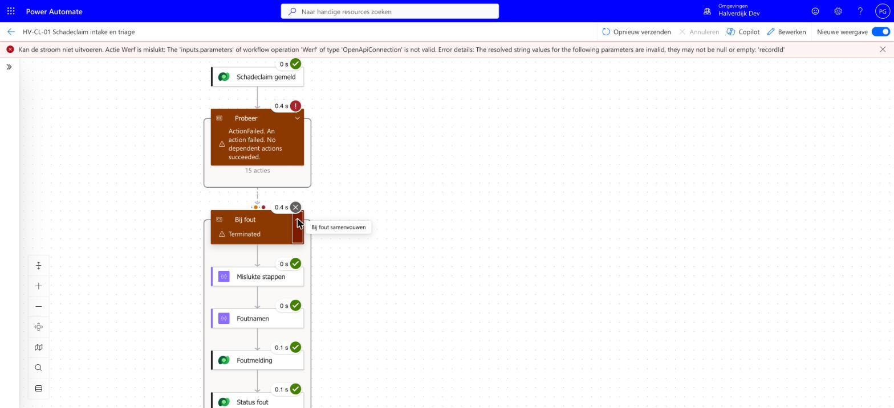

# De flows

Elke flow heeft een eigen **spec** in gewone taal. Daarin staan het doel, wanneer de flow start, wat hij leest en schrijft, de stappen, de beslisregels, wat er gebeurt als iets faalt, en het bewijs dat hij werkt. Onderaan elke spec staat een technische stappenlijst. Die wordt bij elke build gegenereerd uit de code, zodat de uitleg niet kan afwijken van wat echt draait.

## Flow-inventaris

Per flow: wanneer hij start, van welke status naar welke, wie eigenaar is. De tabel komt uit [`definitions.mjs`](definitions.mjs); de build faalt als een flow ontbreekt.

<!--inventory-->
| Flow | Case | Trigger | Van | Naar | Eigenaar | Spec |
|---|---|---|---|---|---|---|
| **HV-DI-01** Weegbon controleren | 01 | Weegbon toegevoegd | Weegbon toegevoegd (status Ontvangen) | In wachtrij ERP · Nazicht · Escalatie · Dubbel | Administratie recyclage | [HV-DI-01.md](HV-DI-01.md) |
| **HV-DI-02** Weegbon na nazicht boeken | 01 | Weegbon gewijzigd → *Goedgekeurd* | Goedgekeurd (Weegbon Nakijken) | In wachtrij ERP · Escalatie · Dubbel | Administratie recyclage | [HV-DI-02.md](HV-DI-02.md) |
| **HV-DI-03** Weigering melden | 01 | Weegbon gewijzigd → *Afgewezen* | Afgewezen | Meldingen aan klant en vervoerder | Milieucoördinator | [HV-DI-03.md](HV-DI-03.md) |
| **HV-CL-01** Schadeclaim intake en triage | 02 | Schadeclaim toegevoegd | Schadeclaim gemeld | In beoordeling (+ aangifte-concept) | Claims & verzekeringen | [HV-CL-01.md](HV-CL-01.md) |
| **HV-CL-02** Schadeclaim goedkeuringsketen | 02 | Schadeclaim gewijzigd → *Ter goedkeuring* | Ter goedkeuring | Goedgekeurd · Afgewezen · terug In beoordeling (verlopen) | Claims & verzekeringen | [HV-CL-02.md](HV-CL-02.md) |
| **HV-CL-03** SLA- en aangiftebewaking | 02 | schema, elke 1 uur | elk uur | Geëscaleerd · aangifte gewaarschuwd | Claims & verzekeringen | [HV-CL-03.md](HV-CL-03.md) |
| **HV-CL-04** Schadeclaim afsluiten: kosten en recuperatie | 02 | Schadeclaim gewijzigd → *Afgesloten* | Afgesloten | Projectkost in de outbox · recuperatie gestart | Claims & verzekeringen | [HV-CL-04.md](HV-CL-04.md) |
| **HV-MA-01** Materiaalaanvraag verwerken en beslissen | 03 | Materiaalaanvraag toegevoegd of gewijzigd → *Ingediend* | Ingediend | Goedgekeurd (DT-03.4) · Ter goedkeuring | Werfplanning | [HV-MA-01.md](HV-MA-01.md) |
| **HV-MA-02** Materiaalaanvraag goedkeuren | 03 | Materiaalaanvraag gewijzigd → *Ter goedkeuring* | Ter goedkeuring | Goedgekeurd · Afgewezen | Afdelingsverantwoordelijke | [HV-MA-02.md](HV-MA-02.md) |
| **HV-MA-03** Materiaalaanvraag uitvoeren | 03 | Materiaalaanvraag gewijzigd → *Goedgekeurd* | Goedgekeurd | Reservaties en aankoopaanvragen in de outbox | Werfplanning | [HV-MA-03.md](HV-MA-03.md) |
| **HV-MA-04** Ontvangst: verbruik boeken | 03 | Materiaalaanvraag gewijzigd → *Ontvangen* | Ontvangen (werfapp) | Verbruik in de outbox → Afgesloten | Werfplanning | [HV-MA-04.md](HV-MA-04.md) |
| **HV-IN-01** ERP-outbox verzenden | alle | schema, elke 5 min | elke 5 minuten | Verzonden · nieuwe poging · Dead-letter | Functioneel beheer | [HV-IN-01.md](HV-IN-01.md) |
| **HV-IN-02** ERP-bevestiging terugschrijven | alle | ERP-outbox gewijzigd → *Verzonden* | Outbox-bericht Verzonden | Weegbon Geboekt · tijdlijn kost geboekt · aanvraag Afgesloten | Functioneel beheer | [HV-IN-02.md](HV-IN-02.md) |
| **HV-OP-01** Meldingen versturen | alle | Melding toegevoegd | Melding aangemaakt | Verstuurd · Extern niet aangesloten · Mislukt | Functioneel beheer | [HV-OP-01.md](HV-OP-01.md) |
<!--/inventory-->

Voor **alle** flows geldt dezelfde foutafhandeling en monitoring (zie [Afspraken](#afspraken-voor-alle-flows)): een fout geeft een *Fout*-melding aan functioneel beheer met de mislukte stap en een link naar de run, en waar de tabel een status *Fout* heeft, krijgt het record die status.

## Elke geautomatiseerde BPMN-taak heeft een flow

Een senior analist legt de flows naast het TO-BE-proces: elke taak die het proces als automatisch tekent (service-, regel- of verzendtaak), moet een flow hebben, of een reden waarom niet. De tabel hieronder wordt gegenereerd uit de BPMN-modellen en de inventaris; een test faalt als een geautomatiseerde taak geen flow en geen reden heeft.

<!--bpmn-coverage-->
| Case | Geautomatiseerde taak (TO-BE) | Flow | Stand |
|---|---|---|---|
| 01 | Document ophalen (postvak / scanmap) | — | niet gebouwd: Postvak en scanmap zijn niet aangesloten: de bonnen staan in Dataverse alsof ze binnenkwamen. |
| 01 | Classificeren en velden extraheren (AI) | — | niet gebouwd: De AI-extractie is gesimuleerd (data/documents.json). Een echte AI Builder-intake vraagt capaciteit in de omgeving. |
| 01 | Elf controles R01–R11 | [HV-DI-01](HV-DI-01.md) | gebouwd |
| 01 | Klant en vervoerder verwittigen | [HV-DI-03](HV-DI-03.md), [HV-OP-01](HV-OP-01.md) | gebouwd |
| 01 | Weging boeken in ERP (API, idempotent) | [HV-DI-01](HV-DI-01.md), [HV-DI-02](HV-DI-02.md), [HV-IN-01](HV-IN-01.md), [HV-IN-02](HV-IN-02.md) | gebouwd |
| 01 | Archiveren + KPI-log | — | niet gebouwd: Archiveren in een documentbeheersysteem is niet gebouwd; de Dataverse-rij met bevindingen en correcties is het auditspoor en de KPI-bron. |
| 02 | Dossier aanmaken + triage (ernst, eigenaar) | [HV-CL-01](HV-CL-01.md) | gebouwd |
| 02 | Betrokkenen verwittigen (Teams / mail) | [HV-CL-01](HV-CL-01.md), [HV-OP-01](HV-OP-01.md) | gebouwd |
| 02 | Aangifte-concept naar verzekeraar (≤ 8 dagen) | [HV-CL-01](HV-CL-01.md), [HV-CL-03](HV-CL-03.md) | gebouwd |
| 02 | Goedkeurings-keten bepalen (DT-02) | [HV-CL-01](HV-CL-01.md) | gebouwd |
| 02 | Kosten en recuperatie boeken op project (ERP) | [HV-CL-04](HV-CL-04.md), [HV-IN-01](HV-IN-01.md), [HV-IN-02](HV-IN-02.md) | gebouwd |
| 03 | Voorraad per depot opvragen (API) | [HV-MA-01](HV-MA-01.md) | gebouwd |
| 03 | Toewijzen, budget, spoed, route (DT-03) | [HV-MA-01](HV-MA-01.md) | gebouwd |
| 03 | Reservatie + aankoopaanvraag naar ERP (outbox, retry) | [HV-MA-03](HV-MA-03.md), [HV-IN-01](HV-IN-01.md) | gebouwd |
| 03 | Verbruik boeken op werf (ERP) | [HV-MA-04](HV-MA-04.md), [HV-IN-01](HV-IN-01.md), [HV-IN-02](HV-IN-02.md) | gebouwd |
<!--/bpmn-coverage-->

## Hoe ze samenhangen

De flows roepen elkaar niet aan. Ze reageren op rijen en statussen in Dataverse. Een app of een flow schrijft een rij of wijzigt een status, en de volgende flow start op die wijziging.

## Drie lagen, één regel

| Laag | Waar | Wat het is |
|---|---|---|
| Spec (dit is wat een analist leest) | `HV-XX-NN.md` in deze map | doel, regels, foutafhandeling, bewijs; de stappenlijst onderaan is gegenereerd |
| Definitie als code | [`definitions.mjs`](definitions.mjs) | de echte flowdefinitie (Logic Apps-schema), reviewbaar en te diffen; [`provision-flows.mjs`](../scripts/provision-flows.mjs) zet ze in Dataverse |
| Export | [`../solution/src/Workflows/`](../solution/src/Workflows/) | wat Power Platform zelf exporteert; hiermee installeer je de solution in een andere omgeving |

De flowbestanden in de case-mappen (`0x-…/artefacts/power-automate/*.json`) zijn het **doelontwerp**: met postvak, Document Intelligence, Teams-kaarten en een echte ERP-API. Wat hier staat is de **gebouwde versie** in de ontwikkelomgeving. Elke spec vermeldt het verschil.

## Afspraken voor alle flows

- **Naam:** `HV-<domein>-<nr> <werkwoord + object>`. Domein: `DI` weegbonnen, `CL` schadeclaims, `MA` materiaal, `IN` integratie, `OP` operaties. Acties krijgen Nederlandse namen die zeggen wat ze doen (`Klant_zoeken`, niet `List_rows_2`).
- **Eén integratiepatroon.** Wat naar het ERP gaat, gaat via de outbox: de flow zet een bericht met een vaste sleutel klaar, [HV-IN-01](HV-IN-01.md) verstuurt met retry, [HV-IN-02](HV-IN-02.md) werkt de bron bij. Geen enkele flow praat rechtstreeks met het ERP. Een ERP-storing gedraagt zich dus in elke case hetzelfde ([ADR-004](../../shared-methodology/adr/ADR-004-outbox-idempotency.md)).
- **Eén patroon voor wachten op een mens.** Een status start de vraag (*Ter goedkeuring*), een eigen flow vraagt de goedkeuring per niveau en bewaart waar de keten staat, de uitkomst is opnieuw een status ([HV-CL-02](HV-CL-02.md), [HV-MA-02](HV-MA-02.md)). Zo kan een keten na een time-out of een herstart verdergaan zonder alles opnieuw te doen.
- **Kleine flows.** Een flow beslist, vraagt, of voert uit, niet alle drie. Zo is elke flow apart te testen en opnieuw te starten.
- **Regels als data.** Drempels en termijnen staan in de tabel *Bedrijfsregel*, niet in de flow. Elke flow leest ze bij de start. De business leest en wijzigt een regel in de backoffice-app, zonder een flow-expressie te ontcijferen. De bron in de repo is [`src/rules.mjs`](../../src/rules.mjs); de geteste motor leest dezelfde waarden, en [`verify.mjs`](../scripts/verify.mjs) meldt elk verschil met de tabel ([regelcatalogus](../../shared-methodology/regelcatalogus.md), [ADR-006](../../shared-methodology/adr/ADR-006-beslistabellen.md)).
- **Foutafhandeling in elke flow.** Alle stappen zitten in een blok `Probeer`. Faalt er iets, dan loopt `Bij_fout`: een melding van soort *Fout* aan functioneel beheer, met de mislukte stap, de foutboodschap en een link naar de run; waar de tabel een status *Fout* heeft, krijgt het record die; daarna staat de run op mislukt, zodat hij ook in de Power Automate-monitoring opvalt.
- **Verwittigen = een melding schrijven.** Een flow schrijft een rij in *Melding*; [HV-OP-01](HV-OP-01.md) levert ze af als in-app-notificatie. Eén kanaalkeuze, één auditspoor.
- **Schema's overlappen nooit.** Flows op een schema ([HV-CL-03](HV-CL-03.md), [HV-IN-01](HV-IN-01.md)) hebben trigger-concurrency 1.
- **Verbindingen via connection references** (`hv_dataverse`, `hv_approvals`), zodat de solution in een andere omgeving met andere accounts werkt.
- **Idempotent:** wat naar het ERP gaat, heeft een sleutel. Een tweede poging met dezelfde sleutel faalt op de alternatieve sleutel; de flow herkent precies die fout als "al in de outbox" of "al geboekt". Elke andere fout stopt de run.
- **Status = de staart van het werk.** Elke flow eindigt met een status op de rij. Wat in de backoffice-app staat, is dus altijd wat de flow deed.
- **Bewijs:** [`verify.mjs`](../scripts/verify.mjs) vergelijkt wat de flows schreven met de geteste regelmotor in `src/` ([VERIFICATION.md](../VERIFICATION.md)). Runs bekijk je met [`runs.mjs`](../scripts/runs.mjs) `HV-DI-01`.

## Monitoring: wie ziet een mislukte run, en hoe snel?

| Wat | Waar | Hoe snel |
|---|---|---|
| Een flow faalt | melding *Fout* aan functioneel beheer (belletje in de backoffice-app) + *Beheer* → *Meldingen* + de run staat op mislukt in Power Automate | binnen de minuut |
| Een ERP-bericht blijft hangen | dead-letter na ruim 5 uur → melding *Fout* + dashboard *ERP-outbox per status* | na de laatste poging |
| Een termijn dreigt | [HV-CL-03](HV-CL-03.md), elk uur | binnen het uur |
| Een melding raakte niet af | status *Mislukt* in *Meldingen* (bv. een rol zonder persoon) | binnen de minuut |

Een bewust mislukte run (een melding zonder werf): `Probeer` faalt, `Bij_fout` stuurt de melding en zet de status op *Fout*.

In productie komt daar nog bij: een wekelijkse blik op de flow-analytics in het Power Platform-beheercentrum, en een alert als een flow uitgeschakeld wordt.
