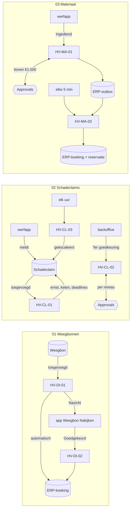

# De zeven flows

Elke flow heeft een eigen **spec** in gewone taal. Daarin staan het doel, wanneer de flow start, wat hij leest en schrijft, de stappen, de beslisregels, wat er gebeurt als iets faalt, en het bewijs dat hij werkt. Onderaan elke spec staat een technische stappenlijst. Die wordt bij elke build gegenereerd uit de code, zodat de uitleg niet kan afwijken van wat echt draait.

| Flow | Case | Start wanneer | Wat hij doet | Eigenaar (rol) | Spec |
|---|---|---|---|---|---|
| **HV-DI-01** Weegbon controleren en boeken | 01 | een weegbon wordt toegevoegd | elf regels R01–R11 toetsen; automatisch boeken, of naar nazicht, escalatie of dubbel | functioneel beheer recyclage | [HV-DI-01.md](HV-DI-01.md) |
| **HV-DI-02** Weegbon na nazicht boeken | 01 | een weegbon krijgt status *Goedgekeurd* | opnieuw controleren op dubbel en geweigerd materiaal, dan de gecorrigeerde waarden boeken | functioneel beheer recyclage | [HV-DI-02.md](HV-DI-02.md) |
| **HV-CL-01** Schadeclaim intake en triage | 02 | een schadeclaim wordt gemeld | ernst, eigenaar, goedkeuringsketen (DT-02), deadlines, verwittigingen, tijdlijn | claims & verzekeringen | [HV-CL-01.md](HV-CL-01.md) |
| **HV-CL-02** Schadeclaim goedkeuringsketen | 02 | een claim krijgt status *Ter goedkeuring* | goedkeuring per niveau via Approvals; één afwijzing stopt de keten | claims & verzekeringen | [HV-CL-02.md](HV-CL-02.md) |
| **HV-CL-03** SLA-bewaking | 02 | elk uur | claims escaleren waarvan de beoordelingsdeadline voorbij is | claims & verzekeringen | [HV-CL-03.md](HV-CL-03.md) |
| **HV-MA-01** Materiaalaanvraag verwerken | 03 | een aanvraag krijgt status *Ingediend* | voorraad per depot toewijzen, budget, DT-03, goedkeuring, ERP-berichten in de outbox | aankoop & logistiek | [HV-MA-01.md](HV-MA-01.md) |
| **HV-MA-02** ERP-outbox verzenden | 03 | elke 5 minuten | berichten naar het ERP sturen, met retry en dead-letter | functioneel beheer ERP | [HV-MA-02.md](HV-MA-02.md) |

## Hoe ze samenhangen

De flows roepen elkaar niet aan. Ze reageren op rijen in Dataverse. Een app of een andere flow schrijft een rij of wijzigt een status, en de volgende flow start op die wijziging.

## Drie lagen, één regel

| Laag | Waar | Wat het is |
|---|---|---|
| Spec (dit is wat een analist leest) | `HV-XX-NN.md` in deze map | doel, regels, foutafhandeling, bewijs; de stappenlijst onderaan is gegenereerd |
| Definitie als code | [`definitions.mjs`](definitions.mjs) | de echte flowdefinitie (Logic Apps-schema), reviewbaar en te diffen; [`provision-flows.mjs`](../scripts/provision-flows.mjs) zet ze in Dataverse |
| Export | [`../solution/src/Workflows/`](../solution/src/Workflows/) | wat Power Platform zelf exporteert; hiermee installeer je de solution in een andere omgeving |

De flowbestanden in de case-mappen (`0x-…/artefacts/power-automate/*.json`) zijn het **doelontwerp**: met postvak, Document Intelligence, Teams-kaarten en een echte ERP-API. Wat hier staat is de **gebouwde versie** in de ontwikkelomgeving. Elke spec vermeldt het verschil.

## Afspraken voor alle flows

- **Naam:** `HV-<case>-<nr> <werkwoord + object>`. Acties krijgen Nederlandse namen die zeggen wat ze doen (`Klant_zoeken`, niet `List_rows_2`).
- **Drempels in omgevingsvariabelen**, niet in de flow. Een drempel aanpassen is configuratie, geen nieuwe release ([ADR-006](../../shared-methodology/adr/ADR-006-beslistabellen.md)).
- **Verbindingen via connection references** (`hv_dataverse`, `hv_approvals`), zodat de solution in een andere omgeving met andere accounts werkt.
- **Idempotent:** wat naar het ERP gaat, heeft een sleutel. Een tweede poging met dezelfde sleutel faalt op de alternatieve sleutel en wordt gelezen als "al geboekt" ([ADR-004](../../shared-methodology/adr/ADR-004-outbox-idempotency.md)).
- **Status = de staart van het werk.** Elke flow eindigt met een status op de rij. Wat in de backoffice-app staat, is dus altijd wat de flow deed.
- **Bewijs:** [`verify.mjs`](../scripts/verify.mjs) vergelijkt wat de flows schreven met de geteste regelmotor in `src/` ([VERIFICATION.md](../VERIFICATION.md)). Runs bekijk je met [`runs.mjs`](../scripts/runs.mjs) `HV-DI-01`.
