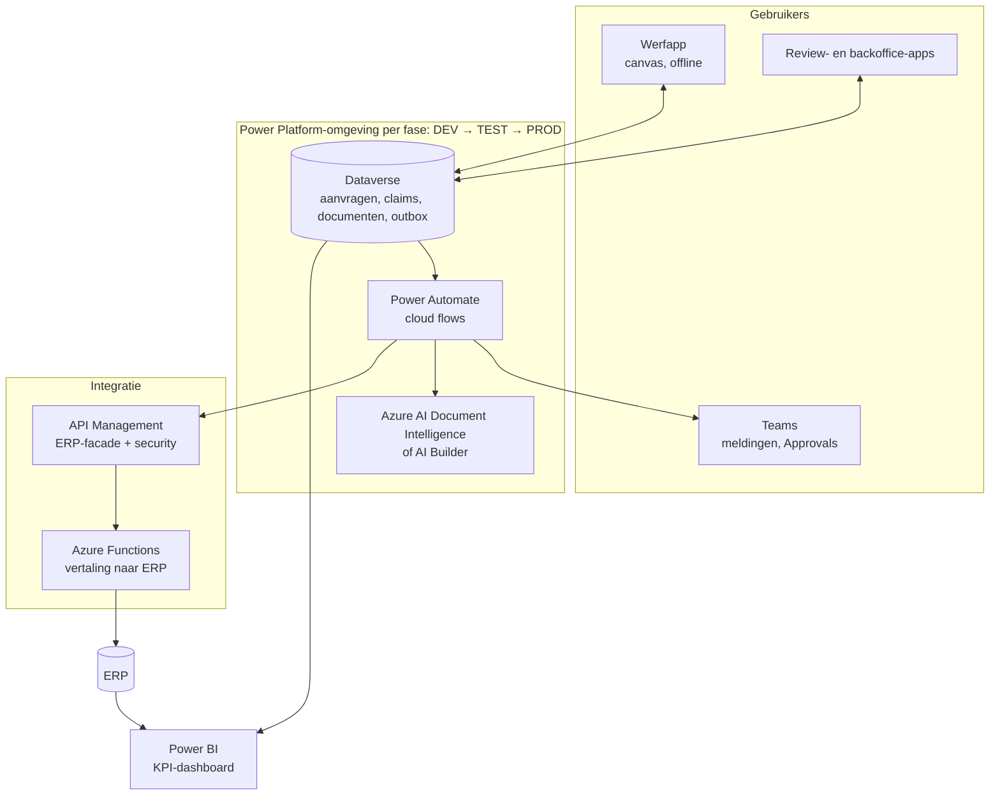

# Architectuurprincipes

Negen principes waaraan elk ontwerp in deze portfolio getoetst wordt. Ze zijn bewust kort, zodat een stuurgroep ze kan onthouden en een developer ze kan toepassen.

| # | Principe | Wat het betekent | Hoe je het toetst |
|---|---|---|---|
| P1 | **ERP blijft de bron** voor financiën, voorraad en projectkosten | Power Platform verzamelt, controleert en stuurt door. Het houdt geen tweede waarheid bij. | Elke financiële waarde in Dataverse heeft een ERP-referentie of is "nog niet geboekt" |
| P2 | **Integreren via een contract, niet via een database** | Alle ERP-verkeer gaat via de ERP-facade (OpenAPI). Er zijn geen directe SQL-koppelingen en geen schermschrapers. | Er bestaat een OpenAPI-bestand, en elke flow-actie naar het ERP gebruikt die connector |
| P3 | **Elke schrijfactie is idempotent** | Dubbel verzenden mag nooit dubbel boeken (weegbon, claim, reservatie). | Er is een Idempotency-Key per POST, en de test "zelfde bericht twee keer" bestaat |
| P4 | **Fouten zijn een proces, geen uitzondering** | Tijdelijke fouten krijgen retry en wachtrij. Definitieve fouten krijgen een ticket met een eigenaar. | De outbox-, dead-letter- en runbook-paragraaf zijn aanwezig |
| P5 | **De mens beslist bij twijfel** | AI levert voorstellen met confidence, regels bepalen wanneer een mens kijkt. AI keurt nooit zelf iets af en boekt niets onzekers. | Er zijn drempels en er is een reviewroute, en de "stille fouten" zijn gemeten |
| P6 | **Regels zijn configuratie** | Drempels (bedragen, confidence, termijnen) staan in omgevingsvariabelen of tabellen, niet hardgecodeerd in tien flows. | De beslistabel staat op één plaats en de Power Fx- en JS-test stemmen overeen |
| P7 | **Werf eerst** | Het ontwerp gaat uit van slecht bereik, handschoenen en weinig tijd: weinig velden, grote knoppen, offline, foto in plaats van tekst. | De UAT wordt op de werf afgenomen, en er is een offlinescenario in het testplan |
| P8 | **Least privilege en audit** | Security roles per rol, service principals voor integratie, tijdlijn alleen-toevoegen. | Er is een rollenmatrix, en audit staat aan op kerntabellen |
| P9 | **Meetbaar vanaf dag 1** | Elk proces logt de tijdstippen die de KPI's nodig hebben (ontvangen, beslist, geboekt). | Elke KPI-definitie heeft een bronveld |

## Doelarchitectuur (gemeenschappelijk voor de drie cases)

Dit is een **conceptueel doelbeeld**. Het bevestigt geen bestaande architectuur van een bestaand bedrijf. De echte keuzes hangen af van het ERP, de licenties en de securityvereisten, en worden per beslissing vastgelegd in [ADR's](adr/README.md).

## Omgevingen en ALM

| Omgeving | Wie | Wat |
|---|---|---|
| DEV | developers, analist | bouwen in een unmanaged solution |
| TEST | key users | UAT op een managed solution, met testdata uit een ERP-sandbox |
| PROD | iedereen | alleen een managed solution, alleen via de pipeline |

Solutions worden met Power Platform Pipelines (of `pac solution` in GitHub Actions) uitgerold. Connection references en omgevingsvariabelen maken dezelfde solution bruikbaar in elke omgeving.
