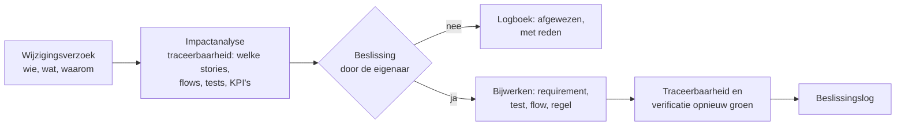

# Governance: wie beslist wat, en hoe verandert een requirement?

Licht, maar vastgelegd. Geen comité voor elke wijziging; wel een vaste plaats waar staat wie wat mag beslissen, wat de afgesproken versie is, en hoe een wijziging loopt. In een fictieve case is dit een voorstel; in een echt project spreek ik het af in de eerste stuurgroep.

## Beslissingsrechten

| Wat | Stelt voor | Beslist | Wordt geïnformeerd |
|---|---|---|---|
| Scope, budget, volgorde van de cases | analist | sponsor (stuurgroep) | proceseigenaars, IT |
| Business requirements (doelen, KPI's) | analist + proceseigenaar | sponsor | stuurgroep |
| Stakeholder- en solution requirements | analist | proceseigenaar van het proces | IT, key users |
| Bedrijfsregels en drempels (DT-02, DT-03, R01–R11) | analist | de eigenaar uit de [regelcatalogus](regelcatalogus.md) | functioneel beheer |
| Architectuur en integratie | analist + developer | IT-architect ([ADR's](adr/README.md)) | stuurgroep |
| Acceptatie (UAT) | analist | key users van het proces | proceseigenaar |
| Go/no-go | analist | proceseigenaar | sponsor |

## Baseline

Na stap 4 (validate) staat een **baseline**: de versie van de requirements waarop gebouwd wordt (versie 1.0). Ze bestaat uit het register per case ([01](../01-document-intelligence/02-analyse.md#requirements), [02](../02-construction-claims/02-analyse.md#requirements), [03](../03-material-requests/02-analyse.md#requirements)), de user stories en de beslistabellen. In git is een baseline een tag; in een echt project tekent de eigenaar per requirement.

In deze portfolio is de baseline-goedkeuring **gesimuleerd**: er is geen echte stuurgroep.

## Wijzigingsbeheer voor requirements en regels

| Soort wijziging | Wie beslist | Wat er moet gebeuren | Release nodig? |
|---|---|---|---|
| Een **drempel** (bv. de netto-tolerantie, de grens €2.500) | eigenaar van de regel | wijzigen in *Bedrijfsregel* in de backoffice; daarna `src/rules.mjs` gelijkzetten zodat de tests op dezelfde waarde draaien; `verify.mjs` toont het verschil tot dan | nee |
| Een **regel** (nieuwe controle, andere logica) | eigenaar van de regel + proceseigenaar | test eerst, dan motor, dan flow; spec en regelcatalogus worden gegenereerd | ja |
| Een **requirement** in de baseline | proceseigenaar (scope: sponsor) | impactanalyse met de [traceerbaarheid](../01-document-intelligence/traceerbaarheid.md); register bijwerken; beslissingslog | afhankelijk van de impact |
| Een requirement **na go-live** | proceseigenaar | als verbeterpunt in de verbeterlijst van stap 7; prioriteit in de stuurgroep | ja |

**Waarom de traceerbaarheid hier telt:** een impactanalyse is pas betrouwbaar als je ziet welke story, flow, test en KPI aan een requirement hangen. Omdat de matrix gegenereerd en door CI gecontroleerd wordt, klopt ze ook na de tiende wijziging.

## Beslissingslog

Elke case heeft een [beslissingslog](../01-document-intelligence/raid-en-beslissingen.md#beslissingslog) met zakelijke én technische beslissingen: ID, datum, beslissing, alternatieven, waarom, wie. Technische beslissingen met blijvende gevolgen krijgen daarnaast een [ADR](adr/README.md).

## Stuurgroep

| | |
|---|---|
| Wie | sponsor (voorzitter), proceseigenaars van de drie cases, IT-verantwoordelijke, analist (secretaris) |
| Hoe vaak | elke 4 weken; extra bij een poort (mandaat, keuze na stap 4, go/no-go, benefits review) |
| Input | één blad per case ([samenvatting](../01-document-intelligence/samenvatting.md)), beslissingen die nodig zijn, KPI's na go-live |
| Output | beslissingen in het log, met eigenaar en datum |
