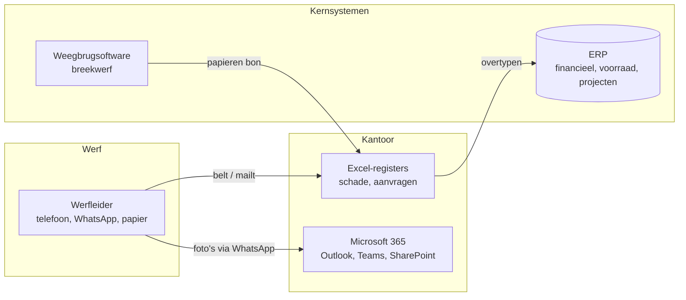

# Halverdijk Group: de fictieve organisatie

> **Fictief.** Halverdijk Group bestaat niet. Het profiel is samengesteld uit wat publiek over Vlaamse familiebouwgroepen te lezen staat: aannemingen, recyclage, asfalt, materieel en zandwinning onder één dak. Het beschrijft geen bestaand bedrijf, en geen enkele interne informatie van een bestaand bedrijf is gebruikt.

## Profiel

| | |
|---|---|
| Wat | Familiale bouwgroep, vierde generatie, "totaalpartner" voor professionele bouwprojecten |
| Waar | Westkust (fictieve gemeente Westerzande), werven in West- en Oost-Vlaanderen |
| Omvang | ±420 medewerkers (aanname), ±45 werfleiders en ploegbazen op de baan |
| IT-team | 3 interne developers + externe partners per project; geen aparte functioneel-beheerploeg |

## Divisies

| Divisie | Activiteit | Raakt case |
|---|---|---|
| Halverdijk Aannemingen | wegenbouw, riolering, sloop, grondwerken, sanering | 02, 03 |
| Halverdijk Recycling | breekwerf, sortering, grondreiniging, verkoop van granulaten | 01, 03 |
| Halverdijk Asfalt | asfaltcentrale, ook met gerecycleerd asfaltgranulaat | 03 |
| Halverdijk Materieel | torenkranen, bouwliften, verhuur van machines | 02 |
| Halverdijk Zand | zandwinning en stortplaats voor bodem | 01 |

## Systemenlandschap (AS-IS, aanname)

Het ERP blijft de bron voor financiën, voorraad en projectkosten. Welk ERP het is, laat deze portfolio bewust open. Alle integraties lopen via een eigen API-laag (de "ERP-facade"), zodat het ontwerp niet afhangt van één leverancier. Zie [ADR-002](adr/ADR-002-erp-facade.md).

## Rollen die in de cases terugkomen

| Rol | Wat hij of zij wil | Grootste ergernis vandaag |
|---|---|---|
| Werfleider | doorwerken, niet typen | "Ik moet drie keer bellen voor één levering" |
| Projectleider | marge en planning van zijn werven bewaken | kosten die weken te laat binnenkomen |
| Afdelingsverantwoordelijke | grip op budgetten en risico's | geen overzicht, alleen telefoontjes bij problemen |
| Administratie (recyclage, aankoop) | correcte boekingen, geen nawerk | overtypen, onleesbare bonnen, nabellen |
| Fleetmanager | machines inzetbaar houden | schade hoort hij pas als de machine al stilstaat |
| Claims & verzekeringen | dossiers op tijd en volledig bij de verzekeraar | aangiftes na de termijn, ontbrekende foto's |
| Milieucoördinator | vergunning en traceerbaarheid respecteren | geweigerde stoffen die toch op een bon belanden |
| Directie / CFO | rendement van digitalisering, compliance | projecten die "af" zijn maar niet gebruikt worden |
| IT / developers | werkbare specificaties, beheersbare oplossingen | vage vragen ("kan dat niet automatisch?") |
