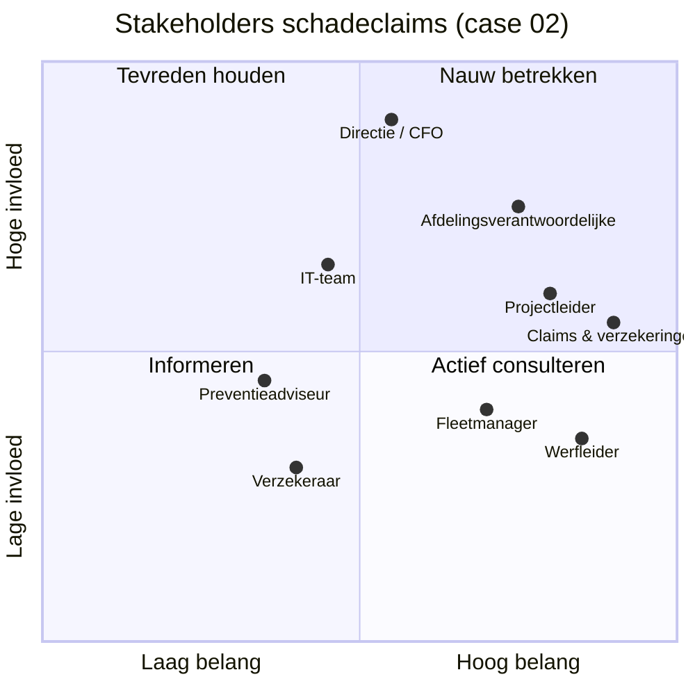

# Stakeholdermethodiek

## 1. Vinden: wie raakt het proces?

Loop het proces één keer fysiek af, van trigger tot boeking, en noteer iedereen die iets aanraakt, beslist, betaalt of klaagt. Daarnaast komt de vaste lijst die in een bouwgroep bijna altijd meedoet:

- de **gebruiker op de werf** (werfleider, ploegbaas, chauffeur);
- de **verwerker op kantoor** (administratie, aankoop, planning);
- de **beslisser** (projectleider, afdelingsverantwoordelijke);
- de **eigenaar van de regels** (milieu, preventie, verzekeringen, boekhouding);
- **IT** (developers, ERP-partner, security);
- **externen** (vervoerders, verhuurders, verzekeraar, leidingbeheerders).

## 2. Indelen: invloed × belang

Per case staat de volledige matrix in `01-discover.md`.

## 3. Betrekken: wie doet wat (RACI)

| Activiteit | Sponsor | Proceseigenaar | Key users | Analist | IT | Externen |
|---|---|---|---|---|---|---|
| Probleem en doel vastleggen | A | R | C | R | I | – |
| AS-IS in kaart brengen | I | A | R | R | C | C |
| TO-BE ontwerpen | I | A | R | R | C | C |
| Optie en scope kiezen | A | R | C | R | C | – |
| Bouwen en integreren | I | C | C | C | A/R | C |
| UAT | I | A | R | R | C | – |
| Go/no-go | A | R | C | C | C | – |
| Baten opvolgen | A | R | I | R | I | – |

R = doet het werk, A = eindverantwoordelijk, C = geconsulteerd, I = geïnformeerd.

## 4. Valkuilen die in de bouw vaak voorkomen

| Valkuil | Gevolg | Wat de analist doet |
|---|---|---|
| Alleen kantoor praten, niet de werf | app die niemand op de werf gebruikt | workshop op de werf, in de keet, op het moment dat het werk gebeurt |
| De luidste projectleider wordt de standaard | regels op maat van één werf | minstens drie werven van verschillende afdelingen vergelijken |
| IT pas betrekken bij het bouwen | ontwerp dat niet integreert | IT in de TO-BE-workshop, architectuurprincipes vooraf delen |
| Externen vergeten | flow die blokkeert op de verzekeraar of vervoerder | in stap 1 per externe partij vragen: wat sturen zij, wat verwachten zij? |
| "Draagvlak" verwarren met "niemand protesteerde" | stille sabotage na go-live | key users per afdeling met een echte rol in de UAT |

## Houding, conflicten en communicatie

Belang en invloed zeggen **wie** je moet betrekken. Houding zegt **hoe**.

| Houding | Wat het betekent | Hoe je ermee omgaat |
|---|---|---|
| Voorstander | wil dat het lukt | geef een rol (key user, champion); let op te hoge verwachtingen |
| Voorstander onder voorwaarden | wil het, als zijn zorg opgelost is | maak de voorwaarde expliciet en zet ze in een requirement of regel (bv. R06 voor de milieucoördinator) |
| Neutraal | heeft er weinig mee te maken, of weet het nog niet | informeer kort, op zijn moment; vraag één concreet ding |
| Sceptisch | ziet risico's of meer werk | luister eerst, laat hem een probleem uit de workshop zelf benoemen, toon resultaten in zijn eigen werk (schaduwdraaien) |
| Tegenstander | verliest iets (controle, routine, status) | benoem het verlies eerlijk; zoek wat hij terugkrijgt; escaleer pas als het project echt blokkeert |

**De houding is een aanname** tot je het gesprek gehad hebt, en ze verandert. Ik herbekijk ze na elke workshop en elke poort.

**Conflicten** tussen stakeholders schrijf ik op met wie tegenover wie staat, waarover, wat er beslist werd en wie besliste. Een analist beslecht geen conflict door zelf te kiezen: hij maakt de keuze zichtbaar, met de gevolgen, en legt ze bij wie de beslissingsrechten heeft ([governance](governance.md#beslissingsrechten)). De beslissing komt in het beslissingslog.

**Het communicatieplan** zegt per stakeholder: wat, hoe vaak, in welke vorm, door wie. Op een werf is dat een toolboxmoment, niet een nieuwsbrief.

Per case: [01](../01-document-intelligence/01-discover.md#stakeholders) · [02](../02-construction-claims/01-discover.md#stakeholdermatrix) · [03](../03-material-requests/01-discover.md#stakeholders).
